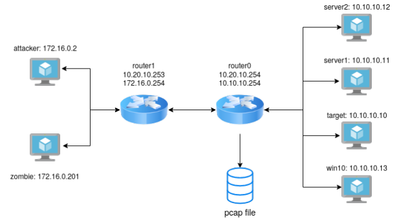
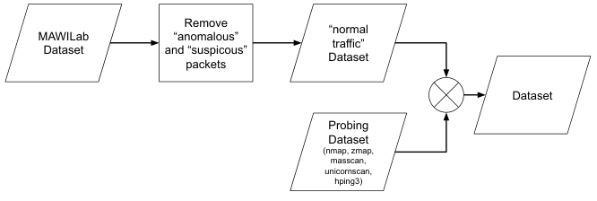
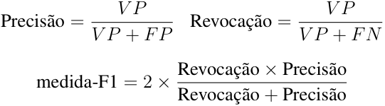
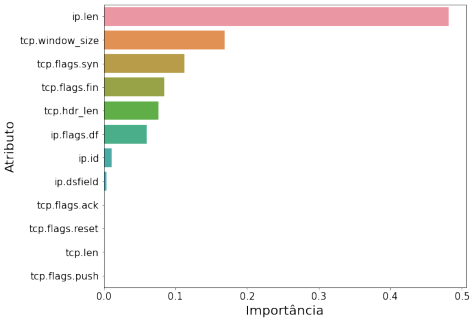
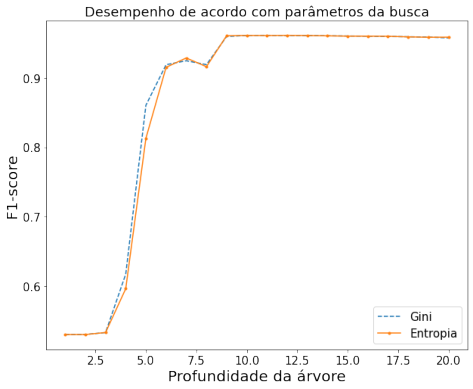
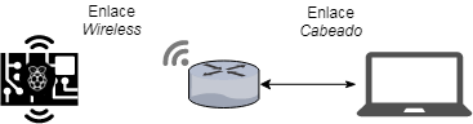

[Original PDF](abordagem-fim-a-fim-para-uso-de-aprendizado-de-maquina.pdf)

<!-- Converted locally with PyMuPDF 2.0. The source language is preserved. Page comments refer to PDF pages. -->

<!-- PDF page 1 -->

# Abordagem fim-a-fim para uso de aprendizado de máquina em IDS – Caso de detecção _stateless_ para TCP Scan

**Gustavo de Carvalho Bertoli**<sup>1</sup> **, Lourenço A Pereira**<sup>1</sup> **, Filipe Verri**<sup>1</sup> **, Cesar Marcondes**<sup>1</sup> **, Aldri L Santos**<sup>2</sup> **, Osamu Saotome**<sup>1</sup>

<sup>1</sup> Instituto Tecnológico de Aeronáutica – ITA

<sup>2</sup> Universidade Federal do Paraná – UFPR

gustavo.bertoli@ga.ita.br, aldri@inf.ufpr.br,

_{_ ljr,verri,cmarcondes,osaotome _}_ @ita.br

## Abstract

_The recent evolution of networks has driven to an increase in cyber attacks. Considering the chain of an attack, it starts from the reconnaissance phase, in which hosts are probed for active services through scans with the TCP transport protocol being still the most used. This work proposes an approach to identify the attacks in their initial phase, and thus stop or compromise their accomplishment. This approach uses isolated inspection of packages (stateless) considering a set of deterministic rules obtained by machine learning, It works as an intrusion detection system (IDS) that achieved an f1-score performance of 0.96 for detection of TCP scan when treated as a problem of data analysis alone, and 82% accuracy when assessed in an end-to-end approach._

## Resumo

_A evolução recente das redes têm impulsionado um aumento da superfície de ataques cibernéticos. O início de um ataque é pela fase de reconhecimento, em que se buscam nos_ hosts _os serviços ativos através de varreduras (_ scan _) sendo o protocolo de transporte TCP ainda o mais utilizado. Este trabalho propõe uma abordagem para identificar os ataques na sua fase inicial, e assim anular ou comprometer sua consumação. Esta abordagem baseia-se na inspeção isolada de pacotes (_ stateless _) em função de um conjunto de regras determinísticas obtidas por aprendizado de máquina. Ela opera como um sistemas de detecção de intrusão (IDS) que alcançou um desempenho f1-score de_ 0,96 _para detecção do TCP scan quando tratado isoladamente como um problema de análise de dados, e_ 82 _% de acurácia quando avaliado na abordagem fim-a-fim._

## 1. Introdução

A evolução recente das redes pode ser ilustrada pelo conceito de Internet das Coisas (IoT - _Internet of Things_ ) que compreende diversas tecnologias, serviços e padrões, resultando, em grande parte, em dispositivos de baixo custo e com recursos limitados, tais como _gateways_ , câmeras de vigilância e sensores de temperatura, entre outros [Sicari et al. 2015, Angrishi 2017, Santos et al. 2019]. Devido à grande quantidade disponível desses dispositivos, eles naturalmente são alvos de diversos ataques e, por suas limitações, tornar-se essencial que os dispositivos sejam protegidos por técnicas e mecanismos de defesa eficientes. Na prevenção de ataques cibernéticos, deve-se privilegiar a detecção das atividades de _scan_ , pois essa abordagem possibilita o bloqueio dos ataques em sua fase inicial, isto é, durante a fase de reconhecimento do

<!-- PDF page 2 -->

alvo [Yadav and Rao 2015]. Estudos realizados sobre 7,41 Petabytes de dados de tráfego, coletados de um grande _backbone_ de rede entre 2004 a 2011, apontaram que cerca de 2,1% dos pacotes atribui-se a _scan_ [Glatz and Dimitropoulos 2012]. Além disso, 46,8% dos incidentes reportados ao CERT.BR no ano de 2019 também foram classificados como _scan_<sup>1</sup> . Isso revela a dimensão que esses ataques representam na Internet, cujo tráfego anual tem dobrado a cada dois anos desde 2005, podendo chegar a 2,3 Zettabyte ao final de 2020, impulsionado também pela implantação do 5G [Idzikowski et al. 2018, Lee and Lee 2012].

Essa questão tem sido tratada na literatura por diversas abordagens. A primeira categorização é se determinada abordagem é _stateful_ ou _stateless_ , isto é, se a avaliação dos estados da conexão entre os dispositivos fará ou não parte dos critérios de classificação dos eventos. No caso _stateful_ exige-se maior disponibilidade de recursos para manter esses estados e uma posição centralizada na rede. Abordagens clássicas ao problema de _scan_ , como o _Threshold Random Walk_ [Jung et al. 2004] – que é uma técnica _stateful_ –, não abordam os tipos mais recentes de ataques como _slow scan_ ou mesmo técnicas que exploram brechas da RFC 793 (TCP)<sup>2</sup> e que são tratadas por regras _stateless_ nos Sistemas de Detecção de Intrusão (IDS)<sup>3</sup> . Importante destacar que regras de detecção de pacotes de forma _stateless_ , assim como as presentes em IDS, são conhecidas para identificar as mais importantes ferramentas de _scan_ [Ghiëtte et al. 2016]. Além disso, essas abordagens não refletem arquiteturas ao contexto de IoT, em que, como definido no conceito de Fog Computing [Yi et al. 2015], surgem requisitos para baixa latência, suporte a mobilidade, geo-distribuição e consciência de localização. No caso de dispositivos de controle descentralizado e posicionamento distribuído por diferentes redes, muitas vezes administradas por terceiros (IoT e Fog Computing), evidencia-se que prover segurança é responsabilidade do próprio dispositivo ou dos equipamentos em seu entorno [Torabi et al. 2018].

Atualmente as principais técnicas de detecção de TCP _scan_ baseiam-se em aprendizado de máquina e mineração de dados, onde destacam-se: redes neurais, associação de regras, redes bayesianas, _clustering_ e árvores de decisão [Buczak and Guven 2016]. Verifica-se que a aplicação de tais técnicas envolve o uso intenso de recursos computacionais: (1) antes de sua operacionalização, para obtenção de dados, modelagem, treinamento e verificação; (2) durante sua efetiva utilização, pois tendem a necessitar de dados ( _clustering_ ) ou resultam em modelos computacionalmente custosos ( _deep learning_ ); e (3) depois de algum tempo, porque uma nova rodada pode ser necessária para adequar os modelos gerados às novas condições do ambiente. Observando-se o fluxo de implantação dessa abordagem, perceber-se a necessidade de um envolvimento constante para a solução do problema da detecção de _scan_ e identificar a potencial sobrecarga em dispositivos de recursos limitados. Assim, no contexto de dispositivos de baixa potência computacional ou dependentes de bateria, o processo de identificação, detecção de intrusão e mitigação de seus efeitos deve ocorrer da forma mais eficiente possível ( _overhead_ mínimo). Para o uso de aprendizado de máquina na área de IDS muito se discute sobre a razão dos modelos desenvolvidos serem pouco vistos em ambientes reais de operação. Isto deve-se a desafios como: alto custo para os erros (um falso-negativo pode causar o comprometimento do sistema); identificação de novos ataques ou variações dos ataques conhecidos;

> 1Estatística de incidentes CERT.BR: https://www.cert.br/stats/incidentes/

> 2nmap.org/man/pt_BR/man-port-scanning-techniques.html

> 3snort.org/downloads#rules

<!-- PDF page 3 -->

e generalização da solução a outros sistemas e arquiteturas [Viegas et al. 2017].

Este trabalho propõe uma abordagem fim-a-fim para uso de aprendizado de máquina em IDS. Assim, criou-se um conjunto de dados que consiste em diversos ataques de TCP _scan_ a fim de generalizar uma regra que seja _stateless_ e aplicável às mais conhecidas ferramentas e técnicas de TCP _scan_ . Particularmente, nosso trabalho trata duas questões: _Q1: como identificar o processo de TCP scan como uma abordagem_ stateless _?_ e _Q2: como derivar uma regra determinística para classificação de atividades de TCP scan?_ Para responder tais questões, empregou-se aprendizado de máquina e, com base em resultados anteriores, aplicou-se árvore de decisão para extrair um conjunto de indicadores capazes de classificar pacotes IPv4 em TCP _scan_ maliciosos. Os resultados obtidos demonstram a efetividade do método, cujo desempenho _f1-score_ foi de 0,96 no _dataset_ utilizado e cuja implementação como módulo de _kernel_ permitiu a correta detecção de 82% dos ataques considerados para a implementação.

O trabalho está organizado da seguinte forma: Na Seção 2, são discutidos os trabalhos relacionados; na Seção 3, descrevemos o método adotado para execução deste trabalho; na Seção 4, detalhamos a implementação do módulo do kernel do Linux e os resultados obtidos dos experimentos; na Seção 5, apresentamos a conclusão deste estudo.

## 2. Trabalhos Relacionados

Referente ao uso de aprendizado de máquina na área de IDS, [Viegas et al. 2017] apresentam uma discussão sobre a dificuldade de transpor os trabalhos de pesquisa para ambientes reais, seja por falta de métodos confiáveis de avaliação ou falta de _datasets_ representativos. Consideram ao todo três categorias de atributos, aqueles baseados em cabeçalho ( _stateless_ ) e os atributos agregados ( _stateful_ ) por _host_ e por serviço. Apresentam também a dificuldade dos modelos de aprendizado de máquina em generalizar para novos ataques, como no caso de _probing_ em que sem o uso de seleção de atributos, obtiveram uma acurácia de 65% para ataques novos com um falso-negativo de 71%. Para tratar essas dificuldades fazem uso de otimização para a seleção dos atributos no processo de aprendizado de máquina considerando um _dataset_ proposto que apresenta as características de uma rede real. No entanto, para o caso específico de TCP _scan_ não exercitam todas as possibilidades de ataques – utilizam apenas a ferramenta Nmap e os ataques TCP SYN, NULL, Connect, FIN, XMAS e ACK – e também não avaliaram o passo seguinte de uma abordagem fim-a-fim que seria a implementação desses modelos.

Visando à agilidade na detecção, a abordagem proposta por [Lobato et al. 2016] concilia as vantagens do processamento de fluxos em tempo real com o processamento de dados mantidos em uma base histórica, o que favorece a detecção de ataques conhecidos e de novos ataques, e relata um melhor desempenho com árvore de decisão em comparação com rede neural e SVM. No entanto, o trabalho também não exercita todas as possibilidades de _scan_ – técnicas e ferramentas –, e o uso da acurácia como métrica de desempenho para comparação entre técnicas de aprendizado ao problema de classificação de ataques é um problema pois o conjunto de dados é predominantemente desbalanceado. Faz uso de atributos obtidos através da análise de componente principal ( _Principal Component Analysis - PCA_ ) e as ferramentas usadas tornam difíceis a implementação em dispositivos de baixa capacidade computacional. [Sanz and Lopez 2018] apresentam um método para detecção de Negação de Serviço (DoS - _Denial of Service_ ) baseado em aprendizagem rela-

<!-- PDF page 4 -->

cionada a grafos. Apesar dos bons resultados obtidos, é notório o uso da métrica acurácia como critério, mesmo que tenham apresentado significativa redução do número de falsos negativos (importante ao problema de detecção de intrusão). No entanto, a aplicabilidade de tal abordagem no contexto de nosso trabalho comprometeria o desempenho de dispositivos baixa potência, devida ao custo computacional da proposta. [Bezerra et al. 2018], no contexto de sistemas de detecção para dispositivos IoT, propuseram a geração de datasets baseados nas alterações provocadas por malwares em dispositivos de botnets e avaliaram métricas como consumo de memória, CPU e energia elétrica. Porém, o foco de nosso trabalho está em bloquear o ataque na fase de reconhecimento, e reutilizar essa abordagem mostra-se infactível, pois a detecção aconteceria após a execução das atividades de scan.

[Zhao 2016] propõe o desenvolvimento de um modelo de detecção de intrusões de rede, baseado em tecnologias de mineração de dados, que combina três métodos: detecção de uso indevido, detecção de anomalias e identificação manual. O modelo utiliza o algoritmo _C.45 Decision Tree_ para construir um classificador capaz de aprender com dados históricos da rede e, assim, reconhecer tentativas de intrusão em novos conjuntos de dados. O modelo foi projetado para a detecção de intrusões em geral. Entretanto, o dataset produzido possui limitações nas técnicas de _Scanning_ e de _Denial of Service_ empregadas. Além disso, a ineficiência na detecção de alguns ataques como, por exemplo, o _Ack Scanning_ (taxa de detecção: 0%), provavelmente, deve-se a análise restrita às conexões TCP efetivamente estabelecidas, as quais não constituem requisito indispensável para todas as modalidades de TCP _scan_ . [Moon et al. 2017] usam um modelo baseado em árvore de decisão aplicado a fluxos TCP presentes no tráfego de uma rede, e assim apresentam um sistema de detecção de intrusão capaz de identificar comportamento malicioso em aplicações. No entanto, as técnicas de _scan_ não necessariamente geram uma quantidade expressiva de fluxos no tráfego de rede e, normalmente, não provocam alterações na integridade dos sistemas, o que pode impactar a eficácia relativa à detecção de _scan_ . [Wuu et al. 2007] relatam a construção de uma solução que adiciona funcionalidades a um sistema de detecção de intrusão para identificar comportamento anômalo e tentativas de intrusão. Esta solução contempla o desenvolvimento de um módulo que aplica técnicas de mineração de dados baseada no algoritmo _Apriori_ para extrair padrões de intrusão únicos e/ou sequenciais de uma coleção de pacotes de ataques. Estes padrões (assinaturas) são convertidos em regras de detecção para o _IDS Snort_ . Porém, o desempenho do módulo é prejudicado em razão da análise do _payload_ e das caraterísticas do algoritmo Apriori, que precisa varrer o banco de dados iterativamente mesmo que os padrões sejam frequentes.

Nossa abordagem é diferente dos demais trabalhos ao considerar ( _i_ ) a análise individual ( _stateless_ ) de pacotes IP com payload contendo segmentos TCP; ( _ii_ ) a produção de um dataset de com características diversas de ferramentas de scan (nmap, unicornscan, hping3, zmap, masscan); ( _iii_ ) a tradução do modelo em implementação de baixo custo computacional capaz de barrar atividades maliciosas de reconhecimento, mitigando o avanço de um atacante na exploração de falhas existentes no sistema alvo. Nossa abordagem fornece um arcabouço de desenvolvimento que abrange de modo fim-a-fim o processo de criação de filtros para sistemas de detecção de intrusão.

## 3. Geração do modelo de classificação dos pacotes

Esta seção detalha a abordagem proposta para criação de um modelo capaz de classificar os pacotes em duas classes: normal e malicioso. Destacamos a opção do algoritmo

<!-- PDF page 5 -->

baseado em árvore de decisão devido a sua facilidade de implementação e descrevemos o processo de construção em quatro passos: _(i)_ metodologia para construção do _dataset_ ; _(ii)_ descrição dos casos de TCP _scan_ que serão analisados, e os parâmetros para extração de pacotes rotulados como ”normal”; _(iii)_ são discutidas as razões pela escolha do aprendizado com árvore de decisão; e _(iv)_ os critérios para pré-processamento dos dados, apresentação da métrica _f1-score_ como critério de desempenho da tarefa de aprendizado e a discussão sobre a obtenção do modelo treinado.

### 3.1. Construção do conjunto de dados ( _dataset_ )

A partir de [Ring et al. 2019] foram avaliados os conjunto de dados que apresentavam a granularidade de pacotes e eram rotulados. Em seguida, buscou-se por aqueles _datasets_ que possuem ataques de TCP _scan_ resultando em cinco _datasets_ possíveis<sup>4</sup> , no entanto, nenhum dos _datasets_ candidatos apresentavam ataques de TCP _scan_ com as diversas ferramentas disponíveis e/ou as diversas técnicas conhecidas, importante salientar que todos os _datasets_ considerados foram construídos através da emulação de pequenas redes. Portanto, na caracterização dos pacotes TCP _scan_ , optou-se por criar um conjunto de dados específico às diversas técnicas e ferramentas de TCP _scan_ conhecidas, inclusive aquelas ferramentas que têm por objetivo fazer a varredura de toda a Internet (Zmap e masscan), conhecido como _horizontal scanning_ , em que se busca por serviços específicos em uma diversidade de endereços IP, em contraponto ao _vertical scanning_ , que busca mapear todos os serviços disponíveis em alvos específicos.



**Figura 1. Ambiente para a geração de tráfego malicioso.**

O conjunto de dados ( _dataset_ ) deste trabalho é composto por duas classes: _scan_ e normal. A classe _scan_ contempla pacotes gerados a partir da execução de todas as técnicas e ferramentas que se busca identificar, enquanto o tráfego rotulado com a classe normal deve conter uma amostra representativa do fluxo da rede que se pretende proteger. Desta forma, desenvolvemos um _dataset_ próprio, composto por pacotes de tráfego TCP/IP e rotulados de forma automática com duas classes, normal e _scan_ . A Figura 1 ilustra o ambiente virtualizado que usamos para a obtenção de tráfego de _scan_ , especificamos a seguinte arquitetura: ( _i_ ) uma rede de ataque, simulando o ambiente externo ao que seria protegido, na qual estão inseridos o _host_ atacante (endereços 172 _._ 16 _._ 0 _.X_ ); ( _ii_ ) uma rede

> 4DARPA (1998), UNSW-NB15 (2015), NDSec-1 (2016), NGIDS-DS (2016), [Viegas et al. 2017]

<!-- PDF page 6 -->

interna, com o _host_ vítima (endereços 10 _._ 10 _._ 10 _.X_ ); ( _iii_ ) um _host_ coletor operando como roteador, com a placa de rede configurada no modo promíscuo, para captura de todo o tráfego (router0); e ( _iv_ ) um segundo _host_ com regras de roteamento (router1), separando as duas redes. As ferramentas de _scan_ foram utilizadas numa máquina virtual (VM) com o sistema operacional Kali Linux ( _attacker_ - 172 _._ 16 _._ 0 _._ 2). Como os pacotes capturados são de um ambiente controlado, o arquivo _pcap_ gerado corresponde aos dados a serem rotulados como _scan_ .



**Figura 2. Fluxo de criação do conjunto de dados (** **_dataset_ ).**

Para a obtenção dos pacotes com rótulo normal foi utilizado o conjunto de dados disponibilizado pelo MAWILab [Fontugne et al. 2010], que consiste em uma grande quantidade de pacotes obtidos em um link de comunicação trans-pacífico entre o Japão e os EUA. Estes pacotes são disponibilizados já com regras para classificá-los em suspeito, anômalo ou normal, a partir destas regras foram extraídos somente os pacotes considerados normais para compor o conjunto de dados utilizado neste trabalho<sup>5</sup> , o processo de composição do _dataset_ gerado é ilustrado na Figura 2.

### 3.2. Parâmetros para geração dos dados

A Tabela 1 lista todos os casos considerados para a geração dos pacotes de TCP _scan_ : as ferramentas utilizadas; as técnicas de TCP _scan_ ; a sintaxe de uso da ferramenta; e o total de pacotes gerados por cada técnica/ferramenta. Referente aos dados normais e uso do MAWILab, a partir do arquivo pcap original, removemos os pacotes considerados anômalos ou suspeitos utilizando as regras disponibilizadas com o _dataset_ ; em seguida é feita uma amostragem aleatória sem reposição de 75 _._ 000 pacotes; o conjunto de dados com rótulo “normal” foi composto pelos pacotes amostrados e colocados em um único arquivo pcap com 2 _._ 141 _._ 635 pacotes; depoisextrai-se apenas os pacotes TCP/IP IPv4 deste pcap gerado, resultando em 103 _._ 094 pacotes. Os atributos contemplados no _dataset_ são os campos de cabeçalhos dos protocolos TCP/IP, o dataset utilizado neste trabalho é composto de 103 _._ 094 pacotes rotulados como “normal” e 22 _._ 373 rotulados como _scan_ , todo o aparato para reprodução dessa metodologia e o próprio _dataset_ está disponível como um repositório na plataforma Github<sup>6</sup> .

### 3.3. Algoritmo de classificação: árvore de decisão

Para responder a questão _Q1: identificação de atividades de scan por meio de uma abordagem stateless_ , os pacotes são analisados isoladamente, sem levar em conta o contexto

> 5Dados de 21/Nov/2019 disponivel em fukuda-lab.org/mawilab/v1.1/2019/11/21/ 20191121.html

> 6Repositório Github: github.com/gubertoli/ProbingDataset

<!-- PDF page 7 -->

**Tabela 1. Comandos dos ataques executados.**

|**Ferramenta**|**Método**|**Comando**|# **pacotes**|
|---|---|---|---|
|nmap|TCP SYN|nmap -sS|1001|
|nmap|TCP Connect|nmap -sT|1002|
|nmap|TCP NULL|nmap -sN|1001|
|nmap|TCP XMAS|nmap -sX|1001|
|nmap|TCP FIN|nmap -sF|1001|
|nmap|TCP ACK|nmap -sA|1000|
|nmap|TCP Window|nmap -sW|1000|
|nmap|TCP Maimon|nmap -sM|1000|
|unicornscan|TCP SYN|unicornscan -Iv -mT|1017|
|unicornscan|TCP Connect|unicornscan -Iv -msf|1026|
|unicornscan|TCP NULL|unicornscan -Iv -mTs|1014|
|unicornscan|TCP XMAS|unicornscan -Iv -mTsFPU|1014|
|unicornscan|TCP FULL XMAS|unicornscan -Iv -mTFSRPAU|1014|
|unicornscan|TCP FIN|unicornscan -Iv -mTsF|1014|
|unicornscan|TCP ACK|unicornscan -Iv -mTsA|1014|
|hping3|TCP SYN|hping3 -c 1000 -V -p ++20 -S|1001|
|hping3|TCP NULL|hping3 -c 1000 -V -p ++20 -Y|1000|
|hping3|TCP XMAS|hping3 -c 1000 -V -p ++20 -UPF|1000|
|hping3|TCP FIN|hping3 -c 1000 -V -p ++20 -F|1000|
|hping3|TCP ACK|hping3 -c 1000 -V -p ++20 -A|1000|
|zmap|TCP SYN|zmap -B 1M -p 0,22,80,443 -n 256 --probes=250|1250|
|masscan|TCP SYN|masscan -p0-500 10.10.10.10/24|1003|

da comunicação em que estão trafegando, esta escolha reduz as opções dos atributos que serão analisados no processo de aprendizado, restringindo-se apenas aos atributos baseado em cabeçalho. Como a abordagem adotada visa obter uma regra de classificação determinística a partir do modelo treinado ( _Q2_ ), escolheu-se o algoritmo árvore de decisão porque ele permite a interpretação direta do modelo (determinar atributos importantes); e a implementação do algoritmo de inferência com complexidade _O_ (1). O desenvolvimento do trabalho usou a linguagem Python 3.7.3 e o pacote scikit-learn versão 0 _._ 23 _._ 1<sup>7</sup> para executar o treinamento e a extração da árvore de inferência, no pacote scikit-learn o algoritmo para Árvore de Decisão é o Classification and Regression Tree (CART).

### 3.4. Treinamento e obtenção do modelo

A partir do conjunto de dados criado, o primeiro passo no processo de aprendizado de máquina é usar algum conhecimento de domínio e pré-processamento para reduzir o número de atributos aplicáveis. Assim, desconsidera-se todos os parâmetros de enlace (camada 2); os campos de endereço IP de origem e destino, o de origem pode ser reconfigurado por um atacante pela técnica de _spoofing_ e o de destino não permite a generalização do aprendizado; os atributos invariáveis na comunicação TCP/IP, ip.version e ip.proto; e desconsiderados também ip.checksum, ip.ttl, tcp.checksum, tcp.dstport, tcp.srcport, ip.ttl, tcp.seq e `tcp.ack_seq`. Os valores de _checksum_ acabam sendo valores descritivos/qualitativos dos campos de cabeçalho e portanto não auxiliam o aprendizado, já a remoção das portas (origem e destino) busca eliminar qualquer imposição do _setup_ utilizado para obtenção dos dados, serviços alvos do _scan_ ; e para a porta de origem, caso o ambiente de aplicação inclua um serviço NAT, esse atributo limitaria a aplicação. Outra característica é o comportamento do campo TTL

> 7 scikit-learn: scikit-learn.org

<!-- PDF page 8 -->

( _time to live_ ) do cabeçalho IP, as rodadas iniciais de aprendizado mostraram uma grande relevância para este atributo na tarefa de classificação dos pacotes, onde a condição na árvore de decisão comparava o TTL ao valor 62. Esse valor relaciona-se diretamente com a arquitetura da Figura 1, visto que no caminho entre a máquina atacante e a vítima, passamos por dois roteadores, sendo que as ferramentas de _scan_ , por padrão, definem o valor de TTL como 64, exceto no caso do Zmap em que verificamos o valor 255 (máximo possível do campo TTL), assim para fins de generalização do problema, eliminou-se esse campo. Finalmente, os campos relacionados a sequência foram removidos por serem definidos de forma aleatória. Foram removidos também todos aqueles atributos com variância igual a zero, pois não contribuem para a tarefa de aprendizado, são eles: `ip.hdr_len`, ip.tos, ip.flags.rb, ip.flags.mf e `ip.frag_offset`, considerando os atributos restantes, nenhum registro duplicado está presente no conjunto de dados.

Na criação da árvore de decisão utilizou-se uma busca em um conjunto de parâmetros possíveis ( _grid search_ ), sendo para o critério de _split_ , avaliados tanto Gini quanto Entropia, para a profundidade da árvore um limite máximo de 20 e por se tratar de um _dataset_ desbalanceado, considerou-se nessa busca com e sem peso da distribuição das classes, isto é, penaliza os erros nos exemplos da classe minoritária ( _scan_ ). É importante destacar a inviabilidade de considerar apenas acurácia como métrica de desempenho neste problema de classificação. Para medir o desempenho do classificador utilizou-se as métricas precisão ( _precision_ ), que representa uma medida de exatidão do modelo; sensibilidade ou revocação ( _recall_ ), que representa uma medida de completude; e a medida-F1 ( _f1-score_ ), que representa a média harmônica ponderada entre precisão e revocação. Essas métricas empregam valores extraídos da matriz de confusão do classificador, em que se extraem os valores de Verdadeiro-Positivos (VP), Falso-Positivos (FP) e Falso-Negativos (FN):



O processo de validação das múltiplas árvores de decisão foi realizado com uma validação cruzada estratificada utilizando-se 10 partições. A opção por estratificação busca manter a proporcionalidade das classes no conjunto de dados de treinamento e validação. O resultado do _grid-search_ é ilustrado pela Figura 4, em que fica claro o melhor desempenho da árvore com o aumento da profundidade até uma profundidade de 11. Como o objetivo é de implementação em dispositivos de baixo poder computacional ou mínimo _overhead_ , o _trade-off_ que surge é a possibilidade de trabalhar com um modelo com menor desempenho ( _f1-score_ ) para que o modelo de inferência extraído seja mais simples resultando na escolha de uma árvore de decisão de menor profundidade.

No caso da árvores de decisão é importante atentar também para que o modelo não esteja superajustado aos dados ( _overfitting_ ) o que dificulta uma generalização do aprendizado, assim uma profundidade menor trata também este problema. Optou-se por uma árvore de decisão com critério de divisão Gini, limitada a uma profundidade máxima de 11 e usando o balanceamento de classes, o que resultou em um modelo com desempenho _f1-score_ de 0,96 em nosso conjunto de dados. A partir do modelo treinado é possível extrair a importância dos atributos para a tarefa de classificação, essa importância é definida

<!-- PDF page 9 -->

pelo critério de impureza e no caso das árvores de decisão, se trata de uma abordagem embutida para avaliação de importância, pois a seleção dos atributos é integrada ao próprio processo de aprendizado [Faceli et al. 2011]. Os atributos, em ordem de importância, são ilustrados na Figura 3 e detalhado na Tabela 2.



**Tabela 2. Descrição dos Atributos.**

|**Atributo**|**Descrição**|
|---|---|
|ip.len|Comprimento total do cabeçalho IP+TCP|
|`tcp.window_size`|Tamanho de janela do protocolo TCP|
|tcp.flags.syn|Flag SYN do protocolo TCP|
|tcp.flags.fin|Flag FIN do protocolo TCP|
|`tcp.hdr_len`|Comprimento total do cabeçalho TCP (_data offset_)|
|ip.flags.df|Flag_don’t fragment_do protocolo IP|
|ip.id|Campo ID do protocolo IP|
|ip.dsfield|Campo de serviços diferenciados do IP (_TOS_)|
|tcp.flags.ack|Flag ACK do protocolo TCP|
|tcp.flags.reset|Flag RESET (RST) do protocolo TCP|
|tcp.len|Payload do TCP em bytes (_segment length_)|
|tcp.flags.push|Flag PUSH (PSH) do protocolo TCP|

**Figura 3. Importância dos Atributos.**

Destaca-se a noção intuitiva que o modelo de árvore de decisão produz a partir dos dados. Isto permite uma tradução natural em instruções imperativas do tipo _if-thenelse_ as quais são possíveis aplicar à detecção de ataques de TCP _scan_ . Outro ponto a se destacar foram os critérios aprendidos pela árvore, a partir do nó raiz nota-se que todos os pacotes com comprimento maior que 64 bytes são considerados legítimos, o que é correto uma vez que os ataques de _scan_ são pacotes sem dados e portanto menor que 64 bytes; outro critério são as regras relacionadas à _window size_ e o valor de limiar 1024 que é uma característica padrão da ferramenta Nmap; e os altos valores para ip.id que são características da ferramenta Zmap.

## 4. Implementação e Avaliação

Esta seção apresenta a implementação e avaliação do método proposto a fim de demonstrar a sua efetividade em ambiente embarcado. O desempenho do método foi avaliado segundo os critérios de identificação dos pacotes TCP _scan_ de forma _stateless_ – Tabela 1 –, e avaliado características operacionais, isto é, quanto de _overhead_ é gerado pela implementação no dispositivo de teste. A implementação do filtro de pacotes foi realizada com netfilter<sup>8</sup> , sistema operacional Linux e executada em um dispositivo Raspberry Pi 3, a avaliação de desempenho foi feita com a ferramenta _sar_ do pacote _sysstat_<sup>9</sup> . Na execução do método, os pacotes de TCP _scan_ são filtrados em _kernel space_ através de Módulos Carregáveis no Kernel ( _Linux Kernel Module_ — LKM), o módulo implementa uma função que é invocada ( _hook_ ) pelo netfilter a cada pacote que chega ( _ingress_ ) na interface _wireless_ do dispositivo, essa função é o código gerado a partir da árvore de decisão treinada que processa cada pacote recebido. A Listagem 1 apresenta um trecho do código da árvore de decisão em que os atributos de cabeçalho TCP/IP são obtidos para a efetiva classificação _stateless_ dos pacotes. Para verificar a implementação completa que

> 8netfilter: https://netfilter.org/

> 9 _sysstat_ : https://sebastien.godard.pagesperso-orange.fr

<!-- PDF page 10 -->



**Figura 4. Desempenho para os diversos hiper-parâmetros.**

pode ser carregada como módulo, consultar o arquivo dt.c<sup>10</sup> .

Os testes foram efetuados em um computador de placa única do modelo Raspberry Pi 3, e as especificações estão descritas na Tabela 3. Foi utilizado um enlace de comunicação misto, cabeado e _wireless_ , para os testes e ataques contra a Raspberry Pi 3. A Raspberry Pi foi configurada com os serviços de comando remoto ( _Secure Shell_ - porta 22) e desktop remoto (VNC - porta 5900), a partir desta configuração reproduziu-se novamente todos os ataques listados na Tabela 1, em duas configurações, com e sem o módulo de _kernel_ responsável pela filtragem de TCP _scan_ carregado. A Figura 5 ilustra o ambiente físico no qual os testes aqui descritos foram realizados, com um computador atacante conectado através de um enlace cabeado até o roteador que por sua vez, conecta-se ao dispositivo de teste através de um enlace _wireless_ .

**Listing 1. Trecho da árvore de decisão treinada.**

```c
int check_packet(struct sk_buff *skb [...]) {
    struct iphdr *iph = ip_hdr(skb);
    struct tcphdr *tcph = tcp_hdr(skb);
    ...
    if (iph->tos < htons(4)) {
        if ((tcph->doff * 4) < htons(22)) {
            return NF_DROP;
        } else {
            return NF_ACCEPT;
        }
    } else {
        return NF_ACCEPT;
    }
    ...
    return NF_ACCEPT;
}
```

Como esperado, na condição sem o módulo todos os ataques foram efetivos, isto é, os serviços disponíveis no dispositivo foram identificados como ativos. Já no caso com o módulo carregado, a filtragem foi efetiva ao evitar a identificação dos serviços disponíveis. No entanto, observou-se também que o modelo não conseguiu identificar todos os ataques, não sendo efetivo para os seguintes: SYN Scan via Nmap, Hping3 e Unicornscan; TCP Connect via Nmap e Unicornscan; Null Scan do Nmap e ACK Scan com Hping3, considerando os 22 ataques sob análise (Tabela 1) o modelo foi

> 10https://github.com/gubertoli/ProbingDataset/blob/master/sbseg2020/ Implementao%20LKM/dt.c

<!-- PDF page 11 -->

**Tabela 3. Especificação da Raspberry PI 3 Model B Rev 1.2.**

|**Componente**|Descrição|
|---|---|
|CPU|Quad core Cortex-A53 SoC @ 1.2 GHz|
|RAM|1GB SDRAM|
|Conectividade wireless|2.4 GHz e 5.0 GHz IEEE 802.11n|
|NIC wired|10/100 MBit/s Ethernet|
|Linux Kernel|4.19.118-v7+ (armv7l)|
|Distributição|Raspbian GNU/Linux 10(buster)|

efetivo em 68% dos casos (acurácia).

Para a poda ( _prunning_ ) da árvore de decisão, além das vantagens de redução de processamento e do _overfitting_ já mencionadas, buscou-se avaliar seu impacto no ambiente de implementação. Assim, gerou-se também um modelo de árvore de decisão com profundidade máxima de seis, sendo que após a implementação no ambiente de teste observou-se um aumento nos casos detectados de 68% para 82%, sendo que os quatros casos não detectados foram os ataques de SYN Scan com Nmap, Zmap e Unicornscan e o de TCP Connect com Nmap e Unicornscan. Em comparação com a importância dos atributos para a árvore de profundidade 11 (Figura 3), neste caso houve uma inversão entre o valor de _window size_ e a _flag_ SYN do cabeçalho TCP e desconsiderou-se a importância das _flags_ ACK, RESET e PUSH. Essa mudança entre as árvores quando avaliada de forma isolada como um problema de análise de dados apresenta uma redução do _f1-score_ de 0,96 para 0,92, assim ela reforça a necessidade da avaliação fim-a-fim da aplicação de aprendizado de máquina nos problemas de IDS.

Para o problema de TCP _scan_ destaca-se a importância de priorizar a composição do _dataset_ com pacotes SYN de comunicação TCP/IP, pois são aqueles com maiores dificuldades de detecção e são os que compõe a maioria dos ataques não identificados – SYN Scan e TCP Connect (início do _three-way handshake_ ). Neste trabalho não exercitouse a criação de atributos derivados ( _feature engineering_ ) que ao custo de um aumento de processamento pode ajudar na identificação das ferramentas utilizadas nos ataques, conforme indica [Ghiëtte et al. 2016]. Outro ponto é realizar a avaliação da implementação em ambientes diferentes do apresentada na Figura 5.

A abordagem proposta utilizando-se da árvore de decisão permitiu a extração de uma regra de filtragem de pacotes contra ataques de TCP _scan_ : **simples:** regra de filtragem baseada em 12 atributos do cabeçalho TCP/IP (Figura 3) permitindo que apenas os pacotes TCP sejam submetidos a verificação, sem manter estado ( _stateless_ );

**auditável:** por se tratar de uma árvore de decisão permite utilizar-se de técnicas de



**Figura 5. Ambiente de teste da prova de conceito.**

<!-- PDF page 12 -->

**Tabela 4. Comparação da execução com e sem o módulo que faz a identificação de pacotes de TCP** **_scan_ (LKM). O** **_overhead_ é mínimo.**

| n=1200 | %memused / Sem LKM | %memused / Com LKM | %sys / Sem LKM | %sys / Com LKM |
|---|---|---|---|---|
| média | 10,94 ± 0,07 | 11,35 ± 0,08 | 7,74 ± 3,12 | 7,78 ± 2,89 |
| max | 11,60 | 12,19 | 18,52 | 16,63 |
| min | 10,79 | 11,18 | 0,75 | 0,76 |

Legenda: %memused - mem. RAM utilizada; %sys - taxa de utilização de CPU em kernel mode.

visualização ou mesmo entender o algoritmo treinado (regras aprendidas); **agnóstica:** buscou-se obter uma regra que não seja enviesada pela técnica ou ferramenta de _scan_ utilizada, assim os atributos consideram ataques feitos com Nmap, Zmap, Unicornscan, Masscan e Hping3.

Uma questão importante na implementação é a quantidade de recursos adicionais exigido para a execução do módulo. Para obter uma estimativa dessa sobrecarga ( _overhead_ ) realizou-se também um experimento em que foi monitorado a taxa de utilização da CPU em modo kernel (%sys), a quantidade de memória RAM consumida (%memused) e se a implementação afeta o processamento dos pacotes de redes avaliando se causa a perda de pacotes (rxdrop/s). O sistema sob teste é o mesmo Raspberry PI 3 em questão, foi utilizado o iPerf3<sup>11</sup> para gerar tráfego direcionado ao sistema. Essa verificação foi feita com as mesmas duas configurações: uma sem o módulo que faz identificação de pacotes TCP _scan_ e outro com o módulo carregado. A execução em cada configuração durou 20 minutos, coletando-se 1 amostra por segundo, totalizando 1200 amostras. Os resultados estão sumarizados na Tabela 4. Os resultados permitem concluir que os custos computacionais são mínimos, confirmou-se também que para os dois cenários não houveram pacotes descartados, isto é, o filtro implementado não causa a exaustão do _buffer_ de processamento do _kernel_ . A regra avaliada possui espaço para otimização pois os ramos da árvore que classificam o pacote como ”normal” foram mantidos para representar a árvore gerada em sua completude, entretanto, é possível a simplificação mantendo-se apenas os ramos que classificam os pacotes como _scan_ .

Demonstra-se que a abordagem foi capaz de generalizar a detecção de ataques TCP _scan_ , partindo de um conjunto de dados gerados em ambientes específicos, tráfego ”normal” de um _link_ trans-pacífico e tráfego ” _scan_ ” gerado em rede local simulada, para um outro ambiente com comunicação _wireless_ . Obteve-se inicialmente uma acurácia de 68% para os ataques considerados neste trabalho, em seguida, uma acurácia de 82% foi obtida a partir da redução do _f1-score_ para 0,92, apresentando assim a diferença de desempenho para quando o problema é limitado na análise de dados e quando o problema é avaliado na abordagem fim-a-fim que considera o _deploy_ do modelo e sua avaliação.

## 5. Conclusões e trabalhos futuros

Este trabalho apresentou o processo de caracterização de pacotes TCP/IP maliciosos que possuem a finalidade de reconhecer os serviços ativos de um host alvo ( _scan_ ). Devido à escassez de _datasets_ específicos para TCP _scan_ disponíveis na literatura, foi construído

> 11 iPerf3: https://iperf.fr/

<!-- PDF page 13 -->

um novo conjunto de dados para treinar uma árvore de decisão de modo que os atributos mais importantes foram destacados. Evidenciou-se os cuidados a serem tomados para geração de um modelo sem viés e com bom desempenho obtendo-se um _f1-score_ de 0,96 quando tratado como um problema de dados e uma acurácia de 82% para os cenário avaliados e quando implementado como um IDS na abordagem fim-a-fim. Ao trabalhar com árvore de decisão obteve-se uma regra imperativa do tipo if-then-else capaz de classificar pacotes individualmente ( _stateless_ ) e de modo determinístico com a realização do modelo por meio da plataforma Raspberry Pi 3 como um módulo do kernel do Linux. Um ponto importante apresentado é a influência do ambiente de obtenção dos dados e a redução nos atributos aplicáveis quando se busca um modelo de aprendizado capaz de generalizar a nível TCP/IP, assim, surge a possibilidade de ampliar o trabalho para conjuntos de dados extraídos a partir das mais diversas arquiteturas e ambientes que utilizam TCP/IP. Esse ponto responde também ao desafio de transpor modelos de aprendizado de máquina para ambientes reais de produção e independente de arquitetura/ambiente. Como trabalhos futuros destaca-se a formalização do método utilizado neste trabalho como um arcabouço composto de cinco fases: geração dados maliciosos; obtenção e caracterização de tráfego legítimo; modelagem e produção de algoritmos de aprendizado de máquina; realização do modelo em uma plataforma-alvo; e avaliação de desempenho final.

## Agradecimentos

Os autores agradecem à CAPES e ao ITA/PPG de Aplicações Operacionais pelo apoio financeiro.

## Referências

- Angrishi, K. (2017). Turning Internet of Things(IoT) into Internet of Vulnerabilities (IoV): IoT Botnets. _CoRR_ , abs/1702.03681.

- Bezerra, V. H., da Costa, V. G. T., Martins, R. A., Junior, S. B., Miani, R. S., and Zarpelão, B. B. (2018). Providing iot host-based datasets for intrusion detection research . In _Anais Principais do XVIII Simpósio Brasileiro em Segurança da Informação e de Sistemas Computacionais_ , pages 15–28, Porto Alegre, RS, Brasil. SBC.

- Buczak, A. L. and Guven, E. (2016). A survey of data mining and machine learning methods for cyber security intrusion detection. _IEEE Communications Surveys Tutorials_ , 18(2):1153–1176.

- Faceli, K., Lorena, A. C., Gama, J., Carvalho, A. C. P. d. L., et al. (2011). _Inteligência Artificial: Uma abordagem de aprendizado de máquina_ . LTC.

- Fontugne, R., Borgnat, P., Abry, P., and Fukuda, K. (2010). Mawilab: Combining diverse anomaly detectors for automated anomaly labeling and performance benchmarking. In _Proceedings of the 6th International COnference_ , Co-NEXT ’10, pages 1–12. ACM.

- Ghiëtte, V., Blenn, N., and Doerr, C. (2016). Remote identification of port scan toolchains. In _2016 8th IFIP International Conference on New Technologies, Mobility and Security (NTMS)_ , pages 1–5. IEEE.

- Glatz, E. and Dimitropoulos, X. (2012). Classifying internet one-way traffic. In _Proceedings of the 2012 Internet Measurement Conference_ , IMC’12.

<!-- PDF page 14 -->

- Idzikowski, F., Chiaraviglio, L., Liu, W., and van de Beek, J. (2018). Future internet architectures and sustainability: An overview. In _2018 IEEE International Conference on Environmental Engineering (EE)_ , pages 1–5.

- Jung, J., Paxson, V., Berger, A. W., and Balakrishnan, H. (2004). Fast portscan detection using sequential hypothesis testing. In _IEEE Symposium on Security and Privacy, 2004. Proceedings. 2004_ , pages 211–225. IEEE.

- Lee, Y. and Lee, Y. (2012). Toward scalable internet traffic measurement and analysis with hadoop. _SIGCOMM Comput. Commun. Rev._ , 43(1):5–13.

- Lobato, A. G. P., Lopez, M. A., and Duarte, O. C. M. B. (2016). Um sistema acurado de detecção de ameaças em tempo real por processamento de fluxos. In _XXXIV Simpósio Brasileiro de Redes de Computadores e Sistemas Distribuídos (SBRC)_ .

- Moon, D., Im, H., Kim, I., and Park, J. H. (2017). Dtb-ids: an intrusion detection system based on decision tree using behavior analysis for preventing apt attacks. _The Journal of supercomputing_ , 73(7):2881–2895.

- Ring, M., Wunderlich, S., Scheuring, D., Landes, D., and Hotho, A. (2019). A survey of network-based intrusion detection data sets. _Computers & Security_ , 86:147–167.

- Santos, A. L., Cervantes, C. A., Nogueira, M., and Kantarci, B. (2019). Clustering and reliability-driven mitigation of routing attacks in massive iot systems. _JISA_ , 10(1):18.

- Sanz, I. J. and Lopez, M. A. (2018). Um sistema de detecção de ameaças distribuídas de rede baseado em aprendizagem por grafos. _Anais do Simpósio Brasileiro de Redes de Computadores e Sistemas Distribuídos (SBRC)_ , 36.

- Sicari, S., Rizzardi, A., Grieco, L., and Coen-Porisini, A. (2015). Security, privacy and trust in internet of things: The road ahead. _Computer Networks_ , 76.

- Torabi, S., Bou-Harb, E., Assi, C., Galluscio, M., Boukhtouta, A., and Debbabi, M. (2018). Inferring, characterizing, and investigating internet-scale malicious iot device activities: A network telescope perspective. In _2018 48th Annual IEEE/IFIP International Conference on Dependable Systems and Networks (DSN)_ , pages 562–573.

- Viegas, E. K., Santin, A. O., and Oliveira, L. S. (2017). Toward a reliable anomaly-based intrusion detection in real-world environments. _Computer Networks_ , 127:200–216.

- Wuu, L.-C., Hung, C.-H., and Chen, S.-F. (2007). Building intrusion pattern miner for snort network intrusion detection system. _Journal of Systems and Software_ , 80(10):1699–1715.

- Yadav, T. and Rao, A. M. (2015). Technical aspects of cyber kill chain. In _International Symposium on Security in Computing and Communication_ , pages 438–452. Springer.

- Yi, S., Li, C., and Li, Q. (2015). A survey of fog computing: concepts, applications and issues. In _Proceedings of the 2015 workshop on mobile big data_ , pages 37–42.

- Zhao, Y. (2016). Network intrusion detection system model based on data mining. In _Software Engineering, Artificial Intelligence, Networking and Parallel/Distributed Computing (SNPD), 2016 17th IEEE/ACIS International Conference on_ .
