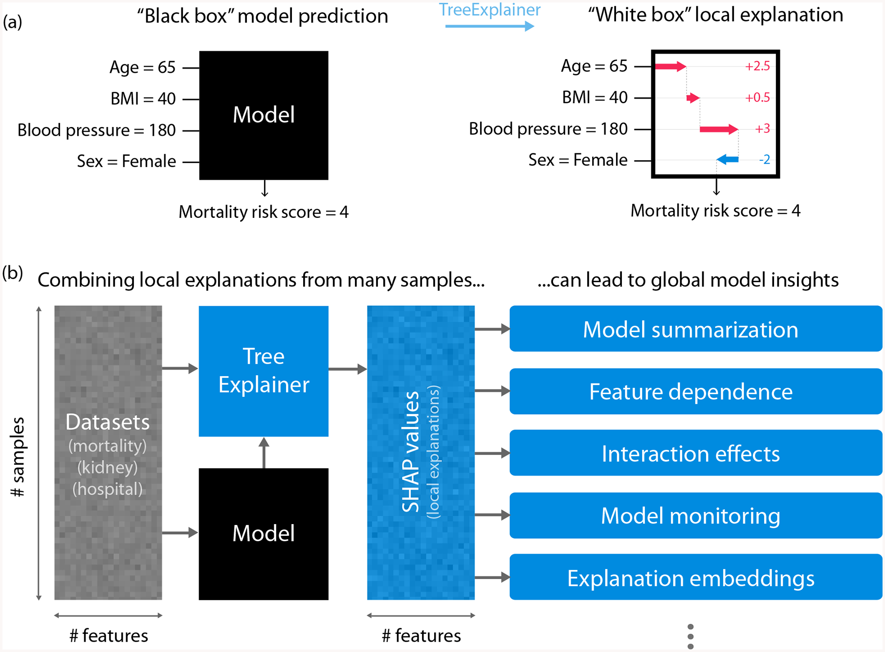
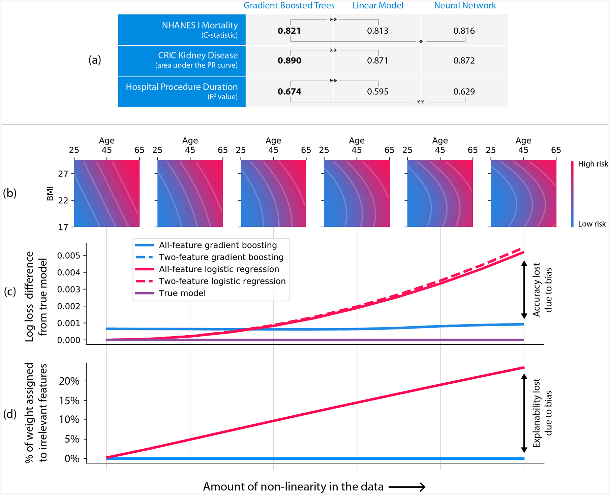
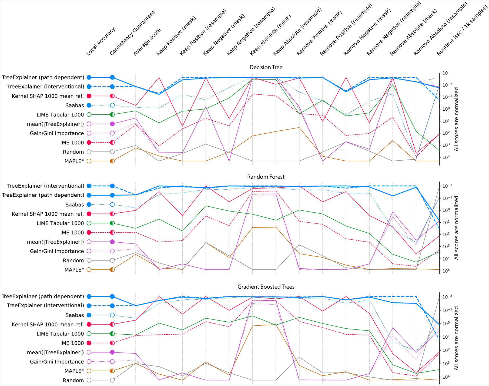
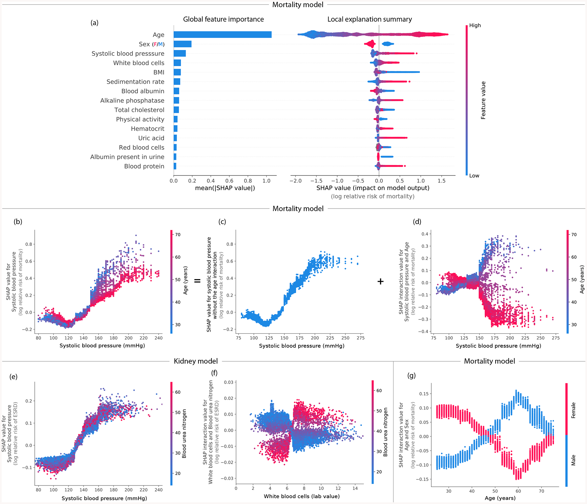
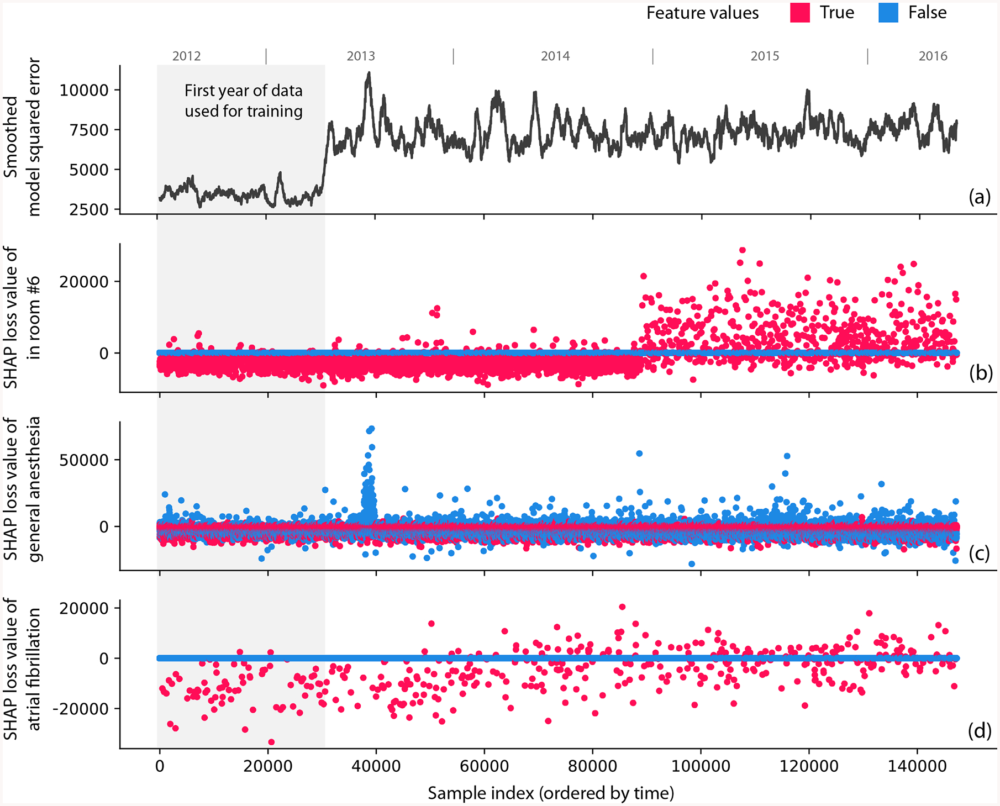
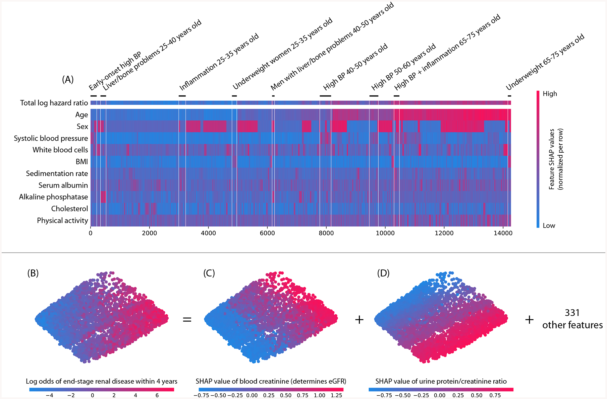
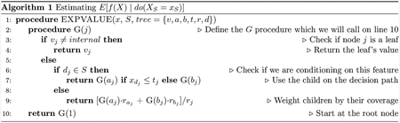
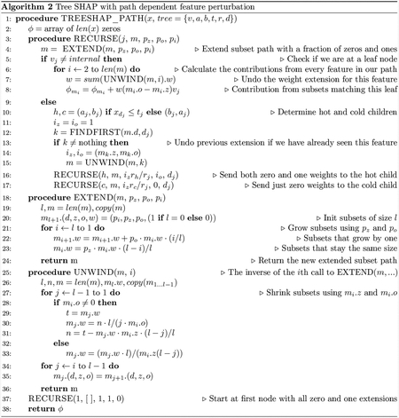
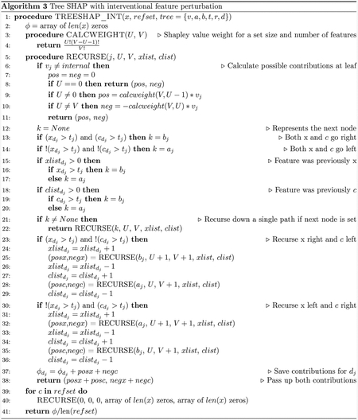

[Source: PubMed Central, PMC7326367](https://pmc.ncbi.nlm.nih.gov/articles/PMC7326367/)

<!-- Extracted locally from the PubMed Central HTML of the author manuscript NIHMS1601475. The source language is preserved. Equations are converted from MathML to LaTeX. Supplementary materials are not included. -->

# From Local Explanations to Global Understanding with Explainable AI for Trees

Scott M Lundberg1,2, Gabriel Erion2,3, Hugh Chen2, Alex DeGrave2,3, Jordan M Prutkin4, Bala Nair5,6, Ronit Katz7, Jonathan Himmelfarb7, Nisha Bansal7, Su-In Lee2,*

1Microsoft Research

2Paul G. Allen School of Computer Science and Engineering, University of Washington

3Medical Scientist Training Program, University of Washington

4Division of Cardiology, Department of Medicine, University of Washington

5Department of Anesthesiology and Pain Medicine, University of Washington

6Harborview Injury Prevention and Research Center, University of Washington

7Kidney Research Institute, Division of Nephrology, Department of Medicine, University of Washington

*Corresponding: suinlee@cs.washington.edu

> Author manuscript; available in PMC: 2020 Jun 30. Published in final edited form as: Nat Mach Intell. 2020 Jan 17;2(1):56–67. doi: 10.1038/s42256-019-0138-9
>
> PMCID: PMC7326367. NIHMSID: NIHMS1601475. PMID: 32607472.

**Author contributions**

S.M.L. and S.I.L conceived the study. S.M.L. designed algorithms, designed visualizations, designed metrics, ran experiments, and contributed writing. G.E. ran experiments, designed visualizations, and contributed writing. H.C. designed algorithms, ran experiments, and contributed writing. A.D. performed dataset creation. R.K., J.H., and N.B. did dataset selection, model vetting, and defined the chronic kidney disease prediction problem. J.P., B.N., R.K., J.H., and N.B. each contributed writing and helped procure and interpret datasets. S.I.L. supervised research, method development, and contributed writing.

## Abstract

Tree-based machine learning models such as random forests, decision trees, and gradient boosted trees are popular non-linear predictive models, yet comparatively little attention has been paid to explaining their predictions. Here, we improve the interpretability of tree-based models through three main contributions: 1) The first polynomial time algorithm to compute optimal explanations based on game theory. 2) A new type of explanation that directly measures local feature interaction effects. 3) A new set of tools for understanding global model structure based on combining many local explanations of each prediction. We apply these tools to three medical machine learning problems and show how combining many high-quality local explanations allows us to represent global structure while retaining local faithfulness to the original model. These tools enable us to i) identify high magnitude but low frequency non-linear mortality risk factors in the US population, ii) highlight distinct population sub-groups with shared risk characteristics, iii) identify non-linear interaction effects among risk factors for chronic kidney disease, and iv) monitor a machine learning model deployed in a hospital by identifying which features are degrading the model’s performance over time. Given the popularity of tree-based machine learning models, these improvements to their interpretability have implications across a broad set of domains.

## One sentence summary:

Exact game-theoretic explanations for ensemble tree-based predictions that guarantee desirable properties.

Machine learning models based on trees are the most popular non-linear models in use today [1, 2]. Random forests, gradient boosted trees, and other tree-based models are used in finance, medicine, biology, customer retention, advertising, supply chain management, manufacturing, public health, and other areas to make predictions based on sets of input features (Figure 1A left). For these applications, models often must be _both accurate and interpretable_, where interpretability means that we can understand how the model uses input features to make predictions [3]. However, despite the rich history of _global_ interpretation methods for trees, which summarize the impact of input features on the model as a whole, much less attention has been paid to _local_ explanations, which reveal the impact of input features on individual predictions (i.e., for a single sample) (Figure 1A right).

## Figure 1: Local explanations based on TreeExplainer enable a wide variety of new ways to understand global model structure.

(a) A local explanation based on assigning a numeric measure of credit to each input feature. (b) By combining many local explanations, we can represent global structure while retaining local faithfulness to the original model. We demonstrate this by using three medical datasets to train gradient boosted decision trees and then compute local explanations based on SHapley Additive exPlanation (SHAP) values [3]. Computing local explanations across all samples in a dataset enables development of many tools for understanding global model structure.

Current local explanation methods include: 1) reporting the decision path, 2) using a heuristic approach that assigns credit to each input feature [4], and 3) applying various model-agnostic approaches that require repeatedly executing the model for each explanation [3, 5–8]. Each current method has limitations. First, simply reporting a prediction’s decision path is unhelpful for most models, particularly those based on multiple trees. Second, the behavior of the heuristic credit allocation has yet to be carefully analyzed; we show here that it is strongly biased to alter the impact of features based on their tree depth. Third, since model-agnostic methods rely on post hoc modeling of an arbitrary function, they can be slow and suffer from sampling variability.

We present TreeExplainer, an explanation method for trees that enables the tractable computation of _optimal_ local explanations, as defined by desirable properties from game theory. TreeExplainer bridges theory to practice by building on previous model-agnostic work based on classic game-theoretic Shapley values [3, 6, 7, 9–11]. It makes three notable improvements.

## 1. Exact computation of Shapley value explanations for tree-based models.

Classic Shapley values can be considered “optimal” since, within a large class of approaches, they are the only way to measure feature importance while maintaining several natural properties from cooperative game theory [3, 11]. Unfortunately, in general these values can only be approximated since computing them exactly is NP-hard [12], requiring a summation over all feature subsets. Sampling-based approximations have been proposed [3, 6, 7]; however, using them to compute low variance versions of the results in this paper for even our smallest dataset would consume years of CPU time (particularly for interaction effects). By focusing specifically on trees, we developed an algorithm that computes local explanations based on exact Shapley values in polynomial time. This provides local explanations with _theoretical guarantees_ of _local accuracy_ and _consistency_ [3] (Methods).

## 2. Extending local explanations to directly capture feature interactions.

Local explanations that assign a single number to each input feature, while very intuitive, cannot directly represent _interaction_ effects. We provide a theoretically grounded way to measure local interaction effects based on a generalization of Shapley values proposed in game theory literature [13]. We show that this approach provides valuable insights into a model’s behavior.

## 3. Tools for interpreting global model structure based on many local explanations.

The ability to efficiently and exactly compute local explanations using Shapley values across an entire dataset enables the development of a range of tools to interpret a model’s global behavior (Figure 1B). We show that combining many local explanations lets us represent global structure while retaining _local faithfulness_ [14] to the original model, which produces detailed and accurate representations of model behavior.

Explaining predictions from tree models is particularly important in medical applications, where the patterns a model uncovers can be more important than the model’s prediction performance [15, 16]. To demonstrate TreeExplainer’s value, we use three medical datasets, which represent three types of loss functions: 1) _Mortality_, a dataset with 14,407 individuals and 79 features based on the NHANES I Epidemiologic Followup Study [17], where we model the risk of death over twenty years of followup. 2) _Chronic kidney disease_, a dataset that follows 3,939 chronic kidney disease patients from the Chronic Renal Insufficiency Cohort study over 10,745 visits, where we use 333 features to classify whether patients will progress to end-stage renal disease within 4 years. 3) _Hospital procedure duration_, an electronic medical record dataset with 147,000 procedures and 2,185 features, where we predict duration of a patient’s hospital stay for an upcoming procedure (Supplementary Methods 1).

In this paper, we discuss how the accuracy and interpretability of tree-based models make them appropriate for many applications. We then describe why these models need more precise local explanations and how we address that need with TreeExplainer. Next, we extend local explanations to capture interaction effects. Finally, we demonstrate the value of explainable AI tools that combine many local explanations from TreeExplainer (https://github.com/suinleelab/treeexplainer-study).

## Advantages of tree-based models

Tree-based models can be more accurate than neural networks in many applications. While deep learning models are more appropriate in fields like image recognition, speech recognition, and natural language processing, tree-based models consistently outperform standard deep models on tabular-style datasets, where features are individually meaningful and lack strong multi-scale temporal or spatial structures [18] (Supplementary Results 1). The three medical datasets we examine here all represent tabular-style data. Gradient boosted trees outperform both pure deep learning and linear regression across all three datasets (Figure 2A; Supplementary Methods 2).

### Figure 2: Gradient boosted tree models can be more accurate than neural networks and more interpretable than linear models.

(a) Gradient boosted tree models outperform both linear models and neural networks on all our medical datasets, where (**) represents a bootstrap retrain P-value < 0.01, and (*) represents a P-value of 0.03. (b–d) Linear models exhibit explanation and accuracy error in the presence of non-linearity. (b) The data generating models we used for the simulation ranged from linear to quadratic along the body mass index (BMI) dimension. (c) Linear logistic regression (red) outperformed gradient boosting (blue) up to a specific amount of non-linearity. Not surprisingly, the linear model’s bias is higher than the gradient boosting model’s, as shown by the steeper slope as we increase non-linearity. (d) As the true function becomes more non-linear, the linear model assigns more credit (coefficient weight) to features that were not used by the data generating model. The weight placed on these irrelevant features is driven by complex cancellation effects and so is not readily interpretable (Supplementary Figure 1). Furthermore, adding L1 regularization to the linear model does not solve the problem (Supplementary Figures 2 and 3).

Tree-based models can also be more interpretable than linear models due to model-mismatch effects. It is well-known that the bias/variance trade-off in machine learning has implications for model accuracy. Less well appreciated is that this trade-off also affects interpretability. Simple high-bias models (such as linear models) seem easy to understand, but they are sensitive to model mismatch, i.e., where the model’s form does not match its true relationships in the data [19]. This mismatch can create hard-to-interpret model artifacts.

To illustrate why low-bias models can be more interpretable than high-bias ones, we compare gradient boosted trees to linear logistic regression using the mortality dataset. We simulate a binary outcome based on a participant’s age and body mass index (BMI), and we vary the amount of non-linearity in the simulated relationship (Figure 2B). As expected, by increasing non-linearity, the bias of the linear model causes accuracy to decline (Figure 2C). Perhaps unexpectedly, it also causes interpretability to decline (Figure 2D). We know that the model should depend only on age and BMI, but even a moderate amount of non-linearity in the true relationship causes the linear model to begin using other irrelevant features (Figure 2D), and the weight placed on these features is driven by complex cancellation effects that are not readily interpretable (Supplementary Figure 1). When a linear model depends on cancellation effects between irrelevant features, the function itself is not complicated, but the meaning of the features it depends on become subtle: they are no longer being used primarily for their marginal effects, but rather for their interaction effects. Thus, even when simpler high-bias models achieve high accuracy, low-bias ones may be preferable, and even more interpretable, since they are likely to better represent the true data-generating mechanism and depend more naturally on their input features (Supplementary Methods 3).

## Local explanations for trees

Current local explanations for tree-based models are _inconsistent_. To our knowledge, only two tree-specific approaches can quantify a feature’s _local_ importance for an individual prediction. The first is simply reporting the decision path, which is unhelpful for ensembles of many trees. The second is an unpublished heuristic approach (proposed by _Saabas_ [4]), which explains a prediction by following the decision path and attributing changes in the model’s expected output to each feature along the path (Supplementary Results 3). The Saabas method has not been well studied, and we demonstrate here it is biased to alter the impact of features based on their distance from a tree’s root (Supplementary Figure 4A). This bias makes Saabas values _inconsistent_, where increasing a model’s dependence on a feature may actually decrease that feature’s Saabas value (Supplementary Figure 5). This is the opposite of what an effective attribution method should do. We show this difference by examining trees representing multi-way AND functions, for which no feature should have more credit than another. Yet Saabas values give splits near the root much less credit than those near the leaves (Supplementary Figure 4A). Consistency is critical for an explanation method since it makes comparisons among feature importance values meaningful.

Model-agnostic local explanation approaches are slow and variable (Supplementary Methods 4; Supplementary Results 4). While model-agnostic local explanation approaches can explain tree models, they rely on post hoc modeling of an arbitrary function and thus can be slow and/or suffer from sampling variability when applied to models with many input features. To illustrate this, we generate random datasets of increasing size and then explain (over)fit XGBoost models with 1,000 trees. This runtime of this experiment shows a linear increase in complexity as the number of features increases; model-agnostic methods take a significant amount of time to run over these datasets, even though we allowed for non-trivial estimate variability (Supplementary Figure 4D) and used only a moderate number of features (Supplementary Figure 4C) (Supplementary Methods 3). While often practical for individual explanations, model-agnostic methods can quickly become impractical for explaining entire datasets (Supplementary Figure 4C–F).

TreeExplainer provides fast local explanations with guaranteed consistency. It bridges theory to practice by reducing the complexity of exact Shapley value computation from exponential to polynomial time. This is important since within the class of _additive feature attribution methods_, a class that we have shown contains many previous approaches to local feature attribution [3], results from game theory imply the Shapley values are the only way to satisfy three important properties: _local accuracy_, _consistency_, and _missingness_. Local accuracy (known as _additivity_ in game theory) states that when approximating the original model _f_ for a specific input _x_, the explanation’s attribution values should sum up to the output _f_(_x_). Consistency (known as _monotonicity_ in game theory) states that if a model changes so that some feature’s contribution increases or stays the same regardless of the other inputs, that input’s attribution should not decrease. Missingness (_null effects_ and _symmetry_ in game theory), is a trivial property satisfied by all previous explanation methods.

TreeExplainer enables the _exact_ computation of Shapley values in _low order polynomial time_ by leveraging the internal structure of tree-based models. Shapley values require a summation of terms over all possible feature subsets, TreeExplainer collapses this summation into a set of calculations specific to each leaf in a tree (Methods). This represents an exponential complexity improvement over previous exact Shapley methods. To compute the impact of a specific feature subset during the Shapley value calculation, TreeExplainer uses interventional expectations over a user-supplied background dataset [11]. But it can also avoid the need for a user-supplied background dataset by relying only on the path coverage information stored in the model (which is usually from the training dataset).

Efficiently and exactly computing the Shapley values guarantees that explanations are always consistent and locally accurate, improving results over previous local explanation methods in several ways:

_Impartial feature credit assignment regardless of tree depth_. In contrast to Saabas values, Shapley values allocate credit uniformly among all features participating in multi-way AND operations (Supplementary Figures 4A–B) and thereby avoid inconsistency problems (Supplementary Figure 5).

_No estimation variability_ (Supplementary Figures 4C–F). Since solutions from model-agnostic sampling methods are approximate, TreeExplainer’s exact explanations eliminate the additional burden of checking their convergence and accepting a certain amount of noise in the estimates (other than noise from the choice of a background dataset).

_Strong benchmark performance_ (Figure 3; Supplementary Figures 6–7). We designed 15 metrics to comprehensively evaluate the performance of local explanation methods; we applied these metrics to ten different explanation methods across three different model types and three datasets. Results for the chronic kidney disease dataset, shown in Figure 3, demonstrate consistent performance improvements for TreeExplainer.

_Consistency with human intuition_ (Supplementary Figure 8). We evaluated how well explanation methods match human intuition by comparing their outputs with human consensus explanations of 12 scenarios based on simple models. Unlike the heuristic Saabas values, Shapley-value-based explanation methods agree with human intuition in all tested scenarios (Supplementary Methods 7).

### Figure 3: Explanation method performance across 15 different evaluation metrics and three classification models in the chronic kidney disease dataset.

Each column represents an evaluation metric, and each row represents an explanation method. The scores for each metric are scaled between the minimum and maximum value, and methods are sorted by their average score. TreeExplainer outperforms previous approaches not only by having theoretical guarantees about consistency, but also by exhibiting improved performance across a large set of quantitative metrics that measure explanation quality (Methods). When these experiments were repeated for two synthetic datasets, TreeExplainer remained the top-performing method (Supplementary Figures 6 and 7). Note that, as predicted, Saabas better approximates the Shapley values (and so becomes a better attribution method) as the number of trees increases (Methods). *Since MAPLE models the local gradient of a function, and not the impact of hiding a feature, it tends to perform poorly on these feature importance metrics [35].

TreeExplainer also extends local explanations to measure interaction effects. Traditionally, local explanations based on feature attribution assign a single number to each input feature. The simplicity of this natural representation comes at the cost of conflating main and interaction effects. While interaction effects between features can be reflected in the global patterns of many local explanations, their distinction from main effects is lost in each local explanation (Figure 4B–G).

### Figure 4: By combining many local explanations, we can provide rich summaries of both an entire model and individual features.

Explanations are based on a gradient boosted decision tree model trained on the mortality dataset. (a) (left) bar-chart of the average SHAP value magnitude, and (right) a set of beeswarm plots, where each dot corresponds to an individual person in the study. The dot’s position on the x-axis shows the impact that feature has on the model’s prediction for that person. When multiple dots land at the same x position, they pile up to show density. (b) SHAP dependence plot of systolic blood pressure vs. its SHAP value in the mortality model. A clear interaction effect with age is visible, which increases the impact of early onset high blood pressure. (c) Using SHAP interaction values to remove the interaction effect of age from the model. (d) Plot of just the interaction effect of systolic blood pressure with age; shows how the effect of systolic blood pressure on mortality risk varies with age. Adding the y-values of C and D produces B. (e) A dependence plot of systolic blood pressure vs. its SHAP value in the kidney model; shows an increase in kidney disease risk at a systolic blood pressure of 125 (which parallels the increase in mortality risk). (f) Plot of the SHAP interaction value of ‘white blood cells’ with ‘blood urea nitrogen’; shows that high white blood cell counts increase the negative risk conferred by high blood urea nitrogen. (g) Plot of the SHAP interaction value of sex vs. age in the mortality model; shows how the differential risk for men and women changes over a lifetime.

We propose _SHAP interaction values_ as a richer type of local explanation. These values use the ‘Shapley interaction index’ from game theory to capture local interaction effects. They follow from generalizations of the original Shapley value properties [13] and allocate credit not just among each player of a game, but among all pairs of players. The SHAP interaction values consist of a matrix of feature attributions (interaction effects on the off-diagonal and the remaining effects on the diagonal). By enabling the separate consideration of interaction effects for individual model predictions, TreeExplainer can uncover significant patterns that might otherwise be missed.

## Local explanations as building blocks for global insights

Previous approaches to understanding a model globally focused on using simple global approximations [2], finding new interpretable features [20], or quantifying the impact of specific internal nodes in a deep network [21–23] (Supplementary Results 2). We present methods that combine many local explanations to provide global insight into a model’s behavior. This lets us retain local faithfulness to the model while still capturing global patterns, resulting in richer, more accurate representations of the model’s behavior.

Local model summarization reveals rare high-magnitude effects on mortality risk and increases feature selection power. Combining local explanations from TreeExplainer across an entire dataset enhances traditional global representations of feature importance by: (1) avoiding the inconsistency problems of current methods (Supplementary Figure 5), (2) increasing the power to detect true feature dependencies in a dataset (Supplementary Figure 9), and (3) enabling us to build _SHAP summary plots_, which succinctly display the magnitude, prevalence, and direction of a feature’s effect. SHAP summary plots avoid conflating the magnitude and prevalence of an effect into a single number, and so reveal rare high magnitude effects. Figure 4A (right) reveals the direction of effects, such as men (blue) having a higher mortality risk than women (red); and the distribution of effect sizes, such as the long right tails of many medical test values. These long tails mean features with a low global importance can be extremely important for specific individuals. Interestingly, rare mortality effects always stretch to the right, which implies there are many ways to die abnormally early when medical measurements are out-of-range, but not many ways to live abnormally longer (Supplementary Results 5).

Local feature dependence reveals both global patterns and individual variability in mortality risk and chronic kidney disease. _SHAP dependence plots_ show how a feature’s value (x-axis) impacts the prediction (y-axis) of every sample (each dot) in a dataset (Figures 4B and E). They provide richer information than traditional partial dependence plots (Supplementary Figure 10). For the mortality model, SHAP dependence plots reproduce the standard risk inflection point of systolic blood pressure [24], while also highlighting that the impact of blood pressure on mortality risk differs for people of different ages (Figure 4B). These types of interaction effects show up as vertical dispersion in SHAP dependence plots (Supplementary Results 6).

For the chronic kidney disease model, a dependence plot again clearly reveals a risk inflection point for systolic blood pressure. However, in this dataset the vertical dispersion from interaction effects appears to be partially driven by differences in blood urea nitrogen (Figure 4E). Correctly modeling blood pressure risk while retaining interpretabilty is vital because blood pressure control in select chronic kidney disease (CKD) populations may delay progression of kidney disease and reduce the risk of cardiovascular events.

Local interactions reveal sex-specific life expectancy changes during aging as well as inflammation effects in chronic kidney disease. Using SHAP interaction values, we can decompose the impact of a feature on a specific sample into _interaction effects_ with other features. This helps us measure global interaction strength as well as decompose SHAP dependence plots into interaction effects at a local (i.e., per sample) level (Figures 4B–D). In the mortality dataset, plotting the SHAP interaction value between age and sex shows a clear change in the relative risk between men and women over a lifetime (Figure 4G). The largest difference in risk between men and women occurs at age 60; the increased risk for men could be driven by their increased cardiovascular mortality relative to women near that age [25]. This pattern is not clearly captured without SHAP interaction values because being male always confers greater risk of mortality than being female (Figure 4A).

In the chronic kidney disease model, we identify an interesting interaction (Figure 4F): high white blood cell counts are more concerning to the model when they are accompanied by high blood urea nitrogen. This supports the notion that inflammation may interact with high blood urea nitrogen to hasten kidney function decline [26, 27] (Supplementary Results 7).

Local model monitoring reveals previously invisible problems with deployed machine learning models. Using TreeExplainer to explain a model’s _loss_, instead of a model’s prediction, can improve our ability to monitor deployed models. Monitoring models is challenging because of the many ways relationships between the input and model target can change post-deployment. Detecting when such changes occur is difficult, so many bugs in machine learning pipelines go undetected, even in core software at top tech companies [28]. We demonstrate that local model monitoring helps debug model deployments and identify problematic features (if any) directly by decomposing the loss among the model’s input features.

We simulated a model deployment with the hospital procedure duration dataset using the first year of data for training and the next three years for deployment. We present three examples: one intentional error and two previously undiscovered problems. (1) We intentionally swapped the labels of operating rooms 6 and 13 partway through the deployment to mimic a typical feature pipeline bug. The overall loss of the model’s prediction gives no indication of the bug (Figure 5A), whereas the _SHAP monitoring plot_ for the room 6 feature clearly identifies the labeling error (Figure 5B). (2) Figure 5C shows a spike in error for the general anesthesia feature shortly after the deployment window begins. This spike corresponds to a subset of procedures affected by a previously undiscovered temporary electronic medical record configuration problem. (3) Figure 5D shows an example of feature drift over time, not of a processing error. During the training period and early in deployment, using the ‘atrial fibrillation’ feature lowers the loss; however, the feature becomes gradually less useful over time and eventually degrades the model. We found this drift was caused by significant changes in atrial fibrillation ablation procedure duration driven by technology and staffing changes (Supplementary Figure 11). Current deployment practice monitors both the overall loss of a model (Figure 5A) over time and potentially statistics about input features. Instead, TreeExplainer lets us directly monitor the impact individual features have on a model’s loss (Supplementary Results 8).

### Figure 5: Monitoring plots reveal problems that would otherwise be invisible in a retrospective hospital machine learning model deployment.

(a) The squared error of a hospital duration model averaged over the nearest 1,000 samples. The increase in error after training occurs because the test error is (as expected) higher than the training error. (b) The SHAP value of the model loss for the feature that indicates whether the procedure happens in room 6. A significant change occurs when we intentionally swap the labels of rooms 6 and 13, which is invisible in the overall model loss. (c) The SHAP value of the model loss for the general anesthesia feature; the spike one-third of the way into the data results from previously unrecognized transient data corruption at a hospital. (d) The SHAP value of the model loss for the atrial fibrillation feature. The plot’s upward trend shows feature drift over time (P-value 5.4 × 10−19).

Local explanation embeddings reveal population subgroups relevant to mortality risk and complementary diagnostic indicators in chronic kidney disease. Unsupervised clustering and dimensionality reduction are widely used to discover patterns characterizing subgroups of samples (e.g., study participants), such as disease subtypes [29, 30]. These techniques have two drawbacks: 1) the distance metric does not account for discrepancies among units/meaning of features (e.g., weight vs. age), and 2) an unsupervised approach cannot know which features are relevant for an outcome of interest and so should be weighted more strongly. We address both limitations using _local explanation embeddings_ to embed each sample into a new “explanation space.” Running clustering in this new space will yield a _supervised clustering_, where samples are grouped based on their explanations. Supervised clustering naturally accounts for the differing units of various features, highlighting only the changes relevant to a particular outcome.

Running hierarchical supervised clustering using the mortality model results in many groups of people that share a similar mortality risk for similar reasons (Figure 6A). This grouping of samples can reveal high level structure in datasets that would not be revealed using standard unsupervised clustering (Supplementary Figure 12) and has various applications, from customer segmentation, to model debugging, to disease sub-typing. Analogously, we can also run PCA on local explanation embeddings for chronic kidney disease samples. This uncovers two primary categories of risk factors that identify unique individuals at risk of end-stage renal disease: (1) factors based on urine measurements, and (2) factors based on blood measurements (Figures 6B–D). This pattern is notable because it continues as we plot more top features (Supplementary Figure 13). The separation between blood and urine features is consistent with the fact that clinically these factors should be measured in parallel. This type of insight into the overall structure of kidney risk is not at all apparent in a standard unsupervised embedding (Supplementary Figure 14; Supplementary Results 9).

### Figure 6: Local explanation embeddings support both supervised clustering and interpretable dimensionality reduction.

(A) A clustering of mortality study individuals by their local explanation embedding. Columns are patients, and rows are features’ normalized SHAP values. Sorting by a hierarchical clustering reveals population subgroups that have distinct mortality risk factors. (B–D) A local explanation embedding of kidney study visits projected onto two principal components. Local feature attribution values can be viewed as an embedding of the samples into a space where each dimension corresponds to a feature and all axes have the units of the model’s output. The embedding colored by: (B) the predicted log odds of a participant developing end-stage renal disease within 4 years of that visit, (C) the SHAP value of blood creatinine, and (D) the SHAP value of the urine protein/creatinine ratio. Many other features also align with these top two principal components (Supplementary Figure 13), and an equivalent unsupervised PCA embedding is far less interpretable (Supplementary Figure 14)

## Discussion

The potential impact of local explanations for tree-based machine learning models is widespread. Explanations can help satisfy transparency requirements, facilitate human/AI collaboration, and aid model development, debugging, and monitoring.

Tree-based machine learning models are widely used in many regulated domains, such as healthcare, finance, and public services. Improved interpretability is vital for these applications. In healthcare, the unknowing deployment of “Clever Hans” predictors that depend on spurious correlations could lead to serious patient harm [31, 32]. In finance, consumer protection laws require explanations for credit decisions, and no accepted standard exists for how to produce these for complex tree-based models [33]. In public service applications, explainability can promote accountability and anti-discrimination policies [34].

Improving human/AI collaboration is critical for applications where explaining machine learning model predictions can enhance human performance. Such applications include predictive medicine, customer retention, and financial model supervision. Local explanations enable support agents to predict why the customer they are calling is likely to leave. They enable doctors to make more informed decisions rather than blindly trust an algorithm’s output. With financial model supervision, local explanations help human experts understand why the model made a specific recommendation for high-risk decisions.

Improving model development, debugging, and monitoring leads to more accurate and reliable deployments of machine learning systems. Local explanations aid model development by revealing which features are most informative for specific subsets of samples. They aid debugging by revealing the global patterns of how a model depends on its input features, and so enable developers to determine when patterns are unlikely to generalize well. Finally, they aid model monitoring by enabling the allocation of global accuracy measures among each model input, significantly increasing the signal-to-noise ratio for detecting problematic data distribution shifts.

In this paper, we identified ways to significantly enhance the interpretability of tree-based models and to broaden the application of local explanation methods. We develop the first polynomial-time algorithm to compute Shapley values for trees. This algorithm solves what is in general an NP-hard problem in polynomial time for an important class of value functions. We present a richer type of local explanation that directly captures interaction effects. We demonstrate how using local explanation methods to explain model loss enables a more sensitive and informative method of model monitoring. We offer many tools for model interpretation that combine local explanations, such as dependence plots, summary plots, supervised clusterings, and explanation embeddings. We demonstrate that Shapley-based local explanations can improve upon state-of-the-art feature selection for trees. We identify under-appreciated interpretability problems with simple linear models. And we compile many varied explainability metrics into a unified open source benchmark, on which TreeExplainer consistently outperforms other alternatives. Local explanations have a distinct advantage over global ones. By focusing only on a single sample, they remain more faithful to the original model. By designing efficient and trustworthy ways to obtain local explanations for modern tree-based models, we take an important step toward enabling local explanations to become foundational building blocks for an ever growing number of downstream machine learning tasks.

## Code availability

Code supporting this paper is published online at https://github.com/suinleelab/treexplainer-study. A widely used Python implementation of TreeExplainer is available at https://github.com/slundberg/shap, and portions of it are included in the standard release of XGBoost (https://xgboost.ai), LightGBM (https://github.com/Microsoft/LightGBM), and CatBoost (https://catboost.ai).

## Data availability

The pre-processed mortality data is available in the repository http://github.com/suinleelab/treexplainer-study. Privacy restrictions prevent the release of the hospital procedure related data, and the kidney disease data is only available directly from the National Institute of Diabetes, Digestive, and Kidney Diseases (NIDDK).

## Methods

### Institutional review board statement

The chronic kidney disease data was obtained from the Chronic Renal Insufficiency Cohort study. University Washington Human Subjects Division determined that our study does not involve human subjects because we do not have access to identifiable information (IRB ID: STUDY00006766).

The anonymous hospital procedure data used for this study was retrieved from three institutional electronic medical record and data warehouse systems after receiving approval from the Institutional Review Board (UW Approval no. 46889).

### Shapley values

Here we review the uniqueness guarantees of Shapley values from game theory as they apply to local explanations of predictions from machine learning models [9]. As applied here, Shapley values are computed by introducing each feature, one at a time, into a conditional expectation function of the model’s output, _f__x_(_S_) = _E_[_f_(_X_) | _do_(_X__S_ = _x__S_)], and attributing the change produced at each step to the feature that was introduced; then averaging this process over all possible feature orderings (Supplementary Figure 15). Note that _S_ is the set of features we are conditioning on, and we follow the causal do-notation formulation suggested in [11], which improves on the motivation of the original SHAP feature perturbation formulation [3]. An equivalent formulation is the randomized baseline method discussed in [10]. Shapley values represent the only possible method in the broad class of _additive feature attribution methods_ [3] that will simultaneously satisfy three important properties: _local accuracy_, _consistency_, and _missingness_.

Local accuracy (known as _additivity_ in game theory) states that when approximating the original model _f_ for a specific input _x_, the explanation’s attribution values should sum up to the output _f_(_x_): **Property 1** (Local accuracy / Additivity).

$$f(x)={\phi}_{0}(f)+{\sum }_{i=1}^{M}{\phi}_{i}(f,x) \tag{1}$$

_The sum of feature attributions_ _ϕ__i_(_f_, _x_) _matches the original model output_ _f_(_x_), _where_ _ϕ_0(_f_) = _E_[_f_(_z_)] = _f__x_(∅).

Consistency (known as _monotonicity_ in game theory) states that if a model changes so that some feature’s contribution increases or stays the same regardless of the other inputs, that input’s attribution should not decrease: **Property 2** (Consistency / Monotonicity). _For any two models_ _f_ and _f_′, _if_

$${f}_{x}^{'}(S)-{f}_{x}^{'}(S\setminus i)\geq {f}_{x}(S)-{f}_{x}(S\setminus i) \tag{2}$$

_for all subsets of features_ $S\in \mathcal{F}$, _then_ _ϕ__i_(_f_′, _x_) ≥ _ϕ__i_(_f_, _x_).

Missingness (similar to _null effects_ in game theory) requires features with no effect on the set function _f__x_ to have no assigned impact. All local previous methods we are aware of satisfy missingness. **Property 3** (Missingness). _If_

$${f}_{x}(S\cup i)={f}_{x}(S) \tag{3}$$

_for all subsets of features_ $S\in \mathcal{F}$, _then_ _ϕ__i_(_f_, _x_) = 0.

The only way to simultaneously satisfy these properties is to use the classic Shapley values: **Theorem 1**. _Only one possible feature attribution method based on_ _f__x_ _satisfies Properties 1_, _2 and 3_:

$${\phi}_{i}(f,x)={\sum }_{R\in \mathcal{R}}\frac{1}{M!}[{f}_{x}({P}_{i}^{R}\cup i)-{f}_{x}({P}_{i}^{R})] \tag{4}$$

_where_ $\mathcal{R}$ _is the set of all feature orderings_, ${P}_{i}^{R}$ _is the set of all features that come before feature i in ordering R_, _and M is the number of input features for the model_.

The equivalent of Theorem 1 has been previously presented in [3] and follows from cooperative game theory results [36], where the values _ϕ__i_ are known as the Shapley values [9]. Shapley values are defined independent of the set function used to measure the importance of a set of features. Since here we are using _f__x_, a conditional expectation function of the model’s output, we are computing the more specific _SHapley Additive exPlanation (SHAP) values_ [3, 11]. For more properties of these values see Supplementary Methods 5

### TreeExplainer with path dependent feature perturbation

We describe the algorithms behind TreeExplainer in three stages. First, we describe an easy to understand (but slow) version of the Tree SHAP algorithm using path dependent feature perturbation (Algorithm 1), then we present the complex polynomial time version of Tree SHAP using path dependence, and finally we describe the Tree SHAP algorithm using interventional (marginal) feature perturbation (where _f__x_(_S_) exactly equals _E_[_f_(_X_) | _do_(_X__S_ = _x__S_)]). While solving for the Shapley values is in general NP-hard [12], these algorithms show that by restricting our attention to trees we can find exact solutions in low-order polynomial runtime.

The Tree SHAP algorithm using path feature dependence does not exactly compute _E_[_f_(_X_) | _do_(_X__S_ = _x__S_)], but instead approximates it using Algorithm 1, which uses the coverage information from the model about which training samples went down which paths in a tree. This is convenient since it means we don’t need to supply a background dataset in order to explain the model (Algorithm 1 also directly parallels the traversal used by the classic “gain” style of feature importance).

Given that _f__x_ is defined using Algorithm 1, Tree SHAP path dependent then exactly computes Equation 4. Letting _T_ be the number of trees, _D_ the maximum depth of any tree, and _L_ the number of leaves, Tree SHAP path dependent has worst case complexity of _O_(_TLD_2). This represents an exponential complexity improvement over previous exact Shapley methods, which would have a complexity of _O_(_TLM_2_M_), where _M_ is the number of input features.

If we ignore computational complexity then we can compute the SHAP values for a tree by computing _f__x_(_S_) and then directly using Equation 4. Algorithm 1 computes _f__x_(_S_) where _tree_ contains the information of the tree. _v_ is a vector of node values; for internal nodes, we assign the value _internal_. The vectors _a_ and _b_ represent the left and right node indexes for each internal node. The vector _t_ contains the thresholds for each internal node, and _d_ is a vector of indexes of the features used for splitting in internal nodes. The vector _r_ represents the cover of each node (i.e., how many data samples fall in that sub-tree).

Algorithm 1 estimates _E_[_f_(_X_) | _do_(_X__S_ = _x__S_)] by recursively following the decision path for _x_ if the split feature is in _S_, and taking the weighted average of both branches if the split feature is not in _S_. The computational complexity of Algorithm 1 is proportional to the number of leaves in the tree, which when used on all _T_ trees in an ensemble and plugged into Equation 4 leads to a complexity of _O_(_TLM_2_M_) for computing the SHAP values of all _M_ features.

Now we calculate the same values as above, but in polynomial time instead of exponential time. Specifically, we propose an algorithm that runs in _O_(_TLD_2) time and _O_(_D_2 + _M_) memory, where for balanced trees the depth becomes _D_ = log _L_. Recall _T_ is the number of trees, _L_ is the maximum number of leaves in any tree, and _M_ is the number of features.

The intuition of the polynomial time algorithm is to recursively keep track of what proportion of all possible subsets flow down into each of the leaves of the tree. This is similar to running Algorithm 1 simultaneously for all 2_M_ subsets _S_ in Equation 4. Note that a single subset _S_ can land in multiple leaves. It may seem reasonable to simply keep track of how many subsets (weighted by the cover splitting of Algorithm 1 on line 9) pass down each branch of the tree. However, this combines subsets of different sizes and so prevents the proper weighting of these subsets, since the weights in Equation 4 depend on |_S_|. To address this we keep track of each possible subset size during the recursion, not just single a count of all subsets. The _EXTEND_ method in Algorithm 2 grows all these subset sizes according to a given fraction of ones and zeros, while the _UNWIND_ method reverses this process and is commutative with _EXTEND_. The _EXTEND_ method is used as we descend the tree. The _UNWIND_ method is used to undo previous extensions when we split on the same feature twice, and to undo each extension of the path inside a leaf to compute weights for each feature in the path. Note that _EXTEND_ keeps track of not just the proportion of subsets during the recursion, but also the weight applied to those subsets by Equation 4. Since the weight applied to a subset in Equation 4 is different when it includes the feature _i_, we need to _UNWIND_ each feature separately once we land in a leaf, so as to compute the correct weight of that leaf for the SHAP values of each feature. The ability to _UNWIND_ only in the leaves depends on the commutative nature of _UNWIND_ and _EXTEND_.

In Algorithm 2, _m_ is the path of unique features we have split on so far, and contains four attributes: i) _d_, the feature index, ii) _z_, the fraction of “zero” paths (where this feature is not in the set _S_) that flow through this branch, iii) _o_, the fraction of “one” paths (where this feature is in the set _S_) that flow through this branch, and iv) _w_, which is used to hold the proportion of sets of a given cardinality that are present weighted by their Shapley weight (Equation 4). Note that the weighting captured by _w_ does not need to account for features not yet seen on the decision path so the effective size of _M_ in Equation 4 is growing as we descend the tree. We use the dot notation to access member values, and for the whole vector _m_._d_ represents a vector of all the feature indexes. The values _p__z_, _p__o_, and _p__i_ represent the fraction of zeros and ones that are going to extend the subsets, and the index of the feature used to make the last split. We use the same notation as in Algorithm 1 for the tree and input vector _x_. The child followed by the tree when given the input _x_ is called the “hot” child. Note that the correctness of Algorithm 2 (as implemented in the open source code) has been validated by comparing its results to the brute force approach based on Algorithm 1 for thousands of random models and datasets where _M <_ 15.

#### Complexity analysis:

Algorithm 2 reduces the computational complexity of exact SHAP value computation from exponential to low order polynomial for trees and sums of trees (since the SHAP values of a sum of two functions is the sum of the original functions’ SHAP values). The loops on lines 6, 12, 21, 27, and 34 are all bounded by the length of the subset path _m_, which is bounded by _D_, the maximum depth of a tree. This means the complexity of _UNWIND_ and _EXTEND_ is bounded by _O_(_D_). Each call to _RECURSE_ incurs either _O_(_D_) complexity for internal nodes, or _O_(_D_2) for leaf nodes, since _UNWIND_ is nested inside a loop bounded by _D_. This leads to a complexity of _O_(_LD_2) for the whole tree because the work done at the leaves dominates the complexity of the internal nodes. For an entire ensemble of _T_ trees this bound becomes _O_(_TLD_2). If we assume the trees are balanced then _D_ = log _L_ and the bound becomes _O_(_TL_ log2 _L_). □

### TreeExplainer with interventional feature perturbation

TreeExplainer with interventional feature perturbation (exactly Equation 4) can be computed with worst case complexity of _O_(_TLDN_), where _N_ is the number of background samples used for the conditional expectations.

The Tree SHAP algorithms provide fast exact solutions for trees and sums of trees (because of the linearity of Shapley values [9]), but there are times when it is helpful to explain not the direct output of the trees, but also a non-linear transform of the tree’s output. A compelling example of this is explaining a model’s loss function, which is very useful for model monitoring and debugging. Unfortunately, there is no simple way to adjust the Shapley values of a function to exactly account for a non-linear transformation of the model output. Instead, we combine a previously proposed compositional approximation (Deep SHAP) [3] with ideas from Tree SHAP to create a fast method specific to trees. The compositional approach requires iterating over each background sample from the dataset used to compute the expectation, and hence we design Algorithm 3 to loop over background samples individually.

Interventional Tree SHAP (by the laws of causality) enforces an independence between the conditional set _S_ and the set of remaining features $({x}_{S}\perp {x}_{\bar{S}})$. Utilizing this independence, Shapley values with respect to _R_ individual background samples can be averaged together to get the attributions for the full distribution. Accordingly, Algorithm 3 is performed by traversing hybrid paths made up of a single foreground and background sample in a tree. At each internal node, _RECURSE_ traverses down the tree, maintaining local state to keep track of the set of upstream features and whether the feature split on was from the foreground or background sample. Then, at each leaf, two contributions are computed - one positive and one negative. Each leaf’s positive and negative contribution depends on the feature being explained. However, calculating the Shapley values by iterating over all features at each leaf would result in a quadratic time algorithm. Instead, _RECURSE_ passes these contributions up to the parent node and determines whether to assign the positive or negative contribution to the feature that was split upon based on the directions the foreground and background samples traversed. Then the internal node aggregates the two positive contributions into a single positive contribution and two negative contributions into a single negative contribution and passes it up to its parent node.

Note that both the positive and negative contribution at each leaf is a function of two variables: 1) _U_: the number of features that matched the foreground sample along the path and 2) _V_: the total number of unique features encountered along the path. This means that for different leaves, a different total number of features _V_ will be considered. This allows the algorithm to consider only _O_(_L_) terms, rather than an exponential number of terms. Despite having different _U_’s at each leaf, interventional Tree SHAP exactly computes the traditional Shapley value formula (which considers a fixed total number of features ≥ _V_ for any given path) because the terms in the summation group together nicely.

#### Complexity Analysis:

If we assume _CALCWEIGHT_ takes constant time (which it will if the factorial function is implemented based on lookup tables), then Algorithm 3 performs a constant amount of computation at each node. This implies the complexity for a single foreground and background sample is _O_(_L_), since the number of nodes in a tree is of the same order as the number of leaves. Repeating this algorithm for each tree and for each background sample gives us _O_(_TRL_). □

Note that for the experiments in this paper we used _R_ = 200 background samples to produce low variance estimates.

### Benchmark evaluation metrics

We used 15 evaluation metrics to measure the performance of different explanation methods. These metrics were chosen to capture practical runtime considerations, desirable properties such as local accuracy and consistency, and a range of different ways to measure feature importance. We considered multiple previous approaches and based these metrics off what we considered the best aspects of prior evaluations [3, 37–39]. Importantly, we have included two different ways to hide features from the model. One based on mean masking, and one based on random interventional feature sampling. After extensive consideration, we did not include metrics based on retraining the original model since, while informative, these can produce misleading results in certain situations where retrained models can swap dependence among correlated input features.

All metrics used to compute comprehensive evaluations of the Shapley value estimation methods we consider are described in Supplementary Methods 6. Results are shown in Figure 3, Supplementary Figures 6 and 7. Python implementations of these metrics are available online https://github.com/suinleelab/treeexplainer-study. Performance plots for all benchmark results are also available in Supplementary Data 1.

### SHAP interaction values

Here we describe the richer explanation model we proposed to capture local interaction effects; it is based on the Shapley interaction index from game theory. The Shapley interaction index is a more recent concept than the classic Shapley values, and follows from generalizations of the original Shapley value properties [13]. It can allocate credit not just among each player of a game, but among all pairs of players. While standard feature attribution results in a vector of values, one for each feature, attributions based on the Shapley interaction index result in a matrix of feature attributions. The interaction effects on the off-diagonal and the remaining effects are on the diagonal. If we use the same definition of _f__x_ that we used to get SHAP values, but with the Shapley interaction index, we get _SHAP interaction values_ [13], defined as:

$${\Phi}_{i,j}(f,x)={\sum }_{S\subseteq \mathcal{M}\setminus \{ i,j\} }\frac{|S|!(M-|S|-2)!}{2(M-1)!}{\nabla }_{ij}(f,x,S), \tag{5}$$

when _i_ ≠ _j_, and

$${\nabla }_{ij}(f,x,S)={f}_{x}(S\cup \{ i,j\} )-{f}_{x}(S\cup \{ i\} )-{f}_{x}(S\cup \{ j\} )+{f}_{x}(S) \tag{6}$$

$$={f}_{x}(S\cup \{ i,j\} )-{f}_{x}(S\cup \{ j\} )-[{f}_{x}(S\cup \{ i\} )-{f}_{x}(S)]. \tag{7}$$

where $\mathcal{M}$ is the set of all _M_ input features. In Equation 5 the SHAP interaction value between feature _i_ and feature _j_ is split equally between each feature so Φ_i_,_j_ (_f_, _x_) = Φ_j_,_i_ (_f_, _x_) and the total interaction effect is Φ_i_,_j_ (_f_, _x_) + Φ_j_,_i_ (_f_, _x_). The remaining effects for a prediction can then be defined as the difference between the SHAP value and the off-diagonal SHAP interaction values for a feature:

$${\Phi}_{i,i}(f,x)={\phi}_{i}(f,x)-{\sum }_{j\neq i}{\Phi}_{i,j}(f,x) \tag{8}$$

We then set Φ0,0 (_f_, _x_) = _f__x_(∅) so Φ(_f_, _x_) sums to the output of the model:

$${\sum }_{i=0}^{M}{\sum }_{j=0}^{M}{\Phi}_{i,j}(f,x)=f(x) \tag{9}$$

While SHAP interaction values could be computed directly from Equation 5, we can leverage Algorithms 2 or 3 to drastically reduce their computational cost for tree models. As highlighted in Equation 7, SHAP interaction values can be interpreted as the difference between the SHAP values for feature _i_ when feature _j_ is present and the SHAP values for feature _i_ when feature _j_ is absent. This allows us to use Algorithm 2 twice, once while ignoring feature _j_ as fixed to present, and once with feature _j_ absent. This leads to a run time of _O_(_TMLD_2) when using Algorithms 2 and _O_(_TMLDN_) for Algorithm 3, since we repeat the process for each feature.

SHAP interaction values have properties similar to SHAP values [13], and allow the separate consideration of interaction effects for individual model predictions. This separation can uncover important interactions captured by tree ensembles. While previous work has used global measures of feature interactions [40, 41], to the best of our knowledge SHAP interaction values represent the first local approach to feature interactions beyond simply listing decision paths.

## Supplementary Material

Final Datasets NIHMS1601475-supplement-Final_Datasets.pdf (17MB, pdf) 

## Acknowledgements

We are grateful to Ruqian Chen, Alex Okeson, Cassianne Robinson, Vadim Khotilovich, Nao Hiranuma, Joseph Janizek, Marco Tulio Ribeiro, Jacob Schreiber, Patrick Hall, and members of Professor Su-In Lee’s group for the feedback and assistance they provided during the development and preparation of this research. This work was funded by National Science Foundation [DBI-1759487, DBI-1552309, DBI-1355899, DGE-1762114, and DGE-1256082]; American Cancer Society [127332-RSG-15-097-01-TBG]; and National Institutes of Health [R35 GM 128638, and R01 NIA AG 061132].

The Chronic Renal Insufficiency Cohort (CRIC) study was conducted by the CRIC Investigators and supported by the National Institute of Diabetes and Digestive and Kidney Diseases (NIDDK). The data from the CRIC study reported here were supplied by the NIDDK Central Repositories. This manuscript was not prepared in collaboration with Investigators of the CRIC study and does not necessarily reflect the opinions or views of the CRIC study, the NIDDK Central Repositories, or the NIDDK.

## References

- 1. Kaggle. The State of ML and Data Science 2017 2017. https://www.kaggle.com/surveys/2017.

- 2. Friedman J, Hastie T & Tibshirani R The elements of statistical learning (Springer series in statistics Springer, Berlin, 2001).

- 3. Lundberg SM & Lee S-I in Advances in Neural Information Processing Systems 30 4768–4777 (2017). http://papers.nips.cc/paper/7062-a-unified-approach-to-interpreting-model-predictions.pdf.

- 4. Saabas A. treeinterpreter Python package. https://github.com/andosa/treeinterpreter.

- 5. Ribeiro MT, Singh S & Guestrin C Why should i trust you?: Explaining the predictions of any classifier in Proceedings of the 22nd ACM SIGKDD (2016), 1135–1144.

- 6. Datta A, Sen S & Zick Y Algorithmic transparency via quantitative input influence: Theory and experiments with learning systems in Security and Privacy (SP), 2016 IEEE Symposium on (2016), 598–617.

- 7. Štrumbelj E & Kononenko I Explaining prediction models and individual predictions with feature contributions. Knowledge and information systems 41, 647–665 (2014).

- 8. Baehrens D et al. How to explain individual classification decisions. Journal of Machine Learning Research 11, 1803–1831 (2010).

- 9. Shapley LS A value for n-person games. Contributions to the Theory of Games 2, 307–317 (1953).

- 10. Sundararajan M & Najmi A The many Shapley values for model explanation. arXiv preprint arXiv:1908.08474 (2019).

- 11. Janzing D, Minorics L & Blöbaum P Feature relevance quantification in explainable AI: A causality problem. arXiv preprint arXiv:1910.13413 (2019).

- 12. Matsui Y & Matsui T NP-completeness for calculating power indices of weighted majority games. Theoretical Computer Science 263, 305–310 (2001).

- 13. Fujimoto K, Kojadinovic I & Marichal J-L Axiomatic characterizations of probabilistic and cardinal-probabilistic interaction indices. Games and Economic Behavior 55, 72–99 (2006).

- 14. Ribeiro MT, Singh S & Guestrin C Anchors: High-precision model-agnostic explanations in AAAI Conference on Artificial Intelligence (2018).

- 15. Shortliffe EH & Sepúlveda MJ Clinical Decision Support in the Era of Artificial Intelligence. Jama 320, 2199–2200 (2018).

- 16. Lundberg SM et al. Explainable machine learning predictions to help anesthesiologists prevent hypoxemia during surgery. Nature Biomedical Engineering 2, 749–760 (2018).

- 17. Cox CS et al. Plan and operation of the NHANES I Epidemiologic Followup Study, 1992 (1997).

- 18. Chen T & Guestrin C XGBoost: A scalable tree boosting system in Proceedings of the 22Nd ACM SIGKDD International Conference on Knowledge Discovery and Data Mining (2016), 785–794.

- 19. Haufe S et al. On the interpretation of weight vectors of linear models in multivariate neuroimaging. Neuroimage 87, 96–110 (2014).

- 20. Kim B et al. Interpretability beyond feature attribution: Quantitative testing with concept activation vectors (tcav). arXiv preprint arXiv:1711.11279 (2017).

- 21. Yosinski J, Clune J, Nguyen A, Fuchs T & Lipson H Understanding neural networks through deep visualization. arXiv preprint arXiv:1506.06579 (2015).

- 22. Bau D, Zhou B, Khosla A, Oliva A & Torralba A Network dissection: Quantifying interpretability of deep visual representations in Proceedings of the IEEE Conference on Computer Vision and Pattern Recognition (2017), 6541–6549.

- 23. Leino K, Sen S, Datta A, Fredrikson M & Li L Influence-directed explanations for deep convolutional networks in 2018 IEEE International Test Conference (ITC) (2018), 1–8.

- 24. Group SR A randomized trial of intensive versus standard blood-pressure control. New England Journal of Medicine 373, 2103–2116 (2015).

- 25. Mozaffarian D et al. Heart disease and stroke statistics—2016 update: a report from the American Heart Association. Circulation, CIR–0000000000000350 (2015).

- 26. Bowe B, Xie Y, Xian H, Li T & Al-Aly Z Association between monocyte count and risk of incident CKD and progression to ESRD. Clinical Journal of the American Society of Nephrology 12, 603–613 (2017).

- 27. Fan F, Jia J, Li J, Huo Y & Zhang Y White blood cell count predicts the odds of kidney function decline in a Chinese community-based population. BMC nephrology 18, 190(2017).

- 28. Zinkevich M Rules of Machine Learning: Best Practices for ML Engineering 2017.

- 29. Van Rooden SM et al. The identification of Parkinson’s disease subtypes using cluster analysis: a systematic review. Movement disorders 25, 969–978 (2010).

- 30. Sørlie T et al. Repeated observation of breast tumor subtypes in independent gene expression data sets. Proceedings of the national academy of sciences 100, 8418–8423 (2003).

- 31. Lapuschkin S et al. Unmasking Clever Hans predictors and assessing what machines really learn. Nature communications 10, 1096(2019).

- 32. Pfungst O Clever Hans:(the horse of Mr. Von Osten.) a contribution to experimental animal and human psychology (Holt, Rinehart and Winston, 1911).

- 33. IIF. IIF Machine Learning Recommendations for Policymakers https://www.iif.com/Publications/ID/3574/Machine-Learning-Recommendations-for-Policymakers. 2019.

- 34. Deeks A The Judicial Demand for Explainable Artificial Intelligence (2019).

- 35. Plumb G, Molitor D & Talwalkar AS Model agnostic supervised local explanations in Advances in Neural Information Processing Systems (2018), 2515–2524.

- 36. Young HP Monotonic solutions of cooperative games. International Journal of Game Theory 14, 65–72 (1985).

- 37. Ancona M, Ceolini E, Oztireli C & Gross M Towards better understanding of gradient-based attribution methods for Deep Neural Networks in 6th International Conference on Learning Representations (ICLR 2018) (2018).

- 38. Hooker S, Erhan D, Kindermans P-J & Kim B Evaluating feature importance estimates. arXiv preprint arXiv:1806.10758 (2018).

- 39. Shrikumar A, Greenside P, Shcherbina A & Kundaje A Not Just a Black Box: Learning Important Features Through Propagating Activation Differences. arXiv preprint arXiv:1605.01713 (2016).

- 40. Lunetta KL, Hayward LB, Segal J & Van Eerdewegh P Screening large-scale association study data: exploiting interactions using random forests. BMC genetics 5, 32(2004).

- 41. Jiang R, Tang W, Wu X & Fu W A random forest approach to the detection of epistatic interactions in case-control studies. BMC bioinformatics 10, S65(2009).
