[Original PDF](from-local-to-global-understanding.pdf)

<!-- Converted locally with PyMuPDF 2.1. The source language is preserved. Page comments refer to PDF pages. -->

<!-- PDF page 1 -->

# Explainable AI for Trees: From Local Explanations to Global Understanding 

Scott M. Lundberg1 , Gabriel Erion1,2 , Hugh Chen1 , Alex DeGrave1,2 , Jordan M. Prutkin3 , Bala Nair4,5 , Ronit Katz6 , Jonathan Himmelfarb6 , Nisha Bansal6 , and Su-In Lee1,* 

1Paul G. Allen School of Computer Science and Engineering, University of Washington 

2Medical Scientist Training Program, University of Washington 

3Division of Cardiology, Department of Medicine, University of Washington 

4Department of Anesthesiology and Pain Medicine, University of Washington 

5Harborview Injury Prevention and Research Center, University of Washington 

6Kidney Research Institute, Division of Nephrology, Department of Medicine, University of Washington 

*Corresponding: suinlee@cs.washington.edu 

**One sentence summary:** Explanations for ensemble tree-based predictions; a unique exact solution that guarantees desirable explanation properties. 

###### **Abstract** 

Tree-based machine learning models such as random forests, decision trees, and gradient boosted trees are the most popular non-linear predictive models used in practice today, yet comparatively little attention has been paid to explaining their predictions. Here we significantly improve the interpretability of tree-based models through three main contributions: 1) The first polynomial time algorithm to compute optimal explanations based on game theory. 2) A new type of explanation that directly measures local feature interaction effects. 3) A new set of tools for understanding global model structure based on combining many local explanations of each prediction. We apply these tools to three medical machine learning problems and show how combining many high-quality local explanations allows us to represent global structure while retaining local faithfulness to the original model. These tools enable us to i) identify high magnitude but low frequency non-linear mortality risk factors in the general US population, ii) highlight distinct population sub-groups with shared risk characteristics, iii) identify non-linear interaction effects among risk factors for chronic kidney disease, and iv) monitor a machine learning model deployed in a hospital by identifying which features are degrading the model’s performance over time. Given the popularity of tree-based machine learning models, these improvements to their interpretability have implications across a broad set of domains. 

## **1 Introduction** 

Machine learning models based on trees are the most popular non-linear models in use today [29, 20]. Random forests, gradient boosted trees, and other tree-based models are used in finance, medicine, biology, customer retention, advertising, supply chain management, manufacturing, public health, and many other areas to make predictions based on sets of input features (Figure 1A left). In these applications it is often important to have models that are _both_ accurate and interpretable, where being interpretable means that we can understand how the model uses the input features to make predictions [41]. Yet while there is a rich history of _global_ interpretation methods for trees that summarize the impact of input features on the model as a whole, much less attention has been paid to _local_ explanations that explain the impact of input features on individual predictions (i.e. for a single sample) (Figure 1A). 

There are three ways we are aware of to explain individual predictions from trees (i.e. local explanation methods): 1) reporting the decision path; 2) an unpublished heuristic approach that assigns credit to each input feature [60]; and 3) a variety of model-agnostic approaches that require executing the model many times for each explanation [56, 15, 

1

<!-- PDF page 2 -->

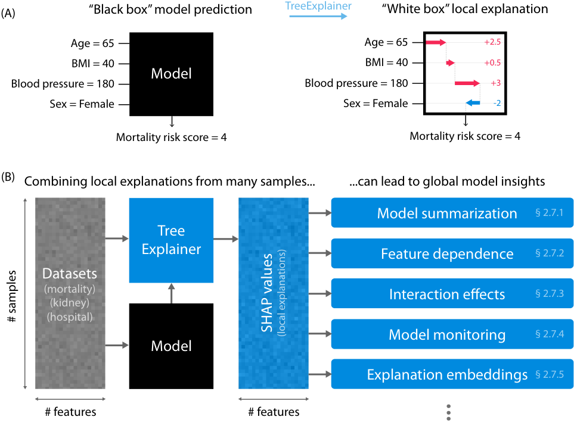

<!-- Start of picture text -->
(A) “Black box” model prediction TreeExplainer “White box” local explanation Age = 65 Age = 65 +2.5 BMI = 40 BMI = 40 +0.5 Model Blood pressure = 180 Blood pressure = 180 +3 Sex = Female Sex = Female -2 Mortality risk score = 4 Mortality risk score = 4 (B) Combining local explanations from many samples... ...can lead to global model insights Model summarization § 2.7.1 Tree Explainer § 2.7.2 Feature dependence Datasets (mortality) § 2.7.3 Interaction effects (kidney) (hospital) Model monitoring § 2.7.4 Model Explanation embeddings § 2.7.5 # features # features # samples SHAP values (local explanations) ... <!-- End of picture text -->

Figure 1: **Local explanations based on TreeExplainer enable a wide variety of new ways to understand global model structure.** (A) A local explanation based on assigning a numeric measure of credit to each input feature (Section 2.5). (B) By combining many local explanations we can represent global structure while retaining local faithfulness to the original model. To demonstrate this we use three illustrative medical datasets to train gradient boosted decision trees and then compute local explanations based on SHapley Additive exPlanation (SHAP) values (Section 2.5). Computing local explanations across all samples in a dataset enables many new tools for understanding global model structure (Section 2.7). 

2

<!-- PDF page 3 -->

71, 41, 4]. These methods have the following limitations: 1) Simply reporting the decision path of a prediction is unhelpful for most models, particularly those based on multiple trees. 2) The behavior of the heuristic credit allocation approach has not yet been carefully analyzed, and as we show in Section 2.3, it is strongly biased to alter the impact of features based on their tree depth. 3) Since model-agnostic methods rely on post-hoc modeling of an arbitrary function, they can be slow and suffer from sampling variability (Section 2.4). 

Here we propose TreeExplainer, a new local explanation method for trees that enables the tractable computation of _optimal_ local explanations, as defined by desirable properties from game theory (Section 2.5). It bridges theory to practice by building on our previous model-agnostic work based on the classic game-theoretic Shapley values [41, 63] and leads to three notable improvements: 

1. _TreeExplainer enables the exact computation of optimal local explanations for tree-based models._ The classic Shapley values can be considered “optimal” in the sense that within a large class of approaches they are the only way to measure feature importance while maintaining several natural properties from cooperative game theory [41]. Unfortunately, in general these values can only be approximated since computing them exactly is NP-hard [45], requiring a summation over all feature subsets. Sampling based approximations have been proposed [71, 41], but using these methods to compute low variance versions of the results in this paper for even our smallest dataset would take years of CPU time (Section 2.4). However, by focusing specifically on trees we were able to develop an algorithm that computes local explanations based on the exact Shapley values in polynomial time. This enables us to provide local explanations that come with _theoretical guarantees_ of _local accuracy_ and _consistency_ [41] (defined in Section 2.5; Methods 9). 

2. _TreeExplainer extends local explanations to directly capture feature interactions._ Local explanations that assign a single number to each input feature are very intuitive, but they cannot directly represent _interaction_ effects. We provide a theoretically grounded way of measuring local interaction effects based on a generalization of Shapley values proposed in game theory literature [21]. We show that this can provide valuable insights into a model’s behavior (Section 2.7.3). 

3. _TreeExplainer provides a new set of tools for understanding global model structure based on many local explanations._ The ability to efficiently and exactly compute local explanations using Shapley values across an entire dataset enables a whole range of new tools to understand the global behavior of the model (Figure 1B; Section 2.7). We show that combining many local explanations allows us to represent global structure while retaining _local faithfulness_ [55] to the original model, which produces more detailed and accurate representations of model behavior. 

The need to explain predictions from tree models is widespread. It is particularly important in medical applications, where the patterns uncovered by a model are often even more important than the model’s prediction performance [64, 42]. We use three medical datasets to demonstrate the value of TreeExplainer (Methods 2); they represent three types of loss functions (Methods 3): 1) _Mortality_ – a mortality dataset with 14,407 individuals and 79 features based on the NHANES I Epidemiologic Followup Study [14], where we model the risk of death over twenty years of followup. 2) _Chronic kidney disease_ – a kidney dataset that follows 3,939 chronic kidney disease patients from the Chronic Renal Insufficiency Cohort study over 10,745 visits with the goal of using 333 features to classify if patients will progress to end-stage renal disease within 4 years. 3) _Hospital procedure duration_ – a hospital electronic medical record dataset with 147,000 procedures and 2,185 features, where we predict the duration of an upcoming procedure. 

We discuss why tree models are the most appropriate models in many situations, both because of their accuracy (Section 2.1), and their interpretability (Section 2.2). We discuss the need for better local explanations of tree-based models (Sections 2.3-2.4), and how we address that need with TreeExplainer (Section 2.5). We then extend local explanations to capture interaction effects (Section 2.6). Finally, we demonstrate the value of the new explainable AI tools enabled by combining many local explanations from TreeExplainer (Section 2.7). To enable the wide use of TreeExplainer, high-performance implementations have also been released and integrated with many major tree-based machine learning packages ( `https://github.com/suinleelab/treeexplainer-study` ). 

## **2 Results** 

### **2.1 Tree-based models can be more accurate than neural networks** 

Tree-based ensemble methods such as random forests and gradient boosted trees achieve state-of-the-art performance in many domains. They have a long history of use in machine learning [20], and new high-performance implementations are an active area of research [10, 32, 54, 51]. While deep learning models are more appropriate in fields like image recognition, speech recognition, and natural language processing, tree-based models consistently outperform standard deep models on tabular-style datasets where features are individually meaningful and do not have strong multi-scale temporal or spatial structures [10]. A balance of computational efficiency, ease of use, and high accuracy have made tree-based models the most popular non-linear model type; four out of the five most popular machine learning models 

3

<!-- PDF page 4 -->

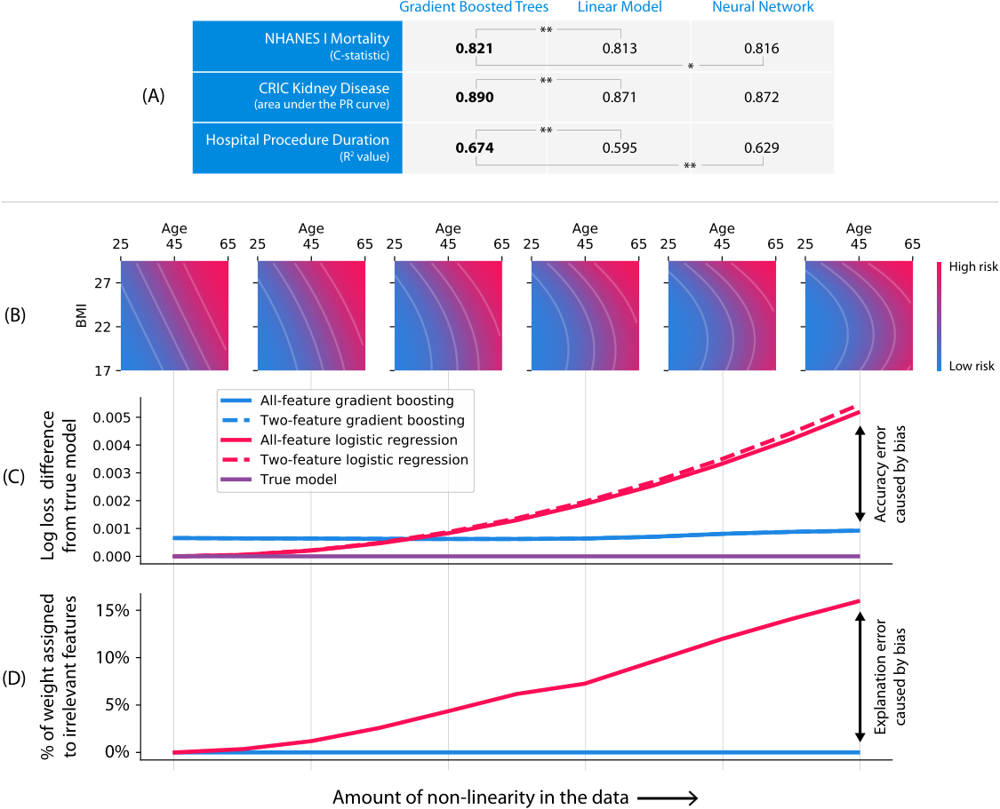

<!-- Start of picture text -->
Gradient Boosted Trees Linear Model Neural Network ** NHANES I Mortality 0.821 0.813 0.816 (C-statistic) * (A) CRIC Kidney Disease 0.890 ** 0.871 0.872 (area under the PR curve) ** Hospital Procedure Duration 0.674 0.595 0.629 (R 2  value) ** High risk (B) Low risk (C) 15% 10% (D) 5% 0% Amount of non-linearity in the data Accuracy error caused by bias from trrue model Log loss  difference caused by bias Explanation error % of weight assigned to irrelevant features <!-- End of picture text -->

Figure 2: **Gradient boosted tree models can be both more accurate than neural networks and more interpretable than linear models.** (A) Gradient boosted tree models outperform both linear models and neural networks on all our medical datasets. (**) represents a P-value _<_ 0 _._ 01, and (*) represents a P-value of 0 _._ 03 (Methods 3). (B-D) Linear models exhibit explanation error as well as accuracy error in the presence of non-linearity. (B) Data generating models used for the simulation, ranging from linear to quadratic along the body mass index (BMI) dimension. (C) The test performance of linear logistic regression (red) is better than gradient boosting (blue) up until a specific amount of non-linearity. Not surprisingly, the bias of the linear model is higher than the gradient boosting model as shown by the steeper slope as we increase the non-linearity. (D) As the true function becomes more non-linear the linear model assigns more credit (coefficient weight) to features that were not used by the data generating model. 

4

<!-- PDF page 5 -->

used by data scientists involve trees [29]. The three medical datasets we examine here all represent tabular-style data, and gradient boosted trees outperform both deep learning and linear regression across all three datasets (Figure 2A) (Methods 3). 

### **2.2 Tree-based models can be more interpretable than linear models** 

While it is well-known that the bias/variance trade-off in machine learning has implications for model accuracy, it is less appreciated that the trade-off also affects interpretability. While simple high-bias models (such as linear models) are often easy to understand, they are also more sensitive to model mismatch – where the true relationships in the data do not match the form of the model. 

To illustrate why low-bias models can be more interpretable than high-bias models we compare gradient boosted trees with lasso regularized linear logistic regression using the mortality dataset. We simulated a binary outcome based on a participant’s age and body mass index (BMI) (Methods 4), and varied the amount of non-linearity in the simulated relationship (Figure 2B). As expected, when we increase the non-linearity, the bias of the linear model causes a drop in accuracy (Figure 2C). However, what is perhaps unexpected is that it also causes a drop in interpretability (Figure 2D). We know that the model should only depend on age and BMI, but even a moderate amount of non-linearity in the true relationship causes the linear model to start using other irrelevant features (Figure 2D). This means that even when a linear model can achieve the same test accuracy as a gradient boosted tree model, the gradient boosted tree model is preferable because its connection to the training data is more interpretable (Figure 2D; Methods 4). 

### **2.3 Current local explanations for tree-based models are inconsistent** 

Despite the long history of approaches designed to compute global measures of feature importance in ensemble tree models (Methods 5), to our knowledge, there are only two approaches to quantify a feature’s _local_ importance for an individual prediction. The first is simply reporting the decision path, which is unhelpful for ensembles of many trees. The second is an unpublished heuristic approach (proposed by _Saabas_ ) that explains a prediction by following the decision path and attributing changes in the expected output of the model to each feature along the path (Methods 6). The Saabas method has not been well studied, and we demonstrate here that it is strongly biased to alter the impact of features based on their distance from the root of a tree (Supplementary Figure 1A). This causes Saabas values to be _inconsistent_ , which means we can modify a model to make a feature clearly more important, and yet the Saabas value attributed to that feature will decrease (Supplementary Figure 2). The difference this makes can be seen by examining trees representing multi-way AND functions. No feature in an AND function should have any more credit than another, yet Saabas values give splits near the root much less credit than splits near the leaves (Supplementary Figure 1A). Consistency is critical for an explanation method because it makes comparisons among feature importance values meaningful. 

### **2.4 Model-agnostic local explanations are slow and variable** 

Model-agnostic local explanation approaches can be used to explain tree models (Methods 7), but they rely on post-hoc modeling of an arbitrary function and thus can be slow and/or suffer from sampling variability when applied to models with many input features. To illustrate this we generated random datasets of increasing size and then explained (over)fit XGBoost models with 1,000 trees. This experiment shows a linear increase in complexity as the number of features increases; model-agnostic methods take a significant amount of time to run over these datasets, even though we allowed for non-trivial estimate variability (Supplementary Figure 1D; Methods 8) and only used a moderate numbers of features (Supplementary Figure 1C). Calculating low variance estimates of the Shapley values for the results in this paper would be intractable; just the chronic kidney disease dataset experiments would have taken almost 2 CPU days for basic explanations, and over 3 CPU years for interaction values (Section 2.6) (Supplementary Figure 1E-F; Methods 8). While often practical for individual explanations, model-agnostic methods can quickly become impractical for explaining entire datasets (Supplementary Figure 1C-F). 

### **2.5 TreeExplainer provides fast local explanations with guaranteed consistency** 

Here we introduce a new local feature attribution method for trees, TreeExplainer, which can exactly compute the classic Shapley values from game theory [63]. TreeExplainer bridges theory to practice by reducing the complexity of exact Shapley value computation from exponential to polynomial time. This is important since within the class of _additive feature attribution methods_ , a class that we have shown contains many previous approaches to local feature attribution [41], results from game theory imply the Shapley values are the only way to satisfy three important properties: _local accuracy_ , _consistency_ , and _missingness_ (Methods 9). Local accuracy states that when approximating the original model _f_ for a specific input _x_ , the explanation’s attribution values should sum up to the output _f_ ( _x_ ). 

5

<!-- PDF page 6 -->

Consistency states that if a model changes so that some feature’s contribution increases or stays the same regardless of the other inputs, that input’s attribution should not decrease. Missingness is a trivial property satisfied by all previous explanation methods (Methods 9). 

Shapley values, as applied here to feature importance, are defined as the sequential impact on the model’s output of observing each input feature’s value, averaged over all possible feature orderings (Supplementary Figure 3; Equation 5 in Methods). This means for each of _all possible_ orderings, we introduce features one at a time into a conditional expectation of the model’s output, then attribute the change in expectation to the feature that was introduced. Since Shapley values can be computed using any set function, not just conditional expectations, we will use the more specific term, _SHapley Additive exPlanation (SHAP) values_ [41], to clarify that we are using conditional expectations to measure the impact of a set of features on the model. 

Perhaps surprisingly, the independently developed Saabas values are computed the same way as SHAP values, but rather than averaging over all feature orderings, Saabas values only consider the single ordering defined by a tree’s decision path. This connection leads to two new insights: 1) The bias and consistency problems of Saabas values (Section 2.3) result from a failure to average feature impacts over all orderings. 2) For an infinite ensemble of random fully-developed trees on binary features, Saabas values effectively consider all orderings and so converge to the SHAP values. In practice, however, tree ensemble models are not infinite, random, or fully developed; to guarantee consistency we need to compute SHAP values exactly. TreeExplainer makes this possible by _exactly_ computing SHAP values in _low order polynomial time_ . This represents an exponential complexity improvement over previous exact Shapley methods. By default, TreeExplainer computes conditional expectations using tree traversal, but it also provides an option that enforces feature independence and supports explaining a model’s loss function (Methods 10). 

Efficiently and exactly computing the Shapley values guarantees that explanations will always be consistent and locally accurate. This results in several improvements over previous local explanation methods: 

- _TreeExplainer impartially assigns credit to input features regardless of their depth in the tree._ In contrast to Saabas values, TreeExplainer allocates credit uniformly among all features participating in multi-way AND operations (Supplementary Figures 1A-B) and avoids inconsistency problems (Supplementary Figure 2). 

- _For moderate sized models, TreeExplainer is several orders of magnitude faster than model-agnostic alternatives, and has zero estimation variability_ (Supplementary Figures 1C-F). Since solutions from model-agnostic sampling methods are approximate, there is always the additional burden of checking their convergence and accepting a certain amount of noise in their estimates. This burden is eliminated by TreeExplainer’s exact explanations. 

- _TreeExplainer consistently outperforms alternative methods across a benchmark of 21 different local explanation metrics_ (Figure 3; Supplementary Figures 4-5). We designed 21 metrics to comprehensively evaluate the performance of local explanation methods, and applied these metrics to eight different explanation methods across three different model types and three datasets (Methods 11). The results for the chronic kidney disease dataset are shown in Figure 3, and demonstrate consistent performance improvement for TreeExplainer. 

- _TreeExplainer matches human intuition across a benchmark of 12 user study scenarios_ (Supplementary Figure 6). We evaluated how well explanation methods match human intuition by comparing their outputs with human consensus explanations of 12 scenarios based on simple models. In contrast to the heuristic Saabas values, Shapley value based explanation methods agree with human intuition in all the scenarios we tested (Methods 12). 

TreeExplainer simultaneously addresses the consistency issues faced by the heuristic Saabas values (Section 2.3), and the computational issues faced by model-agnostic methods (Section 2.4). This leads to fast practical explanations with strong theoretical guarantees that result in improved performance across many quantitative metrics. 

### **2.6 TreeExplainer extends local explanations to measure interaction effects** 

Traditionally, local explanations based on feature attribution assign a single number to each input feature. The simplicity of this natural representation comes at the cost of combining main and interaction effects. While interaction effects between features can be reflected in the global patterns of many local explanations, their distinction from main effects is lost in each local explanation (Section 2.7.2; Figure 4B-G). 

Here we propose _SHAP interaction values_ as a new richer type of local explanation (Methods 13). These values use the ‘Shapley interaction index,’ a relatively recent concept from game theory, to capture local interaction effects. They follow from generalizations of the original Shapley value properties [21] and allocate credit not just among each player of a game, but among all pairs of players. The SHAP interaction values consist of a matrix of feature attributions (the main effects on the diagonal and the interaction effects on the off-diagonal) and have uniqueness guarantees similar to SHAP values [21]. By enabling the separate consideration of main and interaction effects for individual model predictions, TreeExplainer can uncover important patterns that might otherwise be missed (Section 2.7.3). 

6

<!-- PDF page 7 -->

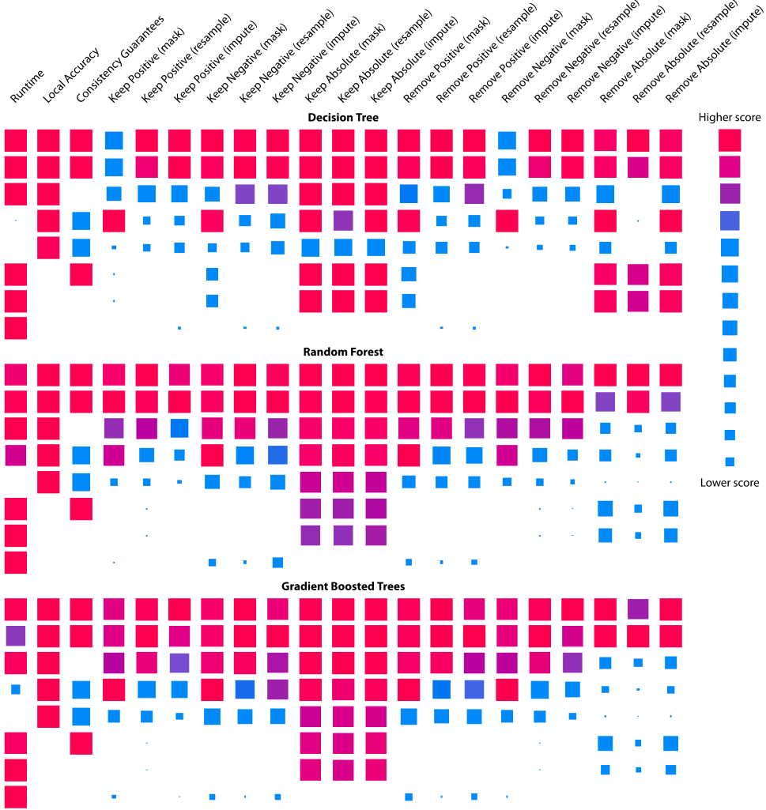

Figure 3: **Explanation method performance across 21 different evaluation metrics and three classification models in the chronic kidney disease dataset.** Each tile represents the performance of a local explanation method on a given metric for a given model. Within each model the columns of tiles are scaled between the minimum and maximum value, and methods are sorted by their overall performance. TreeExplainer outperforms previous approaches not only by having theoretical guarantees of consistency, but also across a large set of other metrics (Methods 11). When these experiments were repeated in two synthetic datasets, TreeExplainer remained the top performing method (Supplementary Figures 4 and 5). Note that, as expected, Saabas becomes a better approximation to the Shapley values (and so a better attribution method) as the number of trees increases (Methods 9). 

7

<!-- PDF page 8 -->

### **2.7 Local explanations from TreeExplainer can be used as building blocks for global understanding** 

We present five new methods that combine many local explanations to provide global insight into a model’s behavior. This allows us to retain local faithfulness to the model while still capturing global patterns, resulting in richer, more accurate representations of the model’s behavior. Each application presented below illustrates how local explanations can be used as building blocks for explainable machine learning. For all experiments we use gradient boosted trees since they have high accuracy (Figure 2A), low bias (Figure 2B-D), and support fast exact local explanations through TreeExplainer (Sections 2.5 and 2.6). 

##### **2.7.1 Local model summarization reveals rare high-magnitude effects on mortality risk and increases feature selection power** 

Combining local explanations from TreeExplainer across an entire dataset enhances traditional global representations of feature importance by: 1) avoiding the inconsistency problems of current methods (Supplementary Figure 2), 2) increasing the power to detect true feature dependencies in a dataset (Supplementary Figure 7), and 3) enabling us to build _SHAP summary plots_ that succinctly display the magnitude, prevalence, and direction of a feature’s effect. SHAP summary plots avoid conflating the magnitude and prevalence of an effect into a single number, and so reveal rare high magnitude effects. Figure 4A illustrates its benefits using the mortality dataset: (left) a standard bar-chart based on the average magnitude of the SHAP values, and (right) a set of beeswarm plots where each dot corresponds to an individual person in the study. The position of the dot on the x-axis is the impact that feature has on the model’s prediction for that person. When multiple dots land at the same x position they pile up to show density. 

Figure 4A (right) reveals the direction of effects, such as men (blue) having a higher mortality risk than women (red); and the distribution of effect sizes, such as the long right tails of many medical test values. These long tails mean features with a low global importance can yet be extremely important for specific individuals. Interestingly, rare mortality effects always stretch to the right, which implies there are many ways to die abnormally early when medical measurements are out-of-range, but not many ways to live abnormally longer (Methods 14). 

##### **2.7.2 Local feature dependence reveals both global patterns and individual variability in mortality risk and chronic kidney disease** 

_SHAP dependence plots_ show how a feature’s value (x-axis) impacted the prediction (y-axis) of every sample (each dot) in a dataset (Figures 4B and E; Methods 15). This provides richer information than traditional partial dependence plots (Supplemental Figure 8). For the mortality model this reproduces the standard risk inflection point of systolic blood pressure [23], while also highlighting that the impact of blood pressure risk is different for people of different ages (Figure 4B). Many individuals have a recorded blood pressure of 180 mmHg in the mortality dataset, but the impact of that measurement on their mortality risk varies because early onset high blood pressure is more concerning to the model than late onset high blood pressure. These types of interaction effects show up as vertical dispersion in SHAP dependence plots. 

For the chronic kidney disease model, a dependence plot again clearly reveals a risk inflection point for systolic blood pressure, but in this dataset the vertical dispersion from interaction effects appears to be partially driven by differences in blood urea nitrogen (Figure 4E). Correctly modeling blood pressure risk while retaining interpretabilty is important since blood pressure control in select chronic kidney disease (CKD) populations may delay progression of kidney disease and reduce the risk of cardiovascular events (Methods 15). 

##### **2.7.3 Local interactions reveal sex-specific life expectancy changes during aging and inflammation effects in chronic kidney disease** 

Using SHAP interaction values, we can decompose the impact of a feature on a specific sample into a main effect and interaction effects with other features. This allows us to measure global interaction strength as well as decompose the SHAP dependence plots into main effects and interaction effects at a local (i.e., per sample) level (Figures 4B-D; Methods 16). 

In the mortality dataset, plotting the SHAP interaction value between age and sex shows a clear change in the relative risk between men and women over a lifetime (Figure 4G). The largest difference in risk between men and women is at age 60. It is plausible that this increased risk is driven by increased cardiovascular mortality in men relative to women near that age [48]. This pattern is not clearly captured without SHAP interaction values because being male always confers greater risk of mortality than being female (Figure 4A). 

In the chronic kidney disease model, an interesting interaction is observed between ‘white blood cells’ and ‘blood urea nitrogen’ (Figure 4F). High white blood cell counts are more concerning to the model when they are accompanied 

8

<!-- PDF page 9 -->

~~Mortality model~~ 

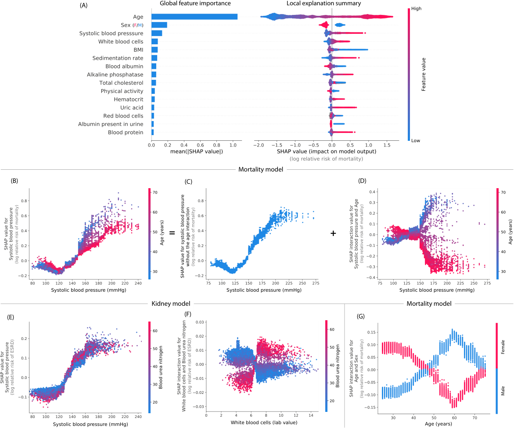

<!-- Start of picture text -->
(A) Global feature importance Local explanation summary (F/M) (log relative risk of mortality) Mortality model (B) (C) (D) = + Systolic blood pressure (mmHg) Systolic blood pressure (mmHg) Systolic blood pressure (mmHg) Kidney model Mortality model (E) (F) (G) Systolic blood pressure (mmHg) White blood cells (lab value) Age (years) Age (years) Age (years) (log relative risk of mortality) without the age interaction  (log relative risk of mortality) (log relative risk of mortality) SHAP value for systolic blood pressure (log relative risk of ESRD) (log relative risk of ESRD) (log relative risk of mortality) FemaleMale <!-- End of picture text -->

Figure 4: **By combining many local explanations we can provide rich summaries of both an entire model and individual features.** (A) Bar chart (left) and SHAP summary plot (right) for a gradient boosted decision tree model trained on the mortality dataset. The long right tails in the summary plot are from rare but high-magnitude risk factors. (B) SHAP dependence plot of systolic blood pressure vs. its SHAP value in the mortality model. A clear interaction effect with age is visible that increases the impact of early onset high blood pressure. (C) Using SHAP interaction values we can remove the interaction effect of age from the model. (D) Plotting just the interaction effect of systolic blood pressure with age shows how the effect of systolic blood pressure on mortality risk varies with age. Adding the y-values of C and D produces B. (E) A dependence plot of systolic blood pressure vs. its SHAP value in the kidney model shows an increase in kidney disease risk at a systolic blood pressure of 125 (which parallels the increase in mortality risk). (F) Plotting the SHAP interaction value of ‘white blood cells’ with ‘blood urea nitrogen’ shows that high white blood cell counts increase the negative risk conferred by high blood urea nitrogen. (G) Plotting the SHAP interaction value of sex vs. age in the mortality model shows how the differential risk of men and women changes over their lifetimes. 9 

9

<!-- PDF page 10 -->

by high blood urea nitrogen. This supports the notion that inflammation may interact with high blood urea nitrogen to contribute to faster kidney function decline [6, 17]. 

##### **2.7.4 Local model monitoring reveals previously invisible problems with deployed machine learning models** 

Here we show how using TreeExplainer to explain a model’s _loss_ , instead of a model’s prediction, can improve our ability to monitor deployed models (Methods 17). Deploying machine learning models in practice is challenging because of the potential for input features to change after deployment. It is hard to detect when such changes occur, so many bugs in machine learning pipelines go undetected, even in core software at top tech companies [78]. We demonstrate that local model monitoring helps debug model deployments by decomposing the loss among the model’s input features and so identifying problematic features (if any) directly. This is a significant improvement over simply speculating about the cause of global model performance fluctuations. 

We simulated a model deployment with the hospital procedure duration dataset using the first year of data for training and the next three years for deployment. We present three examples: (1) is an intentional error, (2) and (3) are previously undiscovered problems. 1) We intentionally swapped the labels of operating rooms 6 and 13 two-thirds of the way through the dataset to mimic a typical feature pipeline bug. The overall loss of the model’s predictions gives no indication that a problem has occurred (Figure 5A), whereas the _SHAP monitoring plot_ for the room 6 feature clearly shows when the labeling error begins (Figure 5B). 2) Figure 5C shows a spike in error for the general anesthesia feature shortly after the deployment window begins. This spike corresponds to a subset of procedures affected by a previously undiscovered temporary electronic medical record configuration problem (Methods 17). 3) Figure 5D shows an example of feature drift over time, not of a processing error. During the training period and early in deployment, using the ‘atrial fibrillation’ feature lowers the loss; however, the feature becomes gradually less useful over time and ends up hurting the model. We found this drift was caused by significant changes in atrial fibrillation ablation procedure duration, driven by technology and staffing changes (Supplementary Figure 9; Methods 17). 

Current deployment practice is to monitor the overall loss of a model (Figure 5A) over time, and potentially statistics of input features. TreeExplainer enables us to instead directly allocate a model’s loss among individual features. 

##### **2.7.5 Local explanation embeddings reveal population subgroups relevant to mortality risk and complementary diagnostic indicators in chronic kidney disease** 

Unsupervised clustering and dimensionality reduction are widely used to discover patterns characterizing subgroups of samples (e.g., study participants), such as disease subtypes [57, 67]. They present two drawbacks: 1) the distance metric does not account for the discrepancies among the units/meaning of features (e.g., weight vs. age), and 2) there is no way for an unsupervised approach to know which features are relevant for an outcome of interest, and so should be weighted more strongly. We can address both of these limitations by using _local explanation embeddings_ to embed each sample into a new “explanation space.” If we run clustering in this new space, we will get a _supervised clustering_ where samples are grouped together based on their _explanations_ . Supervised clustering naturally accounts for the differing units of various features, only highlighting changes that are relevant to a particular outcome (Methods 18). 

Running hierarchical supervised clustering using the mortality model results in many groups of people that share a similar mortality risk for similar reasons (Figure 6A; Methods 18). Analogously, we can also run PCA on local explanation embeddings for chronic kidney disease samples, which uncovers the two primary categories of risk factors that identify unique individuals at risk of end-stage renal disease. This is consistent with the fact that clinically these factors should be measured in parallel (Figures 6B-D; Methods 18). This type of insight into the overall structure of kidney risk is not at all apparent when just looking at a standard unsupervised embedding (Supplementary Figure 11). 

## **3 Discussion** 

Tree-based machine learning models are used in many domains where interpretability is important. We have sought to significantly improve the interpretability of these models in three main ways: First, we present a new exact method for computing the game-theoretic Shapley values, the only explanations that have several desirable properties. Second, we present a new richer type of local explanation that directly captures interaction effects. Finally, we propose many new tools for model interpretation based on combining local explanations. Local explanations have a distinct advantage over global explanations because by only focusing on a single sample they can remain more faithful to the original model. We anticipate that in the future local explanations will become foundational building blocks for many downstream tasks in machine learning. 

10

<!-- PDF page 11 -->

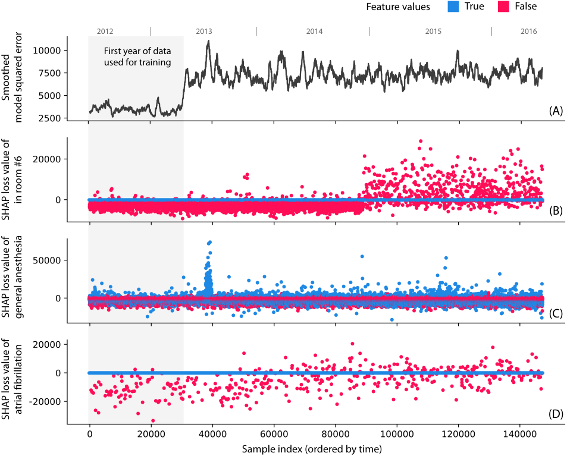

<!-- Start of picture text -->
Feature values True False 2012 2013 2014 2015 2016 First year of data used for training (A) (B) (C) - (D) Sample index (ordered by time) Smoothed model squared error in room #6 SHAP loss value of SHAP loss value of general anesthesia atrial fibrillation SHAP loss value of <!-- End of picture text -->

Figure 5: **Monitoring plots reveal problems that would otherwise be invisible in a retrospective hospital machine learning model deployment.** (A) The squared error of a hospital duration model averaged over the nearest 1,000 samples. The increase in error after training is because the test error is (as expected) higher than the training error. (B) The SHAP value of the model loss for the feature indicating if the procedure happens in room 6. The significant change is where we intentionally swapped the labels of room 6 and 13, which is invisible in the overall model loss. (C) The SHAP value of the model loss for the general anesthesia feature; the spike one-third of the way into the data is the result of a previously unrecognized transient data corruption at a hospital. (D) The SHAP value of the model loss for the atrial fibrillation feature. The upward trend of the plot shows feature drift over time (P-value 5 _._ 4 _×_ 10_−_19 ). 

11

<!-- PDF page 12 -->

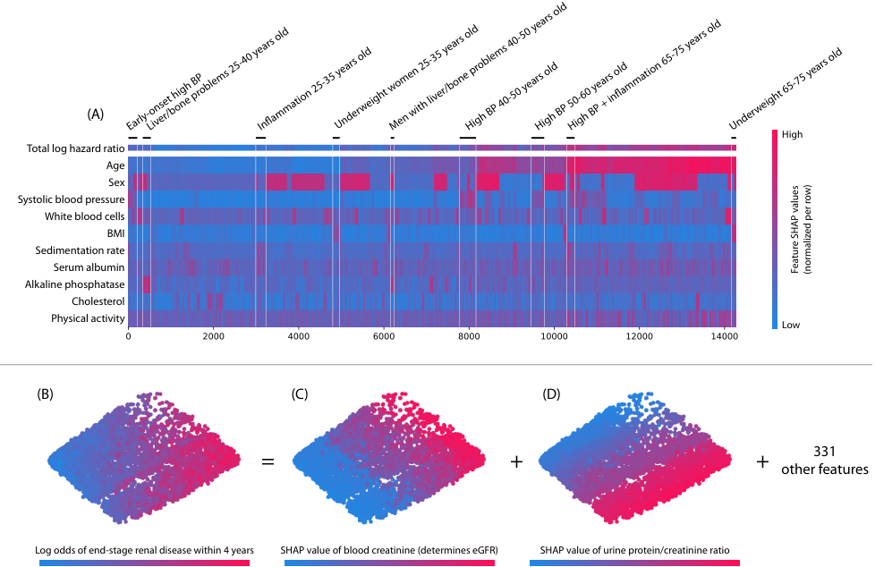

<!-- Start of picture text -->
(A) High Total log hazard ratio Age Sex Systolic blood pressure White blood cells BMI Sedimentation rate Serum albumin Alkaline phosphatase Cholesterol Physical activity Low (B) (C) (D) 331 = + + other features Log odds of end-stage renal disease within 4 years SHAP value of blood creatinine (determines eGFR) SHAP value of urine protein/creatinine ratio Early-onset high BPLiver/bone problems 25-40 years oldInflammation 25-35 years old Underweight women 25-35 years oldMen with liver/bone problems 40-50 years oldHigh BP 40-50 years oldHigh BP 50-60 years oldHigh BP + inflammation 65-75 years old Underweight 65-75 years old Feature SHAP values (normalized per row) <!-- End of picture text -->

Figure 6: **Local explanation embeddings support both supervised clustering and interpretable dimensionality reduction.** (A) A clustering of mortality study individuals by their local explanation embedding. Columns are patients, and rows are features’ normalized SHAP values. Sorting by a hierarchical clustering reveals population subgroups that have distinct mortality risk factors. (B-D) A local explanation embedding of kidney study visits projected onto two principal components. Local feature attribution values can be viewed as an embedding of the samples into a space where each dimension corresponds to a feature and all axes have the units of the model’s output. (B) The embedding colored by the predicted log odds of a participant developing end-stage renal disease with 4 years of that visit. (C) The embedding colored by the SHAP value of blood creatinine. (D) The embedding colored by the SHAP value of the urine protein/creatinine ratio. Many other features also align with these top two principal components (Supplementary Figure 10), and an equivalent unsupervised PCA embedding is far less interpretable (Supplementary Figure 11) 

12

<!-- PDF page 13 -->

### **Acknowledgements** 

We are grateful to Ruqian Chen, Alex Okeson, Cassianne Robinson, Vadim Khotilovich, Nao Hiranuma, Joseph Janizek, Marco Tulio Ribeiro, Jacob Schreiber, and members of the Lee lab for the feedback and assistance they provided during the development and preparation of this research. This work was funded by National Science Foundation [DBI1759487, DBI-1355899, DGE-1762114, and DGE-1256082]; American Cancer Society [127332-RSG-15-097-01-TBG]; and National Institutes of Health [R35 GM 128638]. 

The Chronic Renal Insufficiency Cohort (CRIC) study was conducted by the CRIC Investigators and supported by the National Institute of Diabetes and Digestive and Kidney Diseases (NIDDK). The data from the CRIC study reported here were supplied by the NIDDK Central Repositories. This manuscript was not prepared in collaboration with Investigators of the CRIC study and does not necessarily reflect the opinions or views of the CRIC study, the NIDDK Central Repositories, or the NIDDK. 

13

<!-- PDF page 14 -->

## **Methods** 

## **Methods 1 Institutional review board statement** 

The chronic kidney disease data used in this study was obtained from the Chronic Renal Insufficiency Cohort (CRIC) study. University Washington Human Subjects Division determined that our study does not involve human subjects because we do not have access to identifiable information (IRB ID: STUDY00006766). 

The hospital procedure data used for this study was retrieved from three institutional electronic medical record and data warehouse systems after receiving approval from the Institutional Review Board (University of Washington Human Subjects Division, Approval no. 46889). Protected health information was excluded from the dataset that was used for the machine-learning methods. 

## **Methods 2 The three medical datasets used for experiments** 

### **Methods 2.1 Mortality dataset** 

The mortality data was obtained from the National Health and Nutrition Examination Survey (NHANES I) conducted by the U.S. Centers for Disease Control (CDC), as well as the NHANES I Epidemiologic Follow-up Study (NHEFS) [14]. Raw tape-format data files were obtained from the CDC website and converted to a tabular format by custom scripts. This reformatted version of the public data has been released at `http://github.com/suinleelab/treexplainer-study` . NHANES I examined 23,808 individuals in the United States between 1971 and 1974, recording a large number of clinical and laboratory measurements. The NHANES I Epidemiologic Followup Study researched the status of the original NHANES I participants as of 1992 to identify when they had died, or alternatively when they were last known to be alive. After filtering NHANES I to subjects that had both followup mortality data as well as common health measurements (such as systolic blood pressure) we obtained 79 features for 14,407 individuals, of which 4,785 individuals had recorded death dates before 1992. This data was used to train several cox proportional hazard ratio model types (Section 2.1). Because NHANES I represents a cross section of the United States population, it is a classic dataset that has been often used to understand the association between standard clinical measurements and long term health outcomes [38, 18]. 

### **Methods 2.2 Chronic kidney disease dataset** 

The kidney dataset is from the Chronic Renal Insufficiency Cohort (CRIC) Study which follows individuals with chronic kidney disease recruited from 7 clinical centers [37]. Participants are assessed at an annual visit and study follow-up is ongoing. We joined both visit and person level attributes to create 333 features for 10,745 visits among 3,939 patients. For each visit, we determined if the patient progressed to ‘end-stage renal disease’ within the following four years. (End-stage renal disease is the last stage of chronic kidney disease when kidneys are functioning at 10-15% of their normal capacity; dialysis or kidney transplantation is necessary to sustain life.) Predicting this progression outcome results in a binary classification task. Understanding what leads some people with chronic kidney disease to progress to end-stage renal disease while others do not is a priority in clinical kidney care that can help doctors and patients better manage and treat their condition [49, 75, 73, 46]. In the United States chronic kidney disease affects 14% of the population, so improving our management and understanding of the disease can have a significant positive impact on public health [33]. 

### **Methods 2.3 Hospital procedure duration dataset** 

Our hospital’s operating rooms have installed an Anesthesia Information Management System - AIMS (Merge AIMS, Merge Inc., Hartland, WI) that integrates with medical devices and other electronic medical record systems to automatically acquire hemodynamic, ventilation, laboratory, surgery schedule and patient registration data. The automatic capture of data is supplemented by the manual documentation of medications and anesthesia interventions to complete the anesthesia record during a surgical episode. We extracted data from the AIMS database from June 2012 to May 2016. The corresponding medical history data of each patient were also extracted from our electronic medical record data warehouse (Caradigm Inc., Redmond, WA). Patient and procedure specific data available prior to surgery were captured and summarized into 2,185 features over 147,000 procedures. These data consist of diagnosis codes, procedure types, location, free text notes (represented as a bag of words), and various other information recorded in the EMR system. We measured the duration of a procedure as the time spent in the room by the patient. This is an important prediction task since one potential application of machine learning in hospitals is to reduce costs by better anticipating procedure duration (and so improve surgery scheduling). When hospital scheduling 

14

<!-- PDF page 15 -->

systems depend on machine learning models it is important to monitor the ongoing performance of the model. In Section 2.7.4 we demonstrate how local explanations can significantly improve the process of monitoring this type of model deployment. 

## **Methods 3 Model accuracy performance experiments** 

Modern gradient boosted decision trees often provide state-of-the-art performance on tabular style datasets where features are individually meaningful, as consistently demonstrated by open data science competitions [19, 10]. All three medical datasets we examine here represent tabular-style data, and gradient boosted trees achieve the highest accuracy across all three datasets (Figure 2A). We used 100 random train/test splits followed by retraining to assess the statistical significance of the separation between methods. In the mortality dataset, gradient boosted trees outperformed the linear lasso with a P-value _<_ 0 _._ 01 and the neural network with a P-value of 0 _._ 03. In the chronic kidney disease dataset, gradient boosted trees trees outperformed the linear lasso with a P-value _<_ 0 _._ 01 and the neural network with a P-value of 0 _._ 08. In the hospital procedure duration dataset, gradient boosted trees trees outperformed both the linear lasso and neural network with a P-value _<_ 0 _._ 01. The details of how we trained each method and obtained the results in Figure 2A are presented below. 

### **Methods 3.1 Mortality dataset** 

For NHANES I mortality prediction in Figure 2A, we used a cox proportional hazards loss, and a C-statistic [24] to measure performance. For each of the three algorithms we split the 14 _,_ 407 samples according to a 64/16/20 split for train/validation/test. The features for the linear and the neural network models were mean imputed and standardized based on statistics computed on the training set. For the gradient boosted tree models, we passed the original data unnormalized and with missing values. 

**Gradient Boosted Trees** - Gradient boosted trees were implemented using an XGBoost [10] model with the cox proportional hazards objective (we implemented this objective and merged it into XGBoost to support the experiments in this paper). Hyper-parameters were chosen using coordinate descent on the validation set loss. This resulted in a learning rate of 0 _._ 001; 6 _,_ 765 trees of max depth 4 chosen using early stopping; _ℓ_ 2 regularization of 5 _._ 5; no _ℓ_ 1 regularization; no column sampling during fitting; and bagging sub-sampling of 50%. 

**Linear Model** - The linear model for the mortality dataset was implemented using the lifelines Python package [16]. The _ℓ_ 2 regularization weight was chosen using the validation set and set to 215 _._ 44. 

**Neural Network** - The neural network model was implemented using the DeepSurv Python package [30]. Running DeepSurv to convergence for mortality data took hours on a modern GPU server, so hyper-parameter tuning was done by manual coordinate decent. This resulted in _ℓ_ 2 regularization of 1 _._ 0; the use of batch normalization; a single hidden layer with 20 nodes; a dropout rate of 0 _._ 5; a learning rate of 0 _._ 001 with no decay; and momentum of 0 _._ 9. 

### **Methods 3.2 Chronic kidney disease dataset** 

For CRIC kidney disease prediction, we used logistic loss for binary classification, and measured performance using the area under the precision-recall curve in Figure 2A. For each of the three algorithms we split the 10 _,_ 745 samples according to a 64/16/20 split for train/validation/test. The features for the linear and the neural network models were mean imputed and standardized based on statistics computed on the training set. For the gradient boosted tree models we passed the original data unnormalized and with missing values. 

**Gradient Boosted Trees** - Gradient boosted trees were implemented using an XGBoost [10] model with the binary logistic objective function. Hyper-parameters were chosen using coordinate descent on the validation set loss. This resulted in a learning rate of 0 _._ 003; 2 _,_ 300 trees of max depth 5 chosen using early stopping; no _ℓ_ 2 regularization; no _ℓ_ 1 regularization; a column sampling rate during fitting of 15%; and bagging sub-sampling of 30%. 

**Linear Model** - The linear model for the kidney dataset was implemented using scikit-learn [51]. Both _ℓ_ 1 and _ℓ_ 2 regularization were tested and _ℓ_ 1 was selected based on validation set performance, with an optimal penalty of 0 _._ 1798. 

**Neural Network** - The neural network model was implemented using Keras [12]. We chose to explore various feed-forward network architectures as well as 1D convolution based kernels (that learn a shared non-linear transform across many features). The best performance on the validation data came from a 1D convolution based architecture. After coordinate descent hyper-parameter tuning, we chose 15 1D convolution kernels which then go into a layer of 

15

<!-- PDF page 16 -->

10 hidden units with rectified linear unit activation functions. Dropout of 0 _._ 4 was used during training between the convolution kernels and the hidden layer, and between the hidden layer and the output. Because stochastic gradient descent can have varying performance from run to run, we chose the best model based on validation loss from 10 different optimization runs. 

### **Methods 3.3 Hospital procedure duration dataset** 

For hospital procedure duration prediction, we used a squared error loss and measured performance by the coefficient of determination ( _R_2 ) in Figure 2A. Two different hospital procedure dataset splits were used in this paper. The first dataset split, used for model comparison in Section 2.1 (Figure 2A), consisted of 147,000 procedures divided according to a random 80/10/5/5 split for train/validation/test1/test2. The test2 set was only used to get final performance numbers and not during method development. The features for the linear and the neural network models were mean imputed and standardized based on statistics computed on the training set. For the gradient boosted tree models, we passed the original data unnormalized and with missing values. All hyper-parameter tuning was done with the validation dataset. 

The second dataset split, used for the monitoring plots in Section 2.7.4, divided procedures from the two hospitals based on time: the first 1 year of data was used for training and the last 3 years were used for test, in a manner intended to simulate actual model deployment. Models for this data were not hyper-parameter tuned, as the goal was not to achieve perfect performance but to demonstrate the value of monitoring methods; instead, they simply used the best hyper-parameter values found on the first (random-splits) dataset. 

**Gradient Boosted Trees** - Gradient boosted trees were implemented using an XGBoost [10] model with a squared loss objective function. Hyper-parameters were chosen using grid search over the validation set loss. This resulted in a learning rate of 0 _._ 1; 530 trees of max depth 10 chosen using early stopping; a column sampling rate during fitting of 50%; and no bagging sub-sampling. 

**Linear Model** - The linear model for the procedure duration dataset was implemented using the `LassoCV` class in scikit-learn [51]. _ℓ_ 1 regularization was tuned based on validation set performance to 0 _._ 120. 

**Neural Network** - The neural network model was implemented using Keras [12]. We limited our architecture search to feed-forward networks with up to three hidden layers, and sizes up to 4,096 nodes per layer. The best performance on validation data came from a single-hidden-layer architecture with a 1,024-node layer followed by a dropout probability of 0.75 before the output. 

## **Methods 4 Interpretability comparison of linear models and treebased models in the presence of non-linearities** 

Even if linear models appear easier to interpret, their high bias may force the relationships they learn to be farther from the truth than a low-bias tree-based model (Figures 2B-D). We illustrated this using _simulated outcomes_ from the NHANES I mortality dataset with varying amounts of non-linearity between certain features and the outcome. The input feature data was used as is. Even if the simulated outcome only depends on age and body mass index (BMI), the linear model learns features in the mortality dataset that are non-linearly dependent with age and BMI to try to approximate non-linear relationships with the outcome. This increases the test accuracy of the linear model slightly, as seen by the small increase in performance from the two-feature linear model (dashed red) to the all-feature linear model (solid red) (Figure 2C). However, this comes at the cost of placing much of its weight on features that are not actually used to generate the outcome. In contrast, the gradient boosted tree model correctly uses only age and BMI across all levels of function non-linearity (Figure 2D). Below we describe the experimental setup behind the results in Figure 2B-D (Section 2.2). 

### **Methods 4.1 Selection of features** 

We generated a synthetic label with a known relationship to two input features from the mortality dataset, but to the extent possible, we intended this synthetic relationship to be realistic; while still retaining the ability to control the amount of non-linearity in the relationship. Starting with the classifiers trained on the full mortality (NHANES I) dataset, SHAP dependence plots (Section 2.7.2) were used to find one feature that had a strong linear relationship with mortality (age) and one that had a “U-shaped” relationship with mortality (BMI). These two features were selected and used as the “true” label-generating features in our synthetic model. 

16

<!-- PDF page 17 -->

### **Methods 4.2 Label generation** 

The synthetic label-generating function was constructed using a logistic function applied to the sum of a linear function of age and a quadratic function of BMI. The functional form allows us to smoothly vary the amount of nonlinearity in the label-generating model. The quadratic function of BMI was parameterized as (1 _− p_ ) times a linear function, plus _p_ times a quadratic function, where both functions had the same minimum and maximum values (the x-location of the minimum for the quadratic was set to the mean BMI). The contribution in logits was set to range from a minimum of -2.0 to a maximum of 2.0 for age, and -1.0 to 1.0 for BMI, so that even when nonlinear contribution were the strongest ( _p_ = 1) the linear contribution of the main risk factor was still more important (as true in the original data). The output for each data point was then a probability to be predicted by our models (we did not add noise by binarizing these probabilities to 0-1, so as to avoid the need to average our results over many random replicates). Thus the final label-generating model was 

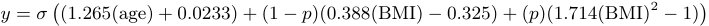

<!-- Start of picture text -->
y =  σ �(1 . 265(age) + 0 . 0233) + (1  − p )(0 . 388(BMI)  − 0 . 325) + ( p )(1 . 714(BMI) 2 − 1)� <!-- End of picture text -->

where _σ_ = 1+1 _e__−t_is the logistic function.A total of 11 datasets were generated,with_p ∈_[0_._0_,_0_._1_,_0_._2_..._1_._0],by applying this labeling function to the true data covariates, so that the matrix of predictors _X_ was real data but the labels _y_ were generated synthetically by a known mechanism. 

### **Methods 4.3 Model training** 

We trained both gradient boosted trees and linear logistic regression to predict the synthetic labels. For each of the 11 datasets with varying degrees _p_ of nonlinearity, models were tuned on a validation set and evaluated on test data with a 64/16/20 train/validation/test split. The only logistic regression hyper-parameter was the L1 regularization penalty which was optimized over the range _λ ∈_ [10_−_4 _,_ 10_−_3 _..._ 103 _,_ 104 ]. The tuned gradient boosting model hyper-parameters were optimized over the tree depths of [1 _,_ 2 _,_ 4 _,_ 8 _,_ 10] and bagging sub-sampling over the rates [0 _._ 2 _,_ 0 _._ 5 _,_ 0 _._ 8 _,_ 1 _._ 0]. The learning rate was fixed at 0 _._ 01; the minimum loss reduction for splitting to 1 _._ 0; the minimum child weight for splitting was 10; and trees we trained for a maximum of 1 _,_ 000 rounds with early stopping based on validation set loss. 

### **Methods 4.4 Feature importance** 

Per-sample importance values were calculated for each feature in each of the 11 datasets using SHAP values for both the logistic (using Linear SHAP values assuming feature independence [41]) and gradient boosted tree (using TreeExplainer’s Tree SHAP algorithm) models. At each value of _p_ , the total weight of irrelevant samples was calculated by taking the absolute value of all SHAP values for all features other than age and BMI, and summing these values across all samples and features. 

## **Methods 5 Previous Global Explanation Methods for Trees** 

While local explanation methods for trees have not been extensively studied, interpreting tree-based models by assigning a global importance value to each input feature is a well studied problem and many methods have been proposed [20, 19, 61, 69, 70, 27, 2, 40, 31]. The most basic global approach is to simply count the number of times a feature was used for splitting, but this fails to account for the differing impacts of different splits. A better approach is to attribute the reduction in loss (aka. Gain) provided by each split in each decision tree to the feature that was split on [8, 20]. This “Gain” measure of feature importance was shown to correctly recover the mutual information between the input features and the outcome label in the limit of an infinite ensemble of totally random fully developed trees [40]. However, it becomes biased for finite ensembles of greedily built trees, and so approaches have been designed to account for this bias when using Gain for feature selection [26, 9]. Another popular method for determining feature importance is to permute the data column corresponding to a feature and then observe the change in the model’s loss [7]. If the model’s loss increases significantly when a feature is permuted then it indicates the model was heavily depending on that feature. This permutation approach can be further extended to account for statistical dependencies between features by permuting only within specified groups of samples [70]. All of these approaches are designed to estimate the global importance of a feature over an entire dataset, so they are not directly applicable to local explanations that are specific to each prediction. If we try to use global methods in place of true local explanations we get significantly worse performance on many benchmark metrics (Figure 3). 

While not explicitly designed to be a global feature attribution method, TreeExplainer can be used as a global method by averaging many local explanations. If we do this over all samples in a dataset, then we get a global measure of feature importance that does not suffer from the inconsistencies of the classic Gain method (Supplementary Figure 2), and unlike the permutation method, does not miss high-order interaction effects. Global feature attribution 

17

<!-- PDF page 18 -->

based on TreeExplainer has a higher power to detect important features in the presence of interactions than current state-of-the-art methods (Supplementary Figure 7). This has important implications for the popular task of feature selection based on tree-ensembles. 

## **Methods 6 Previous local explanation methods for trees** 

As described in Section 2.3, we are aware of only two previous tree-specific local explanation methods: reporting the decision path; and an unpublished heuristic difference in expectations method (proposed by Saabas) [60]. Since reporting the decision path is not useful for large tree ensembles we instead focus on the heuristic Saabas method. The Saabas difference in expectations approach explains a prediction by following the decision path and attributing changes in the expected output of the model to each feature along the path. This is efficient since the expected value of every node in the tree can be estimated by averaging the model output over all the training samples that pass through that node. Let _f_ be a decision tree model, _x_ the instance we are going to explain, _f_ ( _x_ ) the output of the model for the current instance, and _fx_ ( _S_ ) _≈ E_ [ _f_ ( _x_ ) _| xS_ ] the estimated expectation of the model output conditioned on the set _S_ of feature values (Methods 10, Algorithm 1), then we can define the _Saabas value_ for the _i_ ’th feature as 

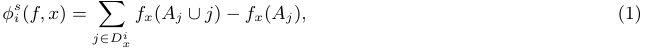

<!-- Start of picture text -->
φ s i ( f, x ) = � fx ( Aj ∪ j )  − fx ( Aj ) , (1) j∈Dx i <!-- End of picture text -->

where _Dx__i_isthesetofnodesonthedecisionpathfrom_x_thatsplitonfeature_i_,and_A_ _j_isthesetofallfeaturessplit on by ancestors of _j_ . Equation 1 results in a set of feature attribution values that sum up to the difference between the expected output of the model and the output for the current prediction being explained (Supplementary Figure 3). When explaining an ensemble model made up of a sum of many decision trees, the Saabas values for the ensemble model are defined as the sum of the Saabas values for each tree. 

## **Methods 7 Model agnostic local explanation methods** 

Many different local explanation methods have been proposed in the literature [4, 71, 56, 15, 41, 55]. The most well known is simply taking the gradient of the model’s output with respect to its inputs at the current sample. This is common in the deep learning literature, as is the related approach of multiplying the gradient times the value of the input features. Relying entirely on the gradient of the model at a single point though can often be misleading [65]. To provide a better allocation of credit for deep learning models, various methods have been proposed that either modify the standard gradient back propagation rule to instead propagate attributions [68, 77, 3, 65, 35, 1], or integrate the gradient along a path based on fair allocation rules from economics [72]. 

In contrast to deep learning methods, model-agnostic methods make no assumptions about the internal structure of the model. These methods rely only on observing the relationship between changes in the model inputs and model outputs. This can be done by training a global mimic model to approximate the original model, then locally explaining the mimic model by either taking its gradient [4], or fitting a local linear model as in MAPLE [53]. Alternatively, the mimic model can be fit to the original model locally for each prediction. For a local linear mimic model the coefficients can be used as an explanation, as in the popular LIME method [56]. For a local decision rule mimic model the rules can be used as the explanation as in Anchors [55]. Another class of approaches do not explicitly fit a mimic model, but instead perturb sets of features to measure their importance, then use methods from game theory to fairly allocate the importance of these sets among the input features, this class includes IME [71] and QII [15]. 

Perhaps surprisingly, despite the seeming variety of different local explanation methods, two back propagation-style deep learning methods [3, 65], local linear mimic models [56], and several game theoretic methods [39, 71, 15] were recently unified into a single class of _additive feature attribution methods_ in our prior study [41]. This class is of particular interest since results from cooperative game theory imply there is a unique optimal explanation approach in the class (the Shapley values) that satisfies several desirable properties [63, 59]. Unfortunately computing the Shapley values is NP-hard in general [45], with a runtime cost exponential in the number of input features. When faced with an NP-hard optimization problem it is typical to build approximate methods, which exactly IME [71] or QII [15] do. However, here we take an alternative approach and restrict our focus specifically to tree-based machine learning models. By doing this we are able to show constructively that solving for the exact Shapley values in trees is not NP-hard, and can be solved by TreeExplainer in low-order polynomial time (Methods 10). 

18

<!-- PDF page 19 -->

## **Methods 8 Convergence experiments for model agnostic Shapley value approximations** 

In Supplementary Figures 1C-D we generated random datasets of increasing size and then explained (over)fit XGBoost models with 1,000 trees. The runtime and standard deviation of the local explanations are reported for Kernel SHAP [41], IME [71], and TreeExplainer; except that for Kernel SHAP and IME the reported times are only a lower bound. Both the IME and Kernel SHAP model-agnostic methods must evaluate the original model a specific number of times for each explanation, so the time spent evaluating the original model represents a lower bound on the runtime of the methods (note that the QII method [15] is not included in our comparisons since for local feature attribution it is identical to IME). In Supplementary Figure 1C we report this lower bound, but it is important to note that in practice there is also additional overhead associated with the actual execution of the methods that depends on how efficiently they are implemented. We also only used a single background reference sample for the model-agnostic approaches. This allows them to converge faster at the expense of using less accurate estimates of conditional expectations. Increasing the number of background samples would only further reduce the computational performance of these methods. Each method is run ten times, then the standard deviation for each feature is divided by the mean of each feature to get a normalized standard deviation (Supplementary Figure 1D). In order to maintain a constant level of normalized standard deviation, Kernel SHAP and IME are allowed a linearly increasing number of samples as the number of features in a dataset, _M_ , grows. In Supplementary Figure 1C, TreeExplainer is so much faster than the model-agnostic methods that it appears to remain unchanged as we scale _M_ , though in reality there is a small growth in its runtime. In Supplementary Figure 1D there is truly no variability since the TreeExplainer method is exact and not stochastic. 

In Supplementary Figures 1E-F, the different explainers are compared in terms of estimation error (absolute deviation from the ground truth) on the chronic kidney disease dataset. We chose this dataset model for our comparisons because it is much smaller than the hospital procedure duration dataset, and has a more common loss function than the mortality dataset model (logistic loss vs. a cox proportional hazards loss). Ground truth is obtained via TreeExplainer’s exact Independent Tree SHAP algorithm with the reference set fixed to be the mean of the data. The plots are obtained by increasing the number of samples allowed to each explainer and reporting the max and mean estimation error. For IME, we tune the minimum samples per feature, a hyper-parameter that is utilized to estimate which features’ attributions have larger variability. After the minimum samples per feature has been achieved, the rest of the samples are allocated so as to optimally reduce the variance of the sum of the estimated values (by giving more samples to features with high sampling variance). As expected this is beneficial to the max evaluation error, but can potentially lead to bias (as for IME (min 10) in Supplementary Figure 1E). While often helpful, _ℓ_ 1 regularization was not useful to improve Kernel SHAP for this dataset, so we report the results from unregularized regression. 

To measure the cost of computing low variance estimates of explanations for the chronic kidney disease dataset we defined “low variance” as 1% of the tenth largest feature impact (out of 333 features), then measured how many samples it took on average to reach a standard deviation below that level (where standard deviation is measured across repeated runs of the explanation method). This was done for both the maximum standard deviation across all features (Supplementary Figure 1E), and the mean standard deviation (Supplementary Figure 1F). Calculating low variance estimates for the experiments presented in this paper on the chronic kidney disease dataset would have taken almost 2 CPU days for basic explanations, and over 3 CPU years for interaction values (Section 2.6). 

## **Methods 9 Unifying previous heuristics with Shapley values** 

Here we review the uniqueness guarantees of Shapley values from game theory as they apply to local explanations of predictions from machine learning models [63]. We then detail how to reinterpret previous local explanation heuristics for trees, and so connect them with Shapley values. 

As applied here, Shapley values are computed by introducing each feature, one at at time, into a conditional expectation function of the model’s output, _fx_ ( _S_ ) _≈ E_ [ _f_ ( _x_ ) _| xS_ ] (Methods 10, Algorithm 1), and attributing the change produced at each step to the feature that was introduced; then averaging this process over all possible feature orderings (Supplementary Figure 3). Shapley values represent the only possible method in the broad class of _additive feature attribution methods_ [41] that will simultaneously satisfy three important properties: _local accuracy_ , _consistency_ , and _missingness_ . 

Local accuracy (known as _additivity_ in game theory) states that when approximating the original model _f_ for a specific input _x_ , the explanation’s attribution values should sum up to the output _f_ ( _x_ ): 

**Property 1** (Local accuracy / Additivity) **.** 

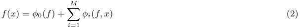

<!-- Start of picture text -->
M f ( x ) =  φ 0( f ) + � φi ( f, x ) (2) i =1 <!-- End of picture text -->

19

<!-- PDF page 20 -->

_The sum of feature attributions φi_ ( _f, x_ ) _matches the original model output f_ ( _x_ ) _, where φ_ 0( _f_ ) = _E_ [ _f_ ( _z_ )] = _fx_ ( _∅_ ) _._ 

Consistency (known as _monotonicity_ in game theory) states that if a model changes so that some feature’s contribution increases or stays the same regardless of the other inputs, that input’s attribution should not decrease: 

**Property 2** (Consistency / Monotonicity) **.** _For any two models f and f__′_ _, if_ 

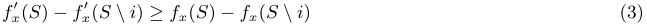

<!-- Start of picture text -->
fx ′ ( S )  − f x  ′ ( S \ i )  ≥ f x ( S )  − f x ( S \ i ) (3) <!-- End of picture text -->

_for all subsets of features S ∈F , then φi_ ( _f__′_ _, x_ ) _≥ φi_ ( _f, x_ ) _._ 

Missingness (similar to _null effects_ in game theory) requires features with no effect on the set function _fx_ to have no assigned impact. All local previous methods we are aware of satisfy missingness. 

**Property 3** (Missingness) **.** _If_ 

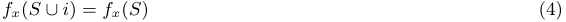

<!-- Start of picture text -->
fx ( S ∪ i ) =  fx ( S ) (4) <!-- End of picture text -->

_for all subsets of features S ∈F , then φi_ ( _f, x_ ) = 0 _._ 

The only way to simultaneously satisfy these properties is to use the classic Shapley values: 

**Theorem 1.** _Only one possible feature attribution method based on fx satisfies Properties 1, 2 and 3:_ 

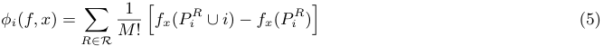

<!-- Start of picture text -->
1 φi ( f, x ) = � M ! � fx ( Pi R ∪ i )  − f x ( P R i ) � (5) R∈R <!-- End of picture text -->

_where R is the set of all feature orderings, Pi__R_ _is the set of all features that come before feature i in ordering R, and M is the number of input features for the model._ 

The equivalent of Theorem 1 has been previously presented in [41] and follows from cooperative game theory results [76], where the values _φi_ are known as the Shapley values [63]. Shapley values are defined independent of the set function used to measure the importance of a set of features. Since here we are using _fx_ , a conditional expectation function of the model’s output, we are computing the more specific _SHapley Additive exPlanation (SHAP) values_ [41]. 

Surprisingly, there is a close parallel between the Saabas values (Equation 1) and the SHAP values (Equation 5). While SHAP values average the importance of introducing a feature over all possible feature orderings, Saabas values only consider the single ordering defined by a tree’s decision path (Supplementary Figure 3). This mean that Saabas values satisfy the local accuracy property since they always sum up to the difference between the expected value of the model _E_ [ _f_ ( _x_ )] and the current output _f_ ( _x_ ). But since they do not average over all orderings they do not match the SHAP values, and so must violate consistency. Examples of such inconsistencies can be found for even very small trees, where changing the model to depend more on one feature can actually cause the Saabas attribution values for that feature to decrease (Supplementary Figure 2). The difference this makes can be seen by examining trees representing multi-way AND functions. If we let all the input features be independent and identically distributed then no feature in an AND function should have any more credit than another, yet for Saabas values, splits near the root are given much less credit than splits near the leaves (Supplementary Figures 1A). This means that while mathematically all the features play an equal role in the model, the features near the root of the tree get little or no credit. This is particularly troubling since features near the root are likely the most important as they were chosen first by greedy splitting. 

There is a close parallel between Saabas values and the classic “Gain” method for global feature attribution (sometimes known as Gini importance) [20]. Just as Gain attributes the change in loss after each split to the feature that was split on, so Saabas attributes the change in conditional expectation after each split to the feature that was split on. Both methods only consider a single order for introducing features into the model, the order defined by paths in the tree. Choosing to use only a single ordering leads to inconsistent allocation of credit (Supplementary Figure 1A and 2). Shapley values guarantee a consistent allocation of credit by averaging the change after each split over all possible orderings. It has been previously shown through a connection with mutual information (which is consistent) that the Gain method becomes consistent in the limit of an infinite ensemble of totally random fully developed trees [40]. This suggests that the Saabas method may also become consistent in the limit of an infinite ensemble of totally random fully developed trees. This is indeed the case, and we show in Theorem 2 that for binary features the Saabas values converge to the SHAP values in the limit of an infinite ensemble of totally random fully developed trees. 

**Theorem 2.** _In the limit of an infinite ensemble of totally random fully developed trees on binary features the Saabas values equal the SHAP values [41] (which are Shapley values of a conditional expectation function of the model’s output)._ 

20

<!-- PDF page 21 -->

_Proof._ Assume all features are binary, then the decision path of a single input instance _x_ for a single tree will be a random ordering of all the input features. The Saabas values for that tree will be equivalent to a single permutation from the formula for Shapley values (Equation 5). Since there is an infinite ensemble of trees, all possible feature orderings will be represented in equal proportions. Given a finite output domain, there will furthermore be all possible feature orderings represented for each possible leaf value. Taking the average of the Saabas values over the ensemble of trees then becomes the same as the averaging function in the definition of the Shapley values (Equation 5). 

## **Methods 10 TreeExplainer algorithms** 

Here, we describe the algorithms behind TreeExplainer in three stages. First, we describe an easy to understand (but slow) version of the main Tree SHAP algorithm, then we present the complex polynomial time version of Tree SHAP, and finally we describe the Independent Tree SHAP algorithm used for explaining non-linear model output transformations (such as the model’s loss). While solving for the Shapley values is in general NP-hard [45], these algorithms show that by restricting our attention to trees, we can find exact algorithms that run in low-order polynomial time. 

### **Methods 10.1 Tree SHAP** 

Tree SHAP, the main algorithm behind TreeExplainer, can exactly compute the Shapley values, and so guarantee consistent explanations (Property 2). Tree SHAP exactly computes Equation 5 in low order polynomial time, where the conditional expectation function, _fx_ , is defined using tree traversal (Algorithm 1). Letting _T_ be the number of trees, _D_ the maximum depth of any tree, and _L_ the number of leaves, Tree SHAP has worst case complexity of _O_ ( _TLD_2 ). This represents an exponential complexity improvement over previous exact Shapley methods, which would have a complexity of _O_ ( _TLM_ 2_M_ ), where _M_ is the number of input features. By directly computing the Shapley values we are able to guarantee that the explanations will always be consistent and locally accurate. 

##### **Methods 10.1.1 Estimating SHAP values directly in** _O_ ( _TLM_ 2_M_ ) **time** 

If we ignore computational complexity then we can compute the SHAP values for a tree by estimating _E_ [ _f_ ( _x_ ) _| xS_ ] and then using Equation 5 (Methods 9). For a tree model, _E_ [ _f_ ( _x_ ) _| xS_ ] can be estimated recursively using Algorithm 1, where _tree_ contains the information of the tree. _v_ is a vector of node values; for internal nodes, we assign the value _internal_ . The vectors _a_ and _b_ represent the left and right node indexes for each internal node. The vector _t_ contains the thresholds for each internal node, and _d_ is a vector of indexes of the features used for splitting in internal nodes. The vector _r_ represents the cover of each node (i.e., how many data samples fall in that sub-tree). 

Algorithm 1 finds _E_ [ _f_ ( _x_ ) _| xS_ ] by recursively following the decision path for _x_ if the split feature is in _S_ , and taking the weighted average of both branches if the split feature is not in _S_ . The computational complexity of Algorithm 1 is proportional to the number of leaves in the tree, which when used on all _T_ trees in an ensemble and plugged into Equation 5 leads to a complexity of _O_ ( _TLM_ 2_M_ ) for computing the SHAP values of all _M_ features. 

|**Algo**|**rithm 1** Estimating _E_[_f_(_x_) _| xS_]|
|---|---|
|1: **p** 2:|**rocedure** EXPVALUE(_x_, _S_, _tree_=_{v, a, b, t, r, d}_) **procedure** G(_j_) _▷_Define the _G_ procedure which we will call on line 10|
|3:|**if** _vj̸_ =_internal_ **then** _▷_Check if node _j_ is a leaf|
|4:|**return** _vj_ _▷_Return the leaf’s value|
|5:|**else**|
|6:|**if** _dj ∈S_ **then** _▷_Check if we are conditioning on this feature|
|7:|**return** G(_aj_) **if** _xdj ≤tj_ **else** G(_bj_) _▷_Use the child on the decision path|
|8:|**else**|
|9:|**return** [G(_aj_)_·raj_ + G(_bj_)_·rbj_]_/rj_ _▷_Weight children by their coverage|
|10:|**return** G(1) _▷_Start at the root node|

##### **Methods 10.1.2 Estimating SHAP values in** _O_ ( _TLD_2 ) **time** 

Now we calculate the same values as above, but in polynomial time instead of exponential time. Specifically, we propose an algorithm that runs in _O_ ( _TLD_2 ) time and _O_ ( _D_2 + _M_ ) memory, where for balanced trees the depth 

21

<!-- PDF page 22 -->

becomes _D_ = log _L_ . Recall _T_ is the number of trees, _L_ is the maximum number of leaves in any tree, and _M_ is the number of features. 

The intuition of the polynomial time algorithm is to recursively keep track of what proportion of all possible subsets flow down into each of the leaves of the tree. This is similar to running Algorithm 1 simultaneously for all 2_M_ subsets _S_ in Equation 5. Note that a single subset _S_ can land in multiple leaves. It may seem reasonable to simply keep track of how many subsets (weighted by the cover splitting of Algorithm 1 on line 9) pass down each branch of the tree. However, this combines subsets of different sizes and so prevents the proper weighting of these subsets, since the weights in Equation 5 depend on _|S|_ . To address this we keep track of each possible subset size during the recursion, not just single a count of all subsets. The _EXTEND_ method in Algorithm 2 grows all these subset sizes according to a given fraction of ones and zeros, while the _UNWIND_ method reverses this process and is commutative with _EXTEND_ . The _EXTEND_ method is used as we descend the tree. The _UNWIND_ method is used to undo previous extensions when we split on the same feature twice, and to undo each extension of the path inside a leaf to compute weights for each feature in the path. Note that _EXTEND_ keeps track of not just the proportion of subsets during the recursion, but also the weight applied to those subsets by Equation 5. Since the weight applied to a subset in Equation 5 is different when it includes the feature _i_ , we need to _UNWIND_ each feature separately once we land in a leaf, so as to compute the correct weight of that leaf for the SHAP values of each feature. The ability to _UNWIND_ only in the leaves depends on the commutative nature of _UNWIND_ and _EXTEND_ . 

In Algorithm 2, _m_ is the path of unique features we have split on so far, and contains four attributes: i) _d_ , the feature index, ii) _z_ , the fraction of “zero” paths (where this feature is not in the set _S_ ) that flow through this branch, iii) _o_ , the fraction of “one” paths (where this feature is in the set _S_ ) that flow through this branch, and iv) _w_ , which is used to hold the proportion of sets of a given cardinality that are present weighted by their Shapley weight (Equation 5). Note that the weighting captured by _w_ does not need to account for features not yet seen on the decision path so the effective size of _M_ in Equation 5 is growing as we descend the tree. We use the dot notation to access member values, and for the whole vector _m.d_ represents a vector of all the feature indexes. The values _pz_ , _po_ , and _pi_ represent the fraction of zeros and ones that are going to extend the subsets, and the index of the feature used to make the last split. We use the same notation as in Algorithm 1 for the tree and input vector _x_ . The child followed by the tree when given the input _x_ is called the “hot” child. Note that the correctness of Algorithm 2 (as implemented in the open source code) has been validated by comparing its results to the brute force approach based on Algorithm 1 for thousands of random models and datasets where _M <_ 15. 

**Complexity analysis:** Algorithm 2 reduces the computational complexity of exact SHAP value computation from exponential to low order polynomial for trees and sums of trees (since the SHAP values of a sum of two functions is the sum of the original functions’ SHAP values). The loops on lines 6, 12, 21, 27, and 34 are all bounded by the length of the subset path _m_ , which is bounded by _D_ , the maximum depth of a tree. This means the complexity of _UNWIND_ and _EXTEND_ is bounded by _O_ ( _D_ ). Each call to _RECURSE_ incurs either _O_ ( _D_ ) complexity for internal nodes, or _O_ ( _D_2 ) for leaf nodes, since _UNWIND_ is nested inside a loop bounded by _D_ . This leads to a complexity of _O_ ( _LD_2 ) for the whole tree because the work done at the leaves dominates the complexity of the internal nodes. For an entire ensemble of _T_ trees this bound becomes _O_ ( _TLD_2 ). If we assume the trees are balanced then _D_ = log _L_ and the bound becomes _O_ ( _TL_ log2 _L_ ). □ 

### **Methods 10.2 Independent Tree SHAP: Estimating SHAP values under independence in** _O_ ( _TRL_ ) **time** 

The Tree SHAP algorithm provides fast exact solutions for trees and sums of trees (because of the linearity of Shapley values [63]), but there are times when it is helpful to explain not the direct output of the trees, but also a non-linear transform of the tree’s output. A compelling example of this is explaining a model’s loss function, which is very useful for model monitoring and debugging (Section 2.7.4). 

Unfortunately, there is no simple way to adjust the Shapley values of a function to exactly account for a nonlinear transformation of the model output. Instead, we combine a previously proposed compositional approximation (Deep SHAP) [41] with ideas from Tree SHAP to create a fast method specific to trees, _Independent Tree SHAP_ . The compositional approach requires iterating over each background sample from the dataset used to compute the expectation. This means that conditional expectations can no longer be computed using Algorithm 1, since only the path corresponding to the current background reference sample will be defined. To solve this we enforce independence between input features then develop Independent Tree SHAP as a single-reference version of Tree SHAP (Algorithm 3). 

Independent Tree SHAP enforces an independence assumption between the conditional set _S_ and the set of remaining features ( _xS⊥xS_ ¯).Utilizingthisindependenceassumption,Shapleyvalueswithrespectto_R_individual background samples can be averaged together to get the attributions for the full distribution. Accordingly, Algorithm 3 is performed by traversing hybrid paths made up of a single foreground and background sample in a tree. At each internal node, _RECURSE_ traverses down the tree, maintaining local state to keep track of the set of upstream features and whether each split went down the path followed by the foreground or background sample. Then, at each leaf, two 

22

<!-- PDF page 23 -->

##### **Algorithm 2** Tree SHAP 

1: **procedure** TREESHAP( _x_ , _tree_ = _{v, a, b, t, r, d}_ ) 2: _φ_ = array of _len_ ( _x_ ) zeros 3: **procedure** RECURSE( _j_ , _m_ , _pz_ , _po_ , _pi_ ) 4: _m_ = EXTEND( _m_ , _pz_ , _po_ , _pi_ ) _▷_ Extend subset path with a fraction of zeros and ones 5: **if** _vj̸_ = _internal_ **then** _▷_ Check if we are at a leaf node 6: **for** _i ←_ 2 to _len_ ( _m_ ) **do** _▷_ Calculate the contributions from every feature in our path 7: _w_ = _sum_ (UNWIND( _m, i_ ) _.w_ ) _▷_ Undo the weight extension for this feature 8: _φmi_ = _φmi_ + _w_ ( _mi.o − mi.z_ ) _vj ▷_ Contribution from subsets matching this leaf 9: **else** 10: _h, c_ = ( _aj, bj_ ) **if** _xdj ≤ tj_ **else** ( _bj, aj_ ) _▷_ Determine hot and cold children 11: _iz_ = _io_ = 1 12: _k_ = FINDFIRST( _m.d, dj_ ) 13: **if** _k̸_ = nothing **then** _▷_ Undo previous extension if we have already seen this feature 14: _iz, io_ = ( _mk.z, mk.o_ ) 15: _m_ = UNWIND( _m, k_ ) 16: RECURSE( _h_ , _m_ , _izrh/rj_ , _io_ , _dj_ ) _▷_ Send both zero and one weights to the hot child 17: RECURSE( _c_ , _m_ , _izrc/rj_ , 0, _dj_ ) _▷_ Send just zero weights to the cold child 18: **procedure** EXTEND( _m_ , _pz_ , _po_ , _pi_ ) 19: _l, m_ = _len_ ( _m_ ) _, copy_ ( _m_ ) 20: _ml_ +1 _._ ( _d, z, o, w_ ) = ( _pi, pz, po,_ (1 **if** _l_ = 0 **else** 0)) _▷_ Init subsets of size _l_ 21: **for** _i ← l_ to 1 **do** _▷_ Grow subsets using _pz_ and _po_ 22: _mi_ +1 _.w_ = _mi_ +1 _.w_ + _po · mi.w ·_ ( _i/l_ ) _▷_ Subsets that grow by one 23: _mi.w_ = _pz · mi.w ·_ ( _l − i_ ) _/l ▷_ Subsets that stay the same size 24: **return** m _▷_ Return the new extended subset path 25: **procedure** UNWIND( _m_ , _i_ ) _▷_ The inverse of the _i_ th call to EXTEND( _m, ..._ ) 26: _l, n, m_ = _len_ ( _m_ ) _, ml.w, copy_ ( _m_ 1 _...l−_ 1) 27: **for** _j ← l −_ 1 to 1 **do** _▷_ Shrink subsets using _mi.z_ and _mi.o_ 28: **if** _mi.o̸_ = 0 **then** 29: _t_ = _mj.w_ 30: _mj.w_ = _n · l/_ ( _j · mi.o_ ) 31: _n_ = _t − mj.w · mi.z ·_ ( _l − j_ ) _/l_ 32: **else** 33: _mj.w_ = ( _mj.w · l_ ) _/_ ( _mi.z_ ( _l − j_ )) 34: **for** _j ← i_ to _l −_ 1 **do** 35: _mj._ ( _d, z, o_ ) = _mj_ +1 _._ ( _d, z, o_ ) 36: **return** m 37: RECURSE(1, [ ], 1, 1, 0) _▷_ Start at first node with all zero and one extensions 38: **return** _φ_ 

23

<!-- PDF page 24 -->

contributions are computed – one positive and one negative. Each leaf’s positive and negative contribution depends on the feature being explained. However, calculating the Shapley values by iterating over all features at each leaf would result in a quadratic time algorithm. Instead, _RECURSE_ passes these contributions up to the parent node and determines whether to assign the positive or negative contribution to the feature that was split upon based on the directions the foreground and background samples traversed. Then the internal node aggregates the two positive contributions into a single positive contribution and two negative contributions into a single negative contribution and passes it up to its parent node. 

Note that both the positive and negative contribution at each leaf is a function of two variables: 1) _U_ : the number of features that matched the foreground sample along the path and 2) _V_ : the total number of unique features encountered along the path. This means that for different leaves, a different total number of features _V_ will be considered. This allows the algorithm to consider only _O_ ( _L_ ) terms, rather than an exponential number of terms. Despite having different _U_ ’s at each leaf, Independent Tree SHAP exactly computes the traditional Shapley value formula (which considers a fixed total number of features _≥ V_ for any given path) because the terms in the summation group together nicely. 

**Complexity Analysis:** If we assume _CALCWEIGHT_ takes constant time (which it will if the factorial function is implemented based on lookup tables), then Algorithm 3 performs a constant amount of computation at each node. This implies the complexity for a single foreground and background sample is _O_ ( _L_ ), since the number of nodes in a tree is of the same order as the number of leaves. Repeating this algorithm for each tree and for each background sample gives us _O_ ( _TRL_ ). □ 

Note that for the experiments in this paper we used _R_ = 200 background samples to produce low variance estimates. 

## **Methods 11 Benchmark evaluation metrics** 

We used 21 evaluation metrics to measure the performance of different explanation methods. These metrics were chosen to capture practical runtime considerations, desirable properties such as local accuracy and consistency, and a range of different ways to measure feature importance. We considered multiple previous approaches and based these metrics off what we considered the best aspects of prior evaluations [1, 25, 41, 65]. Importantly, we have included three different ways to hide features from the model. One based on mean masking, one based on random sampling under the assumption of feature independence, and one based on imputation. The imputation based metrics attempt to avoid evaluating the model on unrealistic data, but it should be noted that this comes at the cost of encouraging explanation methods to assign importance to correlated features. After extensive consideration, we did not include metrics based on retraining the original model since, while informative, these can produce misleading results in certain situations. 

All metrics used to compute comprehensive evaluations of the Shapley value estimation methods we consider are described below (Figure 3, Supplementary Figures 4 and 5). Python implementations of these metrics are available online `https://github.com/suinleelab/treeexplainer-study` . Performance plots for all benchmark results are also available in Supplementary Data 1. 

### **Methods 11.1 Runtime** 

Runtime is reported as the time to explain 1,000 predictions. For the sake of efficiency the runtime for each explanation method was measured using 100 random predictions, and then scaled by 10 to represent the time to explain 1,000 predictions. Both the initialization time of each method and the per-prediction time was measured, and only the per-prediction time was scaled. 

### **Methods 11.2 Local accuracy** 

Local accuracy strictly holds only when the sum of the attribution values exactly sum up from some constant base value to the output of the model for each prediction (Property 1). This means _Ex_ [( _f_ ( _x_ ) _−_� _i__φi_)2] = 0.Buttoalso capture how close methods come to achieving local accuracy when they fail, we compute the normalized standard deviation of the difference from the model’s output over 100 samples 

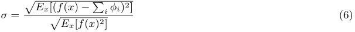

<!-- Start of picture text -->
� Ex [( f ( x )  − � i φi )2] σ = (6) � Ex [ f ( x ) 2 ] <!-- End of picture text -->

24

<!-- PDF page 25 -->

|**Algo**|**rithm 3** Independent Tree SHAP||
|---|---|---|
|1: **p**|**rocedure** INDTREESHAP(_x_, _refset_, _tree_=_{v, a, b, t, r, d}_) ||
|2:|_φ_=array of _len_(_x_) zeros   ||
|3:|**procedure** CALCWEIGHT(_U_, _V_) _▷_Shapley value weight for a  |set size and number of features|
|4:|**return** _U_!(_V −U−_1)! _V_!||
|5:|**procedure** RECURSE(_j_, _U_, _V_, _xlist_, _clist_)||
|6:|**if** _vj̸_ =_internal_ **then** _▷_Calcula |te possible contributions at leaf|
|7:|_pos_=_neg_ = 0||
|8:|**if** _U_ == 0 **then return** (_pos_, _neg_)||
|9:|**if** _U̸_ = 0 **then** _pos_=_calcweight_(_V, U −_1)_∗vj_||
|10:|**if** _U̸_ =_V_ **then** _neg_ =_−calcweight_(_V, U_)_∗vj_||
|11:|**return** (_pos_, _neg_)||
|12:|_k_ =_None_ |_▷_Represents the next node |
|13:|**if** (_xdj > tj_) and (_cdj > tj_) **then** _k_ =_bj_|_▷_Both x and _c_ go right|
|14:|**if** !(_xdj > tj_) and !(_cdj > tj_) **then** _k_ =_aj_|_▷_Both x and _c_ go left|
|15:|**if** _xlistdj >_0 **then**|_▷_Feature was previously x|
|16:|**if** _xdj > tj_ **then** _k_ =_bj_||
|17:|**else** _k_ =_aj_||
|18:|**if** _clistdj >_0 **then** |_▷_Feature was previously _c_|
|19:|**if** _cdj > tj_ **then** _k_ =_bj_||
|20:|**else** _k_ =_aj_||
|21:|**if** _k̸_ =_None_ **then** _▷_Recurse down|a single path if next node is set|
|22:|**return** RECURSE(_k_, _U_, _V_, _xlist_, _clist_)||
|23:|**if** (_xdj > tj_) and !(_cdj > tj_) **then**|_▷_Recurse x right and _c_ left|
|24:|_xlistdj_ =_xlistdj_ + 1 ||
|25:|(_posx_,_negx_) = RECURSE(_bj_, _U_ + 1, _V_ + 1, _xlist_, _clist_)||
|26:|_xlistdj_ =_xlistdj −_1||
|27:|_clistdj_ =_clistdj_ + 1||
|28:|(_posc_,_negc_) = RECURSE(_aj_, _U_, _V_ + 1, _xlist_, _clist_)||
|29:|_clistdj_ =_clistdj −_1||
|30:|**if** !(_xdj > tj_) and (_cdj > tj_) **then**|_▷_Recurse x left and _c_ right|
|31:|_xlistdj_ =_xlistdj_ + 1||
|32:|(_posx_,_negx_) = RECURSE(_aj_, _U_ + 1, _V_ + 1, _xlist_, _clist_)||
|33:|_xlistdj_ =_xlistdj −_1||
|34:|_clistdj_ =_clistdj_ + 1||
|35:|(_posc_,_negc_) = RECURSE(_bj_, _U_, _V_ + 1, _xlist_, _clist_)||
|36:|_clistdj_ =_clistdj −_1||
|37:|_φdj_ =_φdj_ +_posx_+_negc_|_▷_Save contributions for _dj_|
|38:|**return** (_posx_+_posc_, _negx_+_negc_)|_▷_Pass up both contributions|
|39:|**for** _c_ **in** _refset_ **do**||
|40:|RECURSE(0, 0, 0, array of _len_(_x_) zeros, array of _len_(_x_) zeros)||
|41:|**return** _φ/_len(_refset_)||

25

<!-- PDF page 26 -->

then define nine cutoff levels of _σ_ for reporting a positive score between 0 and 1: 

|_σ <_10_−_6 =_⇒_1_._00|(7)|
|---|---|
|10_−_6 _≤σ <_0_._01 =_⇒_0_._90|(8)|
|0_._01_≤σ <_0_._05 =_⇒_0_._75|(9)|
|0_._05_≤σ <_0_._10 =_⇒_0_._60|(10)|
|0_._10_≤σ <_0_._20 =_⇒_0_._40|(11)|
|0_._20_≤σ <_0_._30 =_⇒_0_._30|(12)|
|0_._30_≤σ <_0_._50 =_⇒_0_._20|(13)|
|0_._50_≤σ <_0_._70 =_⇒_0_._10|(14)|

### **Methods 11.3 Consistency guarantees** 

Consistency guarantees are a theoretical property of an explanation method that ensure pairs of cases will never be inconsistent (Property 2). We broke agreement with this property into three different categories: an exact guarantee, a guarantee that holds in the case of infinite sampling, and no guarantee. Note that while inconsistency could be tested computationally, it would require enumerating a search space exponential in the number of input features, which is why we chose to directly report the theoretical guarantees provided by different methods. 

### **Methods 11.4 Keep positive (mask)** 

The Keep Positive (mask) metric measures the ability of an explanation method to find the features that increased the output of the model the most. For a single input the most positive input features are kept at their original values, while all the other input features are masked with their mean value. This is done for eleven different fractions of features ordered by how positive an impact they have as estimated by the explanation method we are evaluating (those that have a negative impact are always removed and never kept). Plotting the fraction of features kept vs. the model output produces a curve that measures how well the local explanation method has identified features that increase the model’s output for this prediction. Higher valued curves represent better explanation methods. We average this curve over explanations of 100 test samples for 10 different models trained on different train/test splits. To summarize how well an explanation method performed we take the area under this curve. Masking features and observing their impact on a model’s output is a common method for assessing local explanation methods [1, 41, 65]. An example plot of this metric for a random forest model of the chronic kidney disease model is available in Supplementary Figure 16. 

### **Methods 11.5 Keep positive (resample)** 

The Keep Positive (resample) metric is similar to the Keep Positive (mask) metric, but instead of replacing hidden features with their mean value, this resample version of the metric replaces them with values from a random training sample. This replacement with values from the training dataset is repeated 100 times and the model output’s are averaged to integrate over the background distribution. If the input features are independent then this estimates the expectation of the model output conditioned on the observed features. The mask version of this metric described above can also be viewed as approximating the conditional expectation of the model’s output, but only if the model is linear. The resample metric does not make the assumption of model linearity. An example plot of this metric for a random forest model of the chronic kidney disease model is available in Supplementary Figure 17. 

### **Methods 11.6 Keep positive (impute)** 

The Keep Positive (impute) metric is similar to the Keep Positive (mask) and (resample) metrics, but instead of replacing hidden features with their mean value or a sample from the training set, this impute version of the metric replaces them with values imputed based on the data’s correlation matrix. The imputations match the maximum likelihood estimate under the assumption that the inputs features follow a multivariate normal distribution. Unlike the mask and resample versions of this metric, the impute version accounts for correlations among the input features. By imputing we prevent the evaluation of the model on invalid inputs that violate the correlations observed in the data (for example having an input where ’hematocrit’ is normal but ’anemia’ is true). An example plot of this metric for a random forest model of the chronic kidney disease model is available in Supplementary Figure 18. 

26

<!-- PDF page 27 -->

### **Methods 11.7 Keep negative (mask)** 

The Keep Negative (mask) metric measures the ability of an explanation method to find the features that decreased the output of the model the most. It works just like the Keep Positive (mask) metric described above, but keeps the most negative impacting features as computed by the explanation method (Supplementary Figure 19). 

### **Methods 11.8 Keep negative (resample)** 

The Keep Negative (resample) metric measures the ability of an explanation method to find the features that decreased the output of the model the most. It works just like the Keep Positive (resample) metric described above, but keeps the most negative impacting features as computed by the explanation method (Supplementary Figure 20). 

### **Methods 11.9 Keep negative (impute)** 

The Keep Negative (impute) metric measures the ability of an explanation method to find the features that decreased the output of the model the most. It works just like the Keep Positive (impute) metric described above, but keeps the most negative impacting features as computed by the explanation method (Supplementary Figure 21). 

### **Methods 11.10 Keep absolute (mask)** 

The Keep Absolute (mask) metric measures the ability of an explanation method to find the features most important for the model’s accuracy. It works just like the Keep Positive (mask) metric described above, but keeps the most important features as measured by the absolute value of the score given by the explanation method (Supplementary Figure 22). Since removing features by the absolute value of their effect on the model is not designed to push the model’s output either higher or lower, we measure not the change in the model’s output, but rather the change in the model’s accuracy. Good explanations will enable the model to achieve high accuracy with only a few important features. 

### **Methods 11.11 Keep absolute (resample)** 

The Keep Absolute (resample) metric measures the ability of an explanation method to find the features most important for the model’s accuracy. It works just like the Keep Absolute (mask) metric described above, but uses resampling instead of mean masking (Supplementary Figure 23). 

### **Methods 11.12 Keep absolute (impute)** 

The Keep Absolute (impute) metric measures the ability of an explanation method to find the features most important for the model’s accuracy. It works just like the Keep Absolute (mask) metric described above, but uses imputing instead of mean masking (Supplementary Figure 24). 

### **Methods 11.13 Remove positive (mask)** 

The Remove Positive (mask) metric measures the ability of an explanation method to find the features that increased the output of the model the most. It works just like the Keep Positive (mask) metric described above, but instead of keeping the most positive features, it instead removes them, which should lower the model output (Supplementary Figure 25). 

### **Methods 11.14 Remove positive (resample)** 

The Remove Positive (resample) metric measures the ability of an explanation method to find the features that increased the output of the model the most. It works just like the Keep Positive (resample) metric described above, but instead of keeping the most positive features, it instead removes them, which should lower the model output (Supplementary Figure 26). 

### **Methods 11.15 Remove positive (impute)** 

The Remove Positive (impute) metric measures the ability of an explanation method to find the features that increased the output of the model the most. It works just like the Keep Positive (impute) metric described above, but instead of keeping the most positive features, it instead removes them, which should lower the model output (Supplementary Figure 27). 

27

<!-- PDF page 28 -->

### **Methods 11.16 Remove negative (mask)** 

The Remove Negative (mask) metric measures the ability of an explanation method to find the features that decreased the output of the model the most. It works just like the Keep Negative (mask) metric described above, but instead of keeping the most negative features, it instead removes them, which should raise the model output (Supplementary Figure 28). 

### **Methods 11.17 Remove negative (resample)** 

The Remove Negative (resample) metric measures the ability of an explanation method to find the features that decreased the output of the model the most. It works just like the Keep Negative (resample) metric described above, but instead of keeping the most negative features, it instead removes them, which should raise the model output (Supplementary Figure 29). 

### **Methods 11.18 Remove negative (impute)** 

The Remove Negative (impute) metric measures the ability of an explanation method to find the features that decreased the output of the model the most. It works just like the Keep Negative (impute) metric described above, but instead of keeping the most negative features, it instead removes them, which should raise the model output (Supplementary Figure 30). 

### **Methods 11.19 Remove absolute (mask)** 

The Remove Absolute (mask) metric measures the ability of an explanation method to find the features most important for the model’s accuracy. It works just like the Keep Absolute (mask) metric described above, but instead of keeping the most important features, it instead removes them, which should lower the model’s performance (Supplementary Figure 31). 

### **Methods 11.20 Remove absolute (resample)** 

The Remove Absolute (resample) metric measures the ability of an explanation method to find the features most important for the model’s accuracy. It works just like the Keep Absolute (resample) metric described above, but instead of keeping the most important features, it instead removes them, which should lower the model’s performance (Supplementary Figure 32). 

### **Methods 11.21 Remove absolute (impute)** 

The Remove Absolute (impute) metric measures the ability of an explanation method to find the features most important for the model’s accuracy. It works just like the Keep Absolute (impute) metric described above, but instead of keeping the most important features, it instead removes them, which should lower the model’s performance (Supplementary Figure 33). 

## **Methods 12 User study experiments** 

Here we explore how consistent different attribution methods are with human intuition. While most complex models cannot be easily explained by humans, very simple decision trees can be explained by people. This means we can run user study experiments that measure how people assign credit to input features for simple models that people understand, then compare people’s allocations to allocations given by different local explanation methods. If an explanation method gives the same result as humans, then we say that method is consistent with human intuition. 

To test human intuition, we use four simple models and ask 33 english speaking individuals in the U.S. on Amazon Mechanical Turk to explain three different samples for each model. Each model is a simple depth-two decision tree that only depends on two binary features. To make the model more approachable we called the model a "sickness score", and used three binary input features: _fever_ , _cough_ , and _headache_ . The models we used were: _AND_ , _OR_ , _XOR_ , and _SUM_ (study participants were not told these names). The headache feature was never used by any of the models. The fever and cough features always each contributed a linear effect of +2 when they were on, but for models other than SUM there were also non-linear effects. For AND +6 was given when both features were true. For OR +6 was given when either feature was true. For XOR +6 was given when either feature was true but not both. For each model we explained three samples: 1) fever false, cough false, headache true; 2) fever false, cough true, headache true; and 3) fever true, cough true, headache true. 

28

<!-- PDF page 29 -->

Users were asked to allocate blame for a sickness score output value among each of the three input features. No constraints were placed on the input fields used to capture user input, except that the fields were not left blank when there was a non-zero sickness score. This experiment resulted in twelve different consensus credit allocations (Supplementary Figures 34-37). We then took these twelve consensus credit allocations and used them as ground truth for twelve metrics. Each metric is the sum of the absolute differences between the human consensus feature attribution and attribution given by an explanation method (Supplementary Figures 38-40). Note that we used a healthy population with independent input features as the background reference dataset (the background is used for computing conditional expectations by the explanation methods). 

The results show that all the local explanation methods based on Shapley values agree with the human consensus feature attribution values across all twelve cases. However, the heuristic Saabas method differs significantly from the human consensus in several of the nonlinear cases (Supplementary Figure 6). Not only do Shapley values have attractive theoretical guarantees, and strong quantitative performance (Figure 3), but these experiments show they also match human intuition on small example models (Supplementary Figure 6). Python implementations of these study scenarios are available online `https://github.com/suinleelab/treeexplainer-study` . Performance plots for all user study results are also available in Supplementary Data 1. 

## **Methods 13 SHAP interaction values** 

Here we describe the new richer explanation model we proposed to capture local interaction effects; it is based on the Shapley interaction index from game theory. The Shapley interaction index is a more recent concept than the classic Shapley values, and follows from generalizations of the original Shapley value properties [21]. It can allocate credit not just among each player of a game, but among all pairs of players. While standard feature attribution results in a vector of values, one for each feature, attributions based on the Shapley interaction index result in a matrix of feature attributions. The main effects are on the diagonal and the interaction effects on the off-diagonal. If we use the same definition of _fx_ that we used to get Sabaas values and SHAP values, but with the Shapley interaction index, we get _SHAP interaction values_ [21], defined as: 

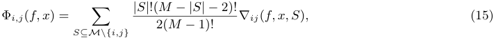

<!-- Start of picture text -->
|S| !( M − |S| − 2)! Φ i,j ( f, x ) = � ∇ij ( f, x, S ) , (15) 2( M − 1)! S⊆M\{i,j} <!-- End of picture text -->

when _i̸_ = _j_ , and 

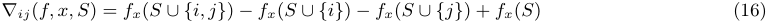

<!-- Start of picture text -->
∇ij ( f, x, S ) =  fx ( S ∪{i, j} )  − fx ( S ∪{i} )  − fx ( S ∪{j} ) +  fx ( S ) (16) <!-- End of picture text -->

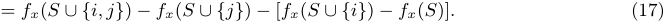

<!-- Start of picture text -->
=  fx ( S ∪{i, j} )  − fx ( S ∪{j} )  − [ fx ( S ∪{i} )  − fx ( S )] . (17) <!-- End of picture text -->

where _M_ is the set of all _M_ input features. In Equation 15 the SHAP interaction value between feature _i_ and feature _j_ is split equally between each feature so Φ _i,j_ ( _f, x_ ) = Φ _j,i_ ( _f, x_ ) and the total interaction effect is Φ _i,j_ ( _f, x_ ) + Φ _j,i_ ( _f, x_ ). The main effects for a prediction can then be defined as the difference between the SHAP value and the off-diagonal SHAP interaction values for a feature: 

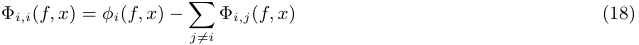

<!-- Start of picture text -->
Φ i,i ( f, x ) =  φi ( f, x )  − � Φ i,j ( f, x ) (18) j̸ = i <!-- End of picture text -->

We then set Φ0 _,_ 0( _f, x_ ) = _fx_ ( _∅_ ) so Φ( _f, x_ ) sums to the output of the model: 

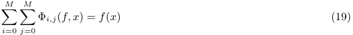

<!-- Start of picture text -->
M M � � Φ i,j ( f, x ) =  f ( x ) (19) i =0 j =0 <!-- End of picture text -->

While SHAP interaction values could be computed directly from Equation 15, we can leverage Algorithm 2 to drastically reduce their computational cost for tree models. As highlighted in Equation 17, SHAP interaction values can be interpreted as the difference between the SHAP values for feature _i_ when feature _j_ is present and the SHAP values for feature _i_ when feature _j_ is absent. This allows us to use Algorithm 2 twice, once while ignoring feature _j_ as fixed to present, and once with feature _j_ absent. This leads to a run time of _O_ ( _TMLD_2 ) when using Tree SHAP, since we repeat the process for each feature. A full open-source implementation is available online `https://github.com/suinleelab/treeexplainer-study` . 

SHAP interaction values have uniqueness guarantees similar to SHAP values [21], and allow the separate consideration of main and interaction effects for individual model predictions. This separation can uncover important interactions captured by tree ensembles that might otherwise be missed (Section 2.7.3). While previous work has used global measures of feature interactions [43, 28], to the best of our knowledge SHAP interaction values represent the first local approach to feature interactions beyond simply listing decision paths. 

29

<!-- PDF page 30 -->

## **Methods 14 Model summarization experiments** 

Here, we describe in more detail the model summarization results introduced in Section 2.7.1. One of the most basic ways to understand a model is to display the global importance of each feature, often as a bar chart (Figure 4A left). For tree-based models such as gradient boosted trees a basic operation supported by any implementation is providing the total “Gain” over all splits for a feature as a global measure of feature importance [20]. Computing SHAP values across a whole dataset, we can improve on this basic task of displaying global feature importance in two ways: 1) By averaging the SHAP values across a dataset, we can get a single global measure of feature importance that retains the theoretical guarantees of SHAP values. This avoids the troubling inconsistency problems of the classic Gain method (Supplementary Figure 2), and also provides better global feature selection power than either Gain or permutation testing (Supplementary Figure 7). This is particularly important since tree-based models are often used in practice for feature selection [22, 50]. 2) A limitation of traditional global explanations for trees is that reporting a single number as the measure of a feature’s importance conflates two important and distinct concepts: the magnitude of an effect, and the prevalence of an effect. By plotting many local explanations in a beeswarm-style _SHAP summary plot_ we can see both the magnitude and prevalence of a feature’s effect (Figure 4A right), and by adding color, we can also display the effect’s direction. 

The value of summary plots based on many local explanations is illustrated in Figure 4A for the NHANES I mortality dataset, where an XGBoost cox proportional hazards model was trained using hyper-parameters optimized on a validation dataset (Methods 3), its predictions were explained using TreeExplainer, and then compiled into a summary plot. On the left of Figure 4A is a familiar bar-chart, not based on a typical heuristic global measure of feature importance, but on the average magnitude of the SHAP values. On the right of Figure 4A is a set of beeswarm plots where each dot corresponds to an individual person in the study. Each person has one dot for each feature, where the position of the dot on the x-axis corresponds to the impact that feature has on the model’s prediction for that person (as measured by the prediction’s SHAP value for that feature). When multiple dots land at the same x position they pile up to show density. 

Unsurprisingly, the dominating factor for risk of death in the U.S. in the 1970s (which is when the NHANES I data was collected) is age. By examining the top row of the summary plot we can see that a high value for the age feature (red) corresponds to a large increase in the log hazard ratio (i.e., a large positive SHAP value), while a low value for age (blue) corresponds to a large decrease in the log hazard ratio (i.e., a large negative SHAP value). The next most important feature for mortality prediction is sex, with men having about a 0.6 increase in log-hazards relative to women, which corresponds to about 7 years of change in the age feature. Interestingly, the impact of being a man vs. woman on the model’s output is not constant across individuals, as can be seen by the spread of the blue and red dots. The differences of effect within the same sex are due to interactions with other features in the model that modulate the importance of sex for different individuals (we explore this in more detail in Methods 15). 

An important pattern in the mortality data revealed by the summary plot, but not by classic global feature importance, is that features with a low global importance can still be some of the most important features for a specific person (Figure 4A). Blood protein, for example, has a low global impact on mortality, as indicated by its small global importance (Figure 4A left). However, for some individuals, high blood protein has a very large impact on their mortality risk, as indicated by the long tail of red dots stretching to the right in the summary plot (Figure 4A right). This trend of rare high magnitude effects is present across many of the features, and always stretches to the right. This reflects the fact that there are many ways to die abnormally early when medical measurements are out of range, but there not many ways to live abnormally longer (since there are no long tails stretching to the left). Summary plots combine many local explanations to provide a more detailed global picture of the model than a traditional list of global feature importance values. In many cases this more detailed view can provide useful insights, as demonstrated in our medical datasets (Figure 4A, Supplementary Figures 12 and 13). 

## **Methods 15 Feature dependence experiments** 

Here we describe in more detail the feature dependence results introduced in Section 2.7.2. Just as summary plots provide richer information than traditional measures of global feature importance (Figure 4A), dependence plots based on SHAP values can provide richer information than traditional partial dependence plots by combining the local importance of a single feature across many samples (Figure 4B-G). Plotting a feature’s value on the x-axis vs. the feature’s SHAP value on the y-axis produces a _SHAP dependence plot_ that shows how much that feature impacted the prediction of every sample in the dataset. 

For the mortality model a SHAP dependence plot reproduces the standard risk inflection point known for systolic blood pressure between 120 mmHg and 140 mmHg [23] (Figure 4B). This highlights the value of a flexible model that is able to capture non-linear patterns, and also shows how interaction effects can have a significant impact on a feature. Standard partial dependence plots capture the general trends, but do not provide any information about 

30

<!-- PDF page 31 -->

the heterogeneity present within people that have the same measured systolic blood pressure (Supplemental Figure 8). Each dot in a SHAP dependence plot represents a person, and the vertical dispersion of the dots is driven by interaction effects with other features in the model. Many different individuals have a recorded blood pressure of 180 mmHg in the mortality dataset, but the impact that measurement has on their log-hazard ratio varies from 0.2 to 0.6 because of other factors that differ among these individuals. We can color by another feature to better understand what drives this vertical dispersion. Coloring by age in Figure 4B explains most of the dispersion, meaning that early onset high blood pressure is more concerning to the model than late onset high blood pressure. 

For the chronic kidney disease (CKD) model a SHAP dependence plot again clearly reveals the previously documented non-linear inflection point for systolic blood pressure risk, but in this dataset the vertical dispersion from interaction effects appears to be partially driven by differences in blood urea nitrogen (Figure 4E). Correctly modeling blood pressure risk is important, since blood pressure control in select CKD populations may delay progression of kidney disease and reduce the risk of cardiovascular events. Lower blood pressure has been found to slow progression of CKD and decrease overall cardiovascular mortality in some studies [74, 58, 66, 52, 62, 5]. For example, long-term follow-up of the Modification of Diet in Renal Disease (MDRD) study suggested that lower systolic blood pressure led to improved kidney outcomes in patients with CKD [62]. The SPRINT trial, which randomized patients to treatment to systolic blood pressure <120 vs. <140 mmHg found that treatment to lower systolic blood pressure was associated with lower risk of cardiovascular disease; though no difference was seen in rates of CKD progression between the treatment groups [23, 11]. 

## **Methods 16 Interaction effect experiments** 

Here we describe in more detail the interaction effect results introduced in Section 2.7.3. As mentioned in Section 2.7.3, using SHAP interaction values we can decompose the impact of a feature on a specific sample into a main effect and interaction effects with other features. SHAP interaction values allow pairwise interaction effects to be measured at an individual sample level. By combining many such samples we can then observe patterns of interaction effects across a dataset. 

In the mortality dataset, we can compute the SHAP interaction values for every sample and then decompose the systolic blood pressure dependence plot into two components. One component contains the main effect of systolic blood pressure and interaction effects with features that are not age, and the other component is the (symmetric) SHAP interaction value of systolic blood pressure and age. The main effect plus the interaction effects equals the original SHAP value for a sample, so we can add the y-values of Figure 4C and Figure 4D to reproduce Figure 4B. Interaction effects are visible in dependence plots through vertical dispersion of the samples, and coloring can often highlight patterns likely to explain this dispersion, but it is necessary to compute the SHAP interaction values to confirm the causes of vertical dispersion. In the systolic blood pressure dependence plot from the mortality model the vertical dispersion is primarily driven by an interaction with age (Figure 4D), as suggested by the original coloring (Figure 4B). 

Plotting interaction values can reveal interesting relationships picked up by complex tree-ensemble models that would otherwise be hidden, such as the interaction effect between age and sex described in Section 2.7.3. In the chronic kidney disease model an interesting interaction effect is observed between ‘white blood cells’ and ‘blood urea nitrogen’ (Figure 4F). This means that high white blood cell counts are more concerning to the model when they are accompanied by high blood urea nitrogen. Recent evidence has suggested that inflammation may be an important contributor to loss of kidney function [6, 17]. While there are numerous markers of inflammation, white blood cell count is one of the most commonly measured clinical tests available, and this interaction effect supports the notion that inflammation may interact with high blood urea nitrogen to contribute to faster kidney function decline. 

## **Methods 17 Model monitoring experiments** 

Here we describe in more detail the model monitoring results introduced in Section 2.7.4. As noted in Section 2.7.4, deploying machine learning models in practice is challenging because they depend on a large range of input features, any of which could change after deployment and lead to degraded performance. Finding problems in deployed models is difficult because the result of bugs is typically not a software crash, but rather a change in an already stochastic measure of prediction performance. It is hard to determine when a change in a model’s performance is due to a feature problem, an expected generalization error, or random noise. Because of this, many bugs in machine learning pipelines can go undetected, even in core software at top tech companies [78]. 

A natural first step when debugging model deployments is to identify which features are causing problems. Computing the SHAP values of a model’s loss function directly supports this by decomposing the loss among the model’s input features. This has two important advantages over traditional model loss monitoring: First, it assigns 

31

<!-- PDF page 32 -->

blame directly to the problematic features so that instead of looking at global fluctuations of model performance, one can see the impact each feature has on the performance. Second, by focusing on individual features we have higher power to identify problems that would otherwise be hidden in all the other fluctuations of the overall model loss. Improving our ability to monitor deployed models is an important part of enabling the safe use of machine learning in medicine. 

As mentioned in Section 2.7.4, to simulate a model deployment we used the hospital procedure duration prediction dataset. It contains four years of data from two large hospitals. We used the first year of data for training and ran the model on the next three years of data to simulate a deployment. This is a simple batch prediction task, and so is far less prone to errors than actual real-time deployments, yet even here we observed dataset issues that had not been previously detected during data cleaning (Figure 5). 

Figure 5A shows the smoothed loss of the procedure duration model over time, and represents the type of monitoring used widely in industry today. There is a clear increase in the model’s error once we switch to the test set, which was expected; then there are short spikes in the error that are hard to differentiate from random fluctuations. To test the value of using monitoring plots based on local explanations we intentionally swapped the labels of operating rooms 6 and 13 two-thirds of the way through the dataset. This is meant to represent the type of coding change that can often happen during active development of a real-time machine learning pipeline. If we look at the overall loss of the model’s predictions two-thirds of the way through we see no indication that a problem has occurred (Figure 5A), which means this type of monitoring would not be able to catch the issue. In contrast, the _SHAP monitoring plot_ for the room 6 feature clearly shows when the room labeling error begins (Figure 5B). The y-axis of the SHAP monitoring plot is the impact of the room 6 feature on the loss. About two-thirds of the way through the data we see a clear shift from negative values (meaning using the feature helps accuracy) to positive values (meaning using the feature hurts accuracy). The impact on accuracy is substantial, but because procedures occurring in room 6 and 13 are just a small fraction of the overall set of procedures, the increased error is invisible when looking at the overall loss (Figure 5A). 

In addition to finding our intentional error, SHAP monitoring plots also revealed problems that were already present in the dataset. Two of these are shown Figure 5C and D. 

In Figure 5C we can see a spike in error for the general anesthesia feature shortly after the deployment window begins. This spike represents a transient configuration issue in our hospital revealed by a SHAP monitoring plot. It corresponds to a subset of procedures from a single hospital where the anesthesia type data field was left blank. After going back to the hospital system we found that this was due to a temporary electronic medical record configuration issue whereby the link between the general anesthesia induction note and the anesthesia type got broken. This prevented the anesthesia type data field from being auto-populated with “general anesthesia” when the induction note was completed. This is exactly the type of configuration issue that impacts machine learning models deployed in practice, and so needs to be detected during model monitoring. 

In Figure 5D we see an example, not of a processing error, but of feature drift over time. The atrial fibrillation feature denotes if a patient is undergoing an atrial fibrillation ablation procedure. During the training period, and for some time into deployment, using the atrial fibrillation feature lowers the loss. But then over the course of time the feature becomes less and less useful until it begins hurting the model by the end of the deployment window. Based on the SHAP monitoring plot for atrial fibrillation we went back to the hospital to determine possible causes. During an atrial fibrillation ablation, the goal is to electrically isolate the pulmonary veins of the heart using long catheters placed from the groin area. Traditionally, the procedure was completed with a radiofrequency ablation catheter delivering point-by-point lesions to burn the left atrium around the pulmonary veins. During the deployment window, the hospital began to use the second generation cryoballoon catheter (Arctic Front Advance, Medtronic Inc., Minneapolis, MN), which freezes the tissue and has been demonstrated to have a shorter procedure duration compared to radiofrequency ablation [36]. At the same time, there were improvements in radiofrequency ablation catheter technology including the use of contact force sensing which allowed the operator to determine how strongly the catheter was touching the left atrial wall. This technology ensures that ablation lesions are delivered with enough force to create significant lesion size. With noncontact force catheters, the operator may think the catheter is touching the atrial wall but it may, in actuality, simply be floating nearby. Contact force sensing is also associated with shorter procedure times [44, 34]. Cryoballoon versus radiofrequency ablation is chosen based on patient characteristics and physician preference. Lastly, during this time there were staffing changes including the use of specialized electrophysiology technologists which decreased procedural preparation time. All of these changes led to a significant decrease in atrial fibrillation ablation procedural and in-room time during the test period (Supplementary Figure 9), which translated into high model error attributable to the atrial fibrillation feature. We quantified the significance of the SHAP monitoring plot trend using an independent t-test between atrial fibrillation ablation procedures that appear in the first 30,000 samples of the test time period vs. those that appear in the last 60,000 samples of the test time period. This lead to a P-value of 5 _._ 4 _×_ 10_−_19 . The complexity of the reasons behind the feature drift in Figure 5D illustrate why it is so difficult to anticipate how assumptions depended on by a model might break in practice. Using SHAP values to monitor the loss of a model allow us to retroactively identify how model assumptions may be changing individually for each input feature, even if we cannot a priori anticipate which features are likely to cause problems. 

32

<!-- PDF page 33 -->

Explaining the loss of a model is not only useful for monitoring over time, it can also be used in dependence plots to understand how a specific feature helps improve model performance. For hospital procedure duration prediction we can plot the dependence between the time of the day feature and it’s impact on the model’s output. The time of day feature indicates when a procedure started, and is particularly effective at reducing the model’s loss just after 7:30am and 8:30am in the morning (Supplementary Figure 15). These two times are when long-running elective surgeries are scheduled in this hospital system, so the dependence plot reveals that the model is using the time of the day to detect routine long-running surgeries. 

Current practice is to monitor the overall loss of the model, and also potentially monitor the statistics of the features for changes over time. This is problematic because just monitoring the overall loss of the model can hide many important problems, while monitoring the changes in the statistics of features is essentially an unsupervised anomaly detection problem that is prone to both false positives and false negatives. Swapping the names of operating rooms that are used equally often would be invisible to such an unsupervised method. By directly attributing the loss to the features we can highlight precisely which features are impacting the loss and by how much. When changes show up in the monitoring plot, those changes are in the units of the model’s loss and so we can quantify how much it is impacting our performance. These monitoring plots represent a compelling way that many local explanations can be combined to provide richer and more actionable insights into model behavior than the current state of the art. 

## **Methods 18 Local explanation embedding experiments** 

Here we describe in more detail the local explanation embedding results introduced in Section 2.7.5. There are two challenges with standard unsupervised clustering methods: 1) The distance metric does not account for the discrepancies among the units and meaning of features (e.g., units of years vs. units of cholesterol), and simple standardization is no guarantee the resulting numbers are comparable. 2) Even after a distance metric is defined, there is no way for an unsupervised approach to know which features are relevant for an outcome of interest, and so should be weighted more strongly. Some applications might seek to cluster patients by groups relating to kidney disease, and another by groups relating to diabetes. But given the same feature set, unsupervised clustering will give the same results in both cases. 

As mentioned in Section 2.7.5, we can address both of the above problems in traditional unsupervised clustering by using local explanation embeddings to embed each sample into a new “explanation space.” If we then run clustering in this new space, we will get a _supervised clustering_ where samples are grouped together that have the same model output for the same reason. Since SHAP values have the same units as the model’s output they are all comparable within a model, even if the original features were not comparable. Supervised clustering naturally accounts for the differing scales of different features, only highlighting changes that are relevant to a particular outcome. Running hierarchical supervised clustering using the mortality model results in groups of people that share a similar mortality risk for similar reasons (Figure 6A). The heatmap in Figure 6A uses the leaf order of a hierarchical agglomerative clustering based on the SHAP values of each sample. On the left are young people, in the middle are middle aged people, and on the right are older people. Within these broad categories many smaller groups are of particular interest, such as people with early onset high-blood pressure, young people with inflammation markers, and underweight older people. Each of these recapitulate known high risk groups of people, which would not have been captured by a simple unsupervised clustering approach (Supplementary Figure 14). 

In addition to making explicit clusters, we can also use dimensionality reduction to directly visualize the explanation space embedding produced by the SHAP values. This gives a continuous representation of the primary directions of model output variation in the dataset. For the kidney disease dataset, the top two principal components of the explanation embedding highlight two distinct risk factors for disease progression (Figures 6B-D). The first principal component aligns with blood creatinine levels, which are used to compute the estimated glomerular filtration rate (eGFR) of the kidneys. High levels of creatinine are a marker of lower eGFR and are the primary test for detection of kidney disease. The second principal component aligns with higher urine protein concentration in the urine. Quantified as the urine protein to urine creatinine ratio (PCR), this is a marker of kidney damage and is used in conjunction with eGFR to quantify levels of kidney disease. If we color the explanation space embedding by the risk of kidney disease progression, we see a roughly continuous increase in risk from left to right (Figure 6B). This is largely explained by a combination of the two orthogonal risk directions described above: One direction follows the blood creatinine level feature (which determine the eGFR) (Figure 6C) and the other direction follows the urine protein feature (Figure 6D). Several of the other top features in the chronic kidney disease model also align with these two orthogonal embedding directions (Supplementary Figure 6B-D). It is well established that eGFR and urine PCR are the strongest predictors of progression to end-stage renal disease among patients with chronic kidney disease [47, 13]. Physiologically, eGFR and PCR are likely complimentary, yet distinct kidney disease markers. Figure 6B-D shows that eGFR and PCR each identify unique individuals at risk of end-stage renal disease; thus confirming that clinically they should be measured in parallel. This type of insight into the overall structure of kidney risk is not at all apparent when just looking at a 

33

<!-- PDF page 34 -->

standard unsupervised embedding (Supplementary Figure 11). 

34

<!-- PDF page 35 -->

## **Supplementary Figures** 

35

<!-- PDF page 36 -->

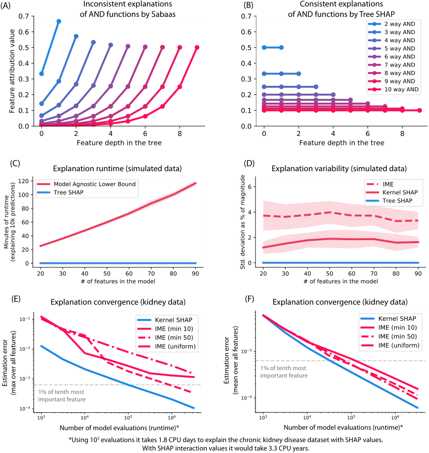

<!-- Start of picture text -->
(A) Inconsistent explanations (B) Consistent explanations of AND functions by Sabaas of AND functions by Tree SHAP (C) (D)  Explanation runtime (simulated data)  Explanation variability (simulated data) (E) (F) Explanation convergence (kidney data) Explanation convergence (kidney data) 1% of tenth most important feature 1% of tenth most important feature Number of model evaluations (runtime)* Number of model evaluations (runtime)* *Using 10 5  evaluations it takes 1.8 CPU days to explain the chronic kidney disease dataset with SHAP values. With SHAP interaction values it would take 3.3 CPU years. Estimation error Estimation error (max over all features) (mean over all features) <!-- End of picture text -->

Supplementary Figure 1: **(A-B) TreeExplainer avoids the consistency problems of previous treespecific approaches.** For tree models that represent a multi-way AND function the Saabas method gives little credit to features near the root, while Tree SHAP evenly distributes credit among all the features involved in the AND function. **(C-F) TreeExplainer represents a dramatic performance improvement over model agnostic approaches.** All model agnostic approaches rely on sampling, so their runtime is lower bounded by the run-time to evaluate the model, and they always have some sampling variability. TreeExplainer’s Tree SHAP algorithm runs thousands of times faster, and has no sampling variability since it is exact. We consider both the Kernel SHAP [41] and IME [71] model agnostic estimators for Shapley values. (C-D) Using simulated data we can train XGBoost models over datasets of different sizes and observe that the number of samples required to maintain estimates with constant variance grows linearly with the number of features in the model. The reported runtime is a lower bound since it only accounts for the time to execute the model, not execute the explanation method itself. (E-F) As we increase the number of model evaluations used by model agnostic approaches we converge towards the exact solution. However, achieving low variance estimates requires days or years of CPU time even on the smallest of our medical datasets. We also only used a single background reference sample for computing conditional expectations in the model agnostic methods (instead of an entire dataset) so these represent lower bounds on the runtime. The estimation error on the y-axis represents the difference from the exact solution with a single background reference sample. Details of the experimental setup for C-F are described in Methods 8. 36

<!-- PDF page 37 -->

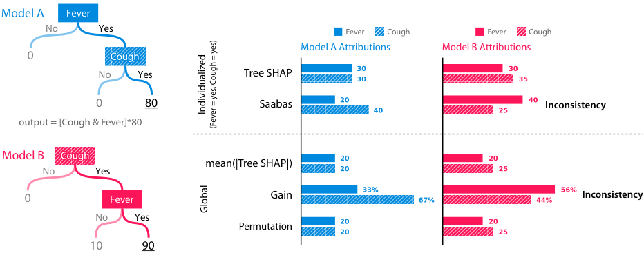

<!-- Start of picture text -->
Model A Fever No Yes Fever C ough Fever C ough Model A Attributions Model B Attributions 0 No Yes Tree SHAP 0 80 Saabas Inconsistency output = [Cough & Fever]*80 Model B mean(|Tree SHAP|) No Yes 0 Fever Gain Inconsistency No Yes Permutation 10 90 Individualized (Fever = yes, Cough = yes) Global <!-- End of picture text -->

output = [Cough & Fever]*80 + [Cough]*10 

Supplementary Figure 2: **Two simple tree models that demonstrate inconsistencies in the Saabas and gain feature attribution methods.** The Cough feature has a larger impact in Model B than Model A, but is attributed less importance in Model B. Similarly, the Cough feature has a larger impact than Fever in Model B, yet is attributed less importance. The individualized attributions explain a single prediction of the model (when both Cough and Fever are Yes) by allocating the difference between the expected value of the model’s output (20 for Model A, 25 for Model B) and the current output (80 for Model A, 90 for Model B). Inconsistency prevents the reliable comparison of feature attribution values. The global attributions represent the overall importance of a feature in the model. “Gain” is the most common way of measuring feature importance in trees and is the sum of the reductions in loss that come from all splits using that feature. “Permutation“ is the change in the model’s accuracy when a single feature is permuted. 

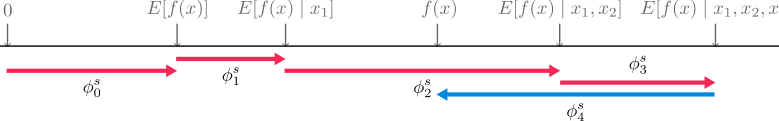

Supplementary Figure 3: The Sabaas values, _φ__s_ _i_,attributefeatureimportancebymeasuringdifferencesin conditional expectations along the order defined by the decision path. This is very similar to SHAP <u>(SHapley Additive exPlanation) values,</u> _φi_ , except SHAP values result from averaging over all possible orderings. This is important since for non-linear functions the order in which features are introduced matters. Proofs from game theory show that averaging over all orderings is the only possible consistent approach where�_M_ _i_ =0_φi_=_f_(_x_) (Methods 10). 

37

<!-- PDF page 38 -->

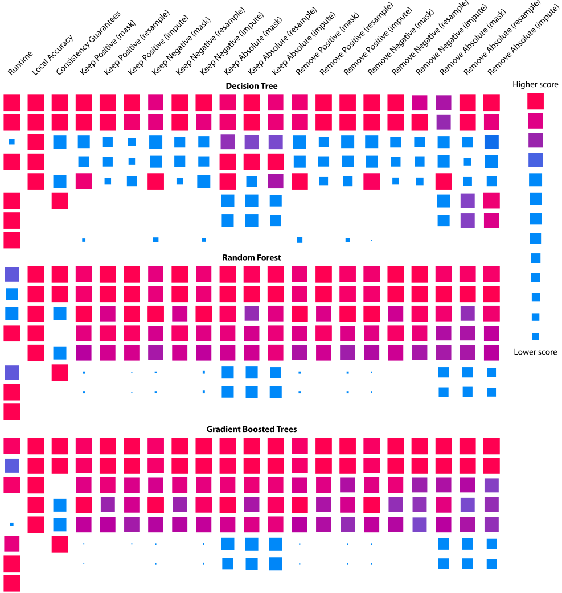

Supplementary Figure 4: **Explanation method performance across thirteen different evaluation metrics and three regression models in a simulated dataset with 60 features divided into tightly correlated groups.** Each tile represents the performance of a feature attribution method on a given metric for a given model. Within each model the columns of tiles are scaled between the minimum and maximum value, and methods are sorted by their overall performance. Some of these metrics have been proposed before and others are new quantitative measures of explanation performance that we are introducing (see Methods). 

38

<!-- PDF page 39 -->

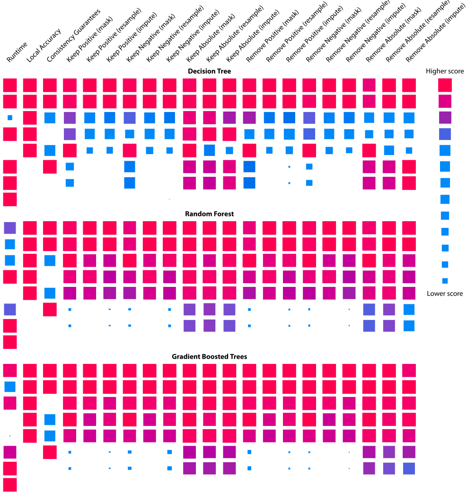

Supplementary Figure 5: **Explanation method performance across thirteen different evaluation metrics and three regression models in a simulated dataset with 60 independent features.** Each tile represents the performance of a feature attribution method on a given metric for a given model. Within each model the columns of tiles are scaled between the minimum and maximum value, and methods are sorted by their overall performance. Some of these metrics have been proposed before and others are new quantitative measures of explanation performance that we are introducing (see Methods). 

39

<!-- PDF page 40 -->

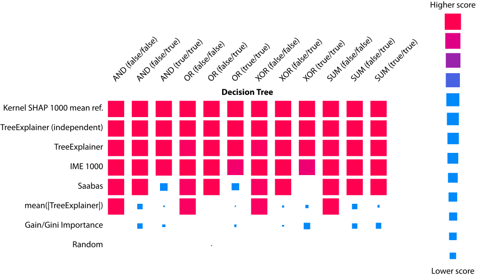

Supplementary Figure 6: **Shapley value based methods agree with human intuition.** We measured the most intuitive way to assign credit among input features by asking users to assign credit for predictions from four simple models (three predictions per model). The consensus allocation observed from a user study was then used as the ground truth and compared with the allocations given by different explanation methods. The sum of absolute differences was used to quantify agreement. All the Shapley value based methods had nearly perfect agreement across all the scenarios. The raw allocations for the cases where Saabas fails are shown in Supplementary Figures 38-40 (Methods 12). Note that since these small (human understandable) models have only three features, model agnostic Shapley methods are accurate and so comparable with TreeExplainer. 

40

<!-- PDF page 41 -->

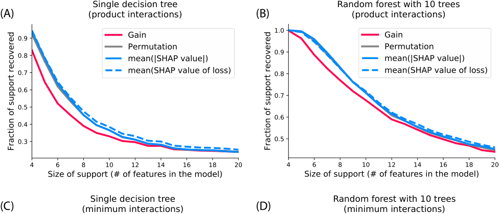

<!-- Start of picture text -->
Single decision tree Random forest with 10 trees (A) (product interactions) (B) (product interactions) Single decision tree Random forest with 10 trees (C) (minimum interactions) (D) (minimum interactions) <!-- End of picture text -->

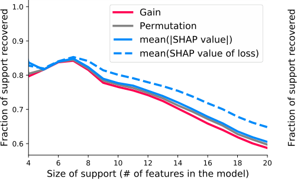

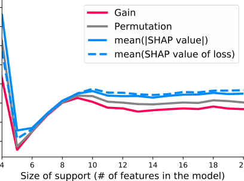

Supplementary Figure 7: **SHAP values can be combined to provide better feature selection power than traditional approaches.** Feature selection methods based on trees or ensembles of trees typically either use the total gain (reduction in train error when splitting) or a permutation test (scramble each feature and observe the change in error) to do feature selection. To compare feature selection power we reproduce the same simulated independent features setting as [31] (but with strong 3rd order interactions) and compare the mean SHAP value of the loss vs. mean SHAP value magnitude vs. gain vs. permutation for feature selection. We also repeat the experiment replacing the product style interactions from [31] with minimum functions. For both a single tree (A,C) and an ensemble of ten trees (B,D) the SHAP values provide a better ranking of features. Perhaps because, unlike gain, they guarantee consistency as defined by Property 2, and unlike permutations, they account for high-order interaction effects. The x-axis of the plots represents the number of features used in the true model (out of 200 total features), while the y-axis represents the fraction of those true features recovered in the set of top ranked features of the same size. Results are averages over performance on 1000 simulated datasets. Both SHAP value based methods outperform gain and permutation testing in every figure, with all paired t-test P-values being _<_ 10_−_7 . 

41

<!-- PDF page 42 -->

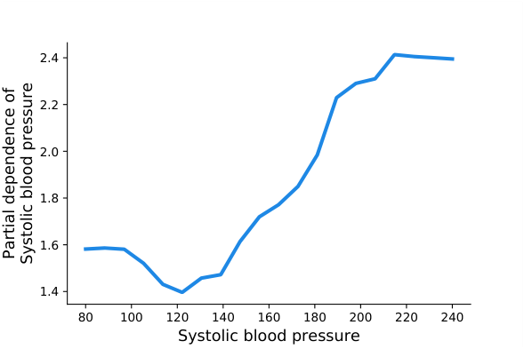

<!-- Start of picture text -->
2.4 2.2 2.0 1.8 1.6 1.4 80 100 120 140 160 180 200 220 240 Systolic blood pressure Partial dependence of Systolic blood pressure <!-- End of picture text -->

Supplementary Figure 8: **Partial dependence plot of systolic blood pressure in the mortality model.** Unlike the corresponding SHAP dependence plot in Figure 4B, the partial dependence plot gives no indication of the heterogeneity between individuals caused by interaction effects in the model. 

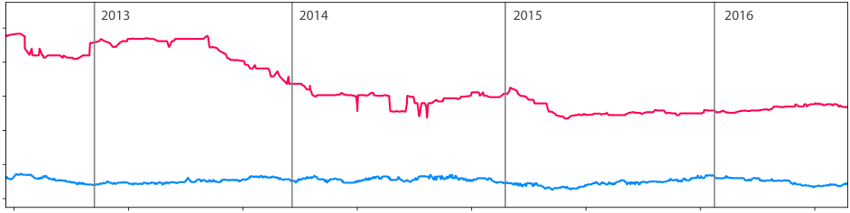

<!-- Start of picture text -->
2013 2014 2015 2016 <!-- End of picture text -->

Supplementary Figure 9: **The average duration of ablation procedures for atrial fibrillation dropped significantly during 2014.** This data was obtained directly from the electrophysiology lab to diagnose why the atrial fibrillation feature was found (using a SHAP monitoring plot) to degrade model performance (Figure 5D). The reason is that around 2014 (which was after the simulated model deployment) the duration of these procedures dropped significantly. 

42

<!-- PDF page 43 -->

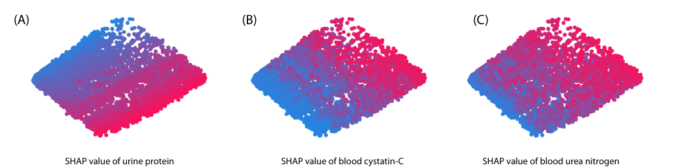

<!-- Start of picture text -->
(A) (B) (C) SHAP value of urine protein SHAP value of blood cystatin-C SHAP value of blood urea nitrogen <!-- End of picture text -->

Supplementary Figure 10: **A local explanation embedding of kidney visits projected onto its first two principle components.** This shows the next three top features beyond those shown in Figures 6B-D. The fact that these features also align with the top principal components shows how many of the important features in the data set are capturing information along two largely orthogonal dimensions. 

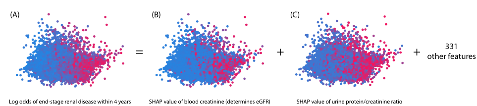

<!-- Start of picture text -->
(A) (B) (C) 331 = + + other features Log odds of end-stage renal disease within 4 years SHAP value of blood creatinine (determines eGFR) SHAP value of urine protein/creatinine ratio <!-- End of picture text -->

Supplementary Figure 11: **Principle component embedding of the chronic kidney disease dataset.** Unlike an embedding based in the local explanation space (Figures 6B-D), an unsupervised embedding of the data does not necessarily align with the outcome of interest in a dataset. 

43

<!-- PDF page 44 -->

<!-- Start of picture text -->
Global feature importance <!-- End of picture text -->

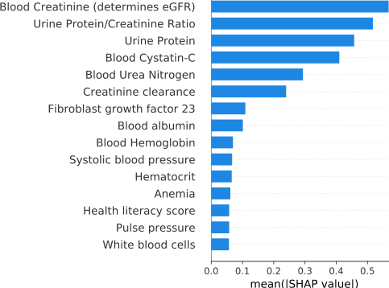

<!-- Start of picture text -->
Local explanation summary <!-- End of picture text -->

Supplementary Figure 12: **Bar chart (left) and summary plot (right) for a gradient boosted decision tree model trained on the chronic kidney disease data.** For the summary plot red dots indicate a high value of that feature for that individual, while blue dots represent a low feature value. The x-axis is the SHAP value of a feature for each individual’s prediction, representing the change in the log-hazard ratio caused by observing that feature. High blood creatinine increases the risk of end-stage kidney disease. Conversely, low creatinine clearance increases the risk of end-stage kidney disease. 

<!-- Start of picture text -->
Global feature importance <!-- End of picture text -->

<!-- Start of picture text -->
Local explanation summary <!-- End of picture text -->

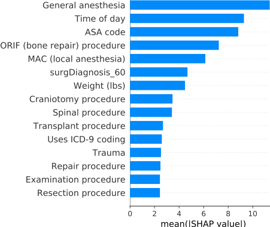

Supplementary Figure 13: **Bar chart (left) and summary plot (right) for a gradient boosted decision tree model trained on the hospital procedure duration data.** For the summary plot red dots indicate a high value of that feature for that individual, while blue dots represent a low feature value. The x-axis is the SHAP value of a feature for each individual’s prediction, representing the change in the log-hazard ratio caused by observing that feature. Many of the features are bag-of-words counts that have only a few non-zero values. Because the model is very nonlinear, the impact of a flag being on (such as the trauma flag) can have very different effects for different procedures (as shown for trauma by the horizontal dispersion of the red dots). 

44

<!-- PDF page 45 -->

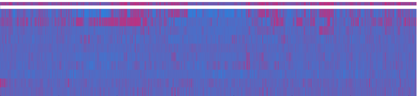

Supplementary Figure 14: **A clustering of 14,264 mortality study individuals by their normalized data values.** Standard complete linkage hierarchical clustering reveals fewer groups consistency with model risk than supervised clustering (Figure 6A ). This is because unsupervised clustering has no bias towards clusters that share common risk characteristics. Row-normalized feature SHAP values are used for coloring, as in Figure 6A. 

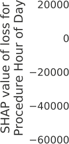

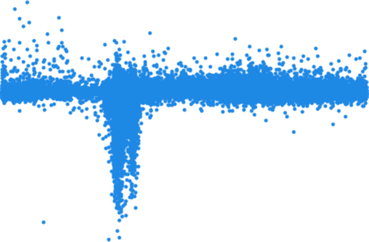

Supplementary Figure 15: **A dependence plot for time of day vs the SHAP value of time of day with respect to the model loss.** In our hospital system long running elective surgeries are scheduled at 7:20-7:30 AM on Monday/Tuesday/Thursday/Friday and at 8:20-8:30 AM on Wednesday. This plot shows that the primary way model is using time of day to reduce the model’s loss is by detecting these surgery scheduling times. Each dot is a procedure, the x-axis is the time that procedure was scheduled to begin, and the y-axis is the impact knowing the time of day had on the model’s loss for predicting that procedure’s duration (lower is better). 

45

<!-- PDF page 46 -->

#### Keep Positive (mask) - Random Forest 

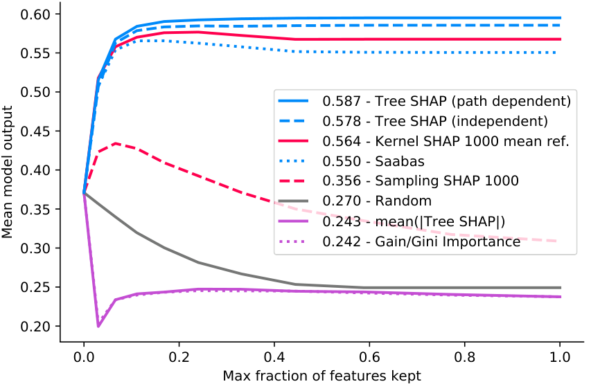

<!-- Start of picture text -->
0.60 0.55 0.50  0.587 - Tree SHAP (path dependent)  0.578 - Tree SHAP (independent) 0.45  0.564 - Kernel SHAP 1000 mean ref.  0.550 - Saabas 0.40  0.356 - Sampling SHAP 1000  0.270 - Random 0.35  0.243 - mean(|Tree SHAP|) 0.30  0.242 - Gain/Gini Importance 0.25 0.20 0.0 0.2 0.4 0.6 0.8 1.0 Max fraction of features kept Mean model output <!-- End of picture text -->

Supplementary Figure 16: **Keep positive (mask) metric for a random forest trained on the chronic kidney disease dataset.** Sorting the attribution values of an explanation method provides an ordering of the features for each prediction made by the model. Here we keep a fraction of the features ordered by how much they increase the model’s output. Features that are not kept are masked with their mean value. If the ordering is good, as we include more and more features we push the model’s output higher. Note that features with a negative contribution are always masked. The x-axis is the maximum fraction of features kept and the y-axis is the mean increase of the model over 100 predictions (averaged over 10 model’s trained on different train/test splits of the dataset). Note that the Tree SHAP and Sampling SHAP algorithms correspond to TreeExplainer and IME [71], respectively. 

46

<!-- PDF page 47 -->

#### Keep Positive (resample) - Random Forest 

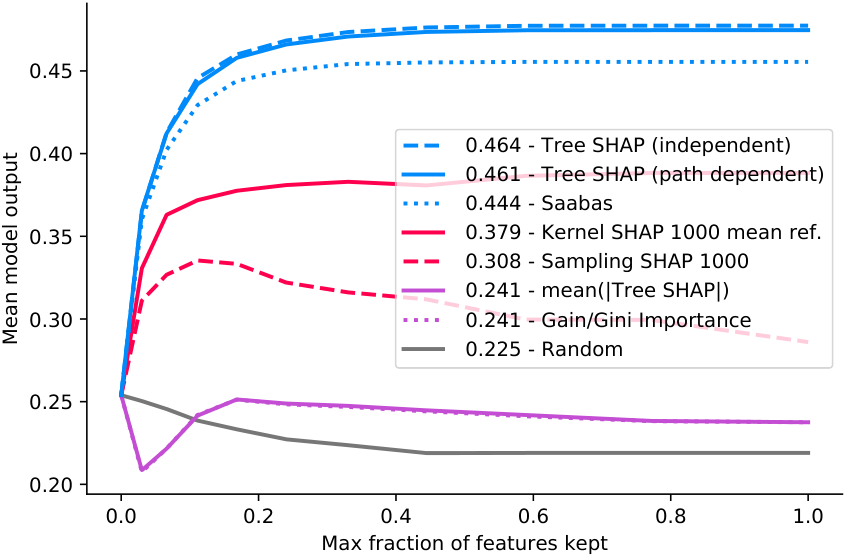

<!-- Start of picture text -->
0.45 0.40  0.464 - Tree SHAP (independent)  0.461 - Tree SHAP (path dependent)  0.444 - Saabas 0.35  0.379 - Kernel SHAP 1000 mean ref.  0.308 - Sampling SHAP 1000  0.241 - mean(|Tree SHAP|) 0.30  0.241 - Gain/Gini Importance  0.225 - Random 0.25 0.20 0.0 0.2 0.4 0.6 0.8 1.0 Max fraction of features kept Mean model output <!-- End of picture text -->

Supplementary Figure 17: **Keep positive (resample) metric for a random forest trained on the chronic kidney disease dataset.** This is just like Supplementary Figure 16 except that instead of masking the hidden features with their mean value, we instead replace them with a random sample from the training dataset. This resampling process is averaged over 100 times to integrate over the distribution of background samples. If the input features are independent of one another then this effectively computes the conditional expectation of the model output conditioned on only the observed features. Note that the Tree SHAP and Sampling SHAP algorithms correspond to TreeExplainer and IME [71], respectively. 

47

<!-- PDF page 48 -->

<!-- Start of picture text -->
Keep Positive (impute) - Random Forest <!-- End of picture text -->

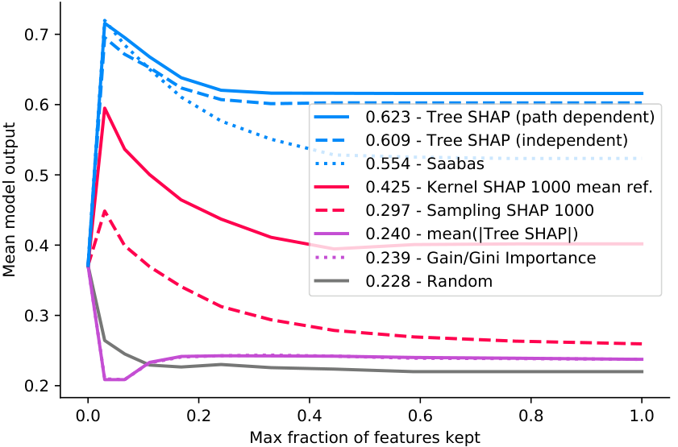

<!-- Start of picture text -->
0.7 0.6  0.623 - Tree SHAP (path dependent)  0.609 - Tree SHAP (independent)  0.554 - Saabas 0.5  0.425 - Kernel SHAP 1000 mean ref.  0.297 - Sampling SHAP 1000  0.240 - mean(|Tree SHAP|) 0.4  0.239 - Gain/Gini Importance  0.228 - Random 0.3 0.2 0.0 0.2 0.4 0.6 0.8 1.0 Max fraction of features kept Mean model output <!-- End of picture text -->

Supplementary Figure 18: **Keep positive (impute) metric for a random forest trained on the chronic kidney disease dataset.** This is just like Supplementary Figures 16 and 17 except that instead of mean masking or resampling the hidden features, we instead impute them using the covariance matrix of the training data (this is maximum likelihood imputation if we assume the input features are multivariate normal). This imputation process seeks to avoid evaluating the model on unrealistic input data. In contrast with mean imputation or resampling we assume the input feature are independent and so many provide unrealistic combinations of input features (such as pregnant men). Note that the Tree SHAP and Sampling SHAP algorithms correspond to TreeExplainer and IME [71], respectively. 

48

<!-- PDF page 49 -->

#### Keep Negative (mask) - Random Forest 

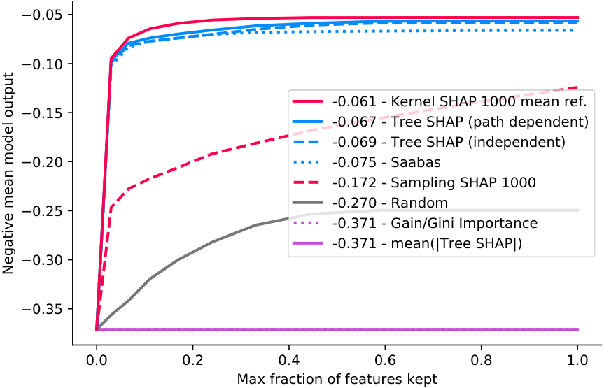

<!-- Start of picture text -->
0.05 0.10 -0.061 - Kernel SHAP 1000 mean ref. 0.15 -0.067 - Tree SHAP (path dependent) -0.069 - Tree SHAP (independent) 0.20 -0.075 - Saabas -0.172 - Sampling SHAP 1000 -0.270 - Random 0.25 -0.371 - Gain/Gini Importance -0.371 - mean(|Tree SHAP|) 0.30 0.35 0.0 0.2 0.4 0.6 0.8 1.0 Max fraction of features kept Negative mean model output <!-- End of picture text -->

Supplementary Figure 19: **Keep negative (mask) metric for a random forest trained on the chronic kidney disease dataset.** This is just like Supplementary Figure 16 except that we keep the most negative features instead of the most positive. Note that the Tree SHAP and Sampling SHAP algorithms correspond to TreeExplainer and IME [71], respectively. 

49

<!-- PDF page 50 -->

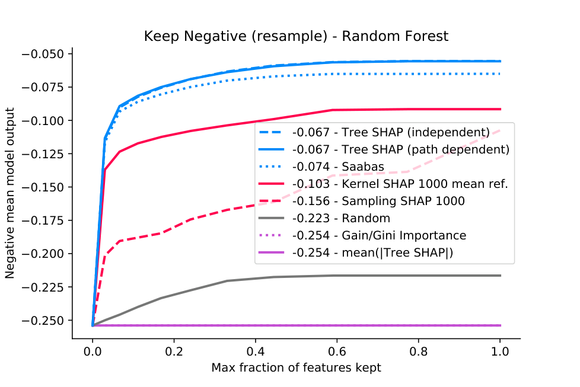

<!-- Start of picture text -->
Keep Negative (resample) - Random Forest 0.050 0.075 0.100 -0.067 - Tree SHAP (independent) 0.125 -0.067 - Tree SHAP (path dependent) -0.074 - Saabas -0.103 - Kernel SHAP 1000 mean ref. 0.150 -0.156 - Sampling SHAP 1000 0.175 -0.223 - Random -0.254 - Gain/Gini Importance 0.200 -0.254 - mean(|Tree SHAP|) 0.225 0.250 0.0 0.2 0.4 0.6 0.8 1.0 Max fraction of features kept Negative mean model output <!-- End of picture text -->

Supplementary Figure 20: **Keep negative (resample) metric for a random forest trained on the chronic kidney disease dataset.** This is just like Supplementary Figure 17 except that we keep the most negative features instead of the most positive. Note that the Tree SHAP and Sampling SHAP algorithms correspond to TreeExplainer and IME [71], respectively. 

50

<!-- PDF page 51 -->

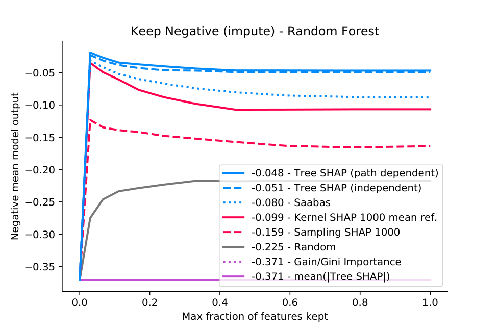

<!-- Start of picture text -->
Keep Negative (impute) - Random Forest 0.05 0.10 0.15 0.20 -0.048 - Tree SHAP (path dependent) -0.051 - Tree SHAP (independent) 0.25 -0.080 - Saabas -0.099 - Kernel SHAP 1000 mean ref. 0.30 -0.159 - Sampling SHAP 1000 -0.225 - Random -0.371 - Gain/Gini Importance 0.35 -0.371 - mean(|Tree SHAP|) 0.0 0.2 0.4 0.6 0.8 1.0 Max fraction of features kept Negative mean model output <!-- End of picture text -->

Supplementary Figure 21: **Keep negative (impute) metric for a random forest trained on the chronic kidney disease dataset.** This is just like Supplementary Figure 18 except that we keep the most negative features instead of the most positive. Note that the Tree SHAP and Sampling SHAP algorithms correspond to TreeExplainer and IME [71], respectively. 

51

<!-- PDF page 52 -->

#### Keep Absolute (mask) - Random Forest 

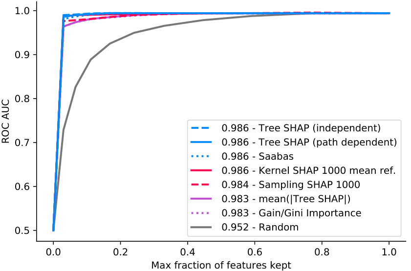

<!-- Start of picture text -->
1.0 0.9 0.8  0.986 - Tree SHAP (independent) 0.7  0.986 - Tree SHAP (path dependent)  0.986 - Saabas  0.986 - Kernel SHAP 1000 mean ref. 0.6  0.984 - Sampling SHAP 1000  0.983 - mean(|Tree SHAP|)  0.983 - Gain/Gini Importance  0.952 - Random 0.5 0.0 0.2 0.4 0.6 0.8 1.0 Max fraction of features kept ROC AUC <!-- End of picture text -->

Supplementary Figure 22: **Keep absolute (mask) metric for a random forest trained on the chronic kidney disease dataset.** This is just like Supplementary Figures 16 and 19 except that we keep the most important features by absolute value instead of the most positive or negative. Since this no longer specifically pushes the model output higher or lower, we instead measure the accuracy of the model. Good attribution methods will identify important features that when kept will result in better model accuracy, measured in this case by the area under the receiver operating characteristic (ROC) curve. Note that the Tree SHAP and Sampling SHAP algorithms correspond to TreeExplainer and IME [71], respectively. 

52

<!-- PDF page 53 -->

#### Keep Absolute (resample) - Random Forest 

<!-- Start of picture text -->
1.0 0.9 0.8  0.986 - Tree SHAP (independent) 0.7  0.986 - Tree SHAP (path dependent)  0.986 - Kernel SHAP 1000 mean ref.  0.986 - Saabas 0.6  0.984 - Sampling SHAP 1000  0.983 - mean(|Tree SHAP|)  0.983 - Gain/Gini Importance  0.956 - Random 0.5 0.0 0.2 0.4 0.6 0.8 1.0 Max fraction of features kept ROC AUC <!-- End of picture text -->

Supplementary Figure 23: **Keep absolute (resample) metric for a random forest trained on the chronic kidney disease dataset.** This is just like Supplementary Figures 17 and 20 except that we keep the most important features by absolute value instead of the most positive or negative (as in Figure 22). Note that the Tree SHAP and Sampling SHAP algorithms correspond to TreeExplainer and IME [71], respectively. 

53

<!-- PDF page 54 -->

#### Keep Absolute (resample) - Random Forest 

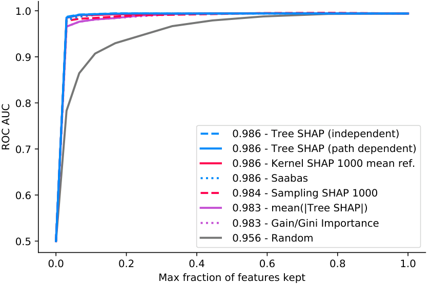

<!-- Start of picture text -->
1.0 0.9 0.8  0.986 - Tree SHAP (independent) 0.7  0.986 - Tree SHAP (path dependent)  0.986 - Kernel SHAP 1000 mean ref.  0.986 - Saabas 0.6  0.984 - Sampling SHAP 1000  0.983 - mean(|Tree SHAP|)  0.983 - Gain/Gini Importance  0.956 - Random 0.5 0.0 0.2 0.4 0.6 0.8 1.0 Max fraction of features kept ROC AUC <!-- End of picture text -->

Supplementary Figure 24: **Keep absolute (impute) metric for a random forest trained on the chronic kidney disease dataset.** This is just like Supplementary Figures 18 and 21 except that we keep the most important features by absolute value instead of the most positive or negative (as in Figure 22). Note that the Tree SHAP and Sampling SHAP algorithms correspond to TreeExplainer and IME [71], respectively. 

54

<!-- PDF page 55 -->

<!-- Start of picture text -->
Remove Positive (mask) - Random Forest <!-- End of picture text -->

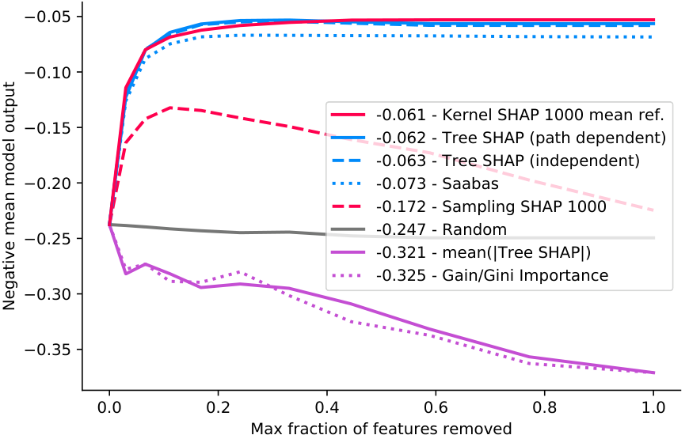

<!-- Start of picture text -->
0.05 0.10 -0.061 - Kernel SHAP 1000 mean ref. 0.15 -0.062 - Tree SHAP (path dependent) -0.063 - Tree SHAP (independent) 0.20 -0.073 - Saabas -0.172 - Sampling SHAP 1000 -0.247 - Random 0.25 -0.321 - mean(|Tree SHAP|) -0.325 - Gain/Gini Importance 0.30 0.35 0.0 0.2 0.4 0.6 0.8 1.0 Max fraction of features removed Negative mean model output <!-- End of picture text -->

Supplementary Figure 25: **Remove positive (mask) metric for a random forest trained on the chronic kidney disease dataset.** This is just like Supplementary Figure 16 except that we remove the most positive features instead of keeping them. Note that the Tree SHAP and Sampling SHAP algorithms correspond to TreeExplainer and IME [71], respectively. 

55

<!-- PDF page 56 -->

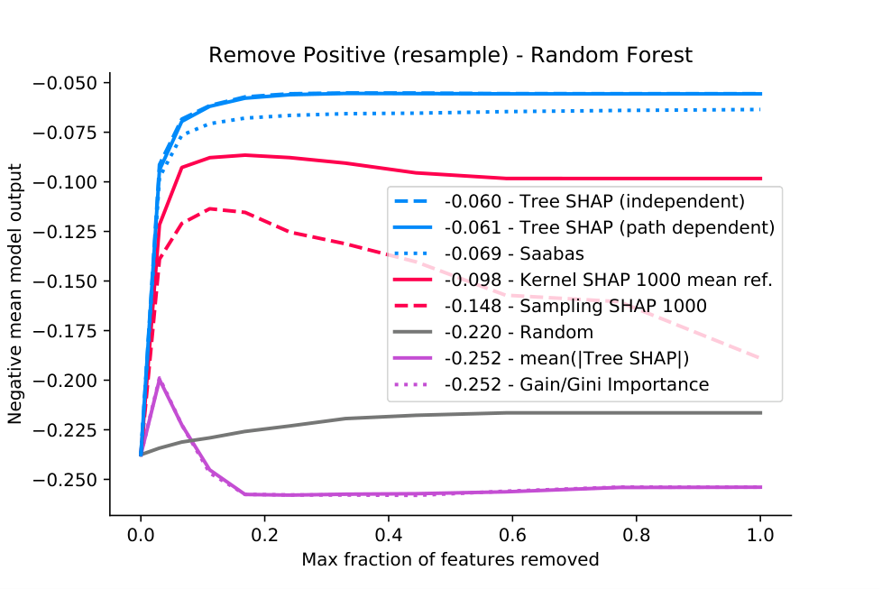

<!-- Start of picture text -->
Remove Positive (resample) - Random Forest 0.050 0.075 0.100 -0.060 - Tree SHAP (independent) 0.125 -0.061 - Tree SHAP (path dependent) -0.069 - Saabas 0.150 -0.098 - Kernel SHAP 1000 mean ref. -0.148 - Sampling SHAP 1000 0.175 -0.220 - Random -0.252 - mean(|Tree SHAP|) 0.200 -0.252 - Gain/Gini Importance 0.225 0.250 0.0 0.2 0.4 0.6 0.8 1.0 Max fraction of features removed Negative mean model output <!-- End of picture text -->

Supplementary Figure 26: **Remove positive (resample) metric for a random forest trained on the chronic kidney disease dataset.** This is just like Supplementary Figure 17 except that we remove the most positive features instead of keeping them. Note that the Tree SHAP and Sampling SHAP algorithms correspond to TreeExplainer and IME [71], respectively. 

56

<!-- PDF page 57 -->

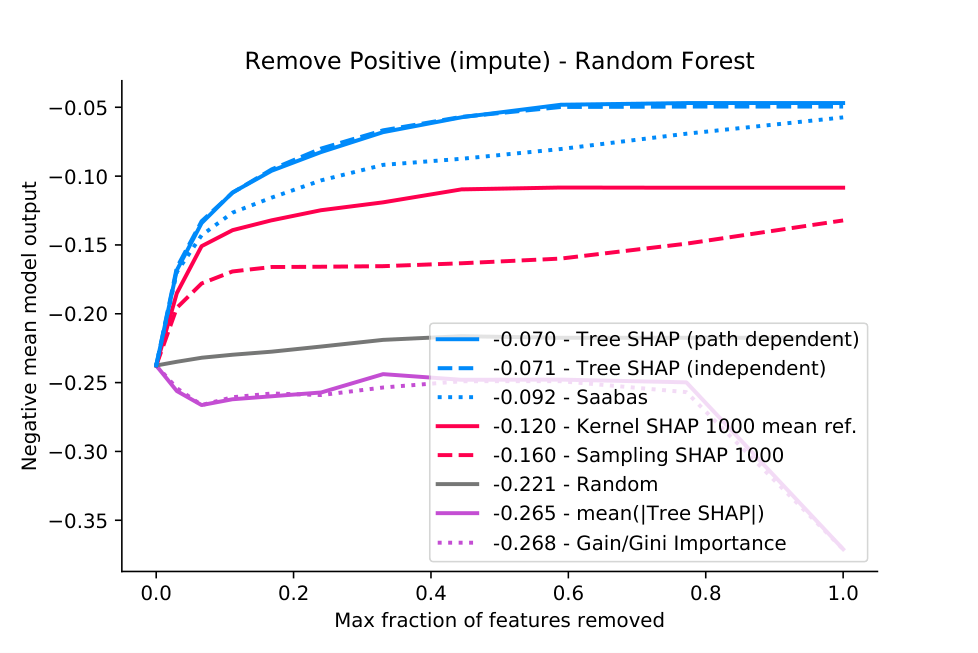

<!-- Start of picture text -->
Remove Positive (impute) - Random Forest 0.05 0.10 0.15 0.20 -0.070 - Tree SHAP (path dependent) -0.071 - Tree SHAP (independent) 0.25 -0.092 - Saabas -0.120 - Kernel SHAP 1000 mean ref. 0.30 -0.160 - Sampling SHAP 1000 -0.221 - Random 0.35 -0.265 - mean(|Tree SHAP|) -0.268 - Gain/Gini Importance 0.0 0.2 0.4 0.6 0.8 1.0 Max fraction of features removed Negative mean model output <!-- End of picture text -->

Supplementary Figure 27: **Remove positive (impute) metric for a random forest trained on the chronic kidney disease dataset.** This is just like Supplementary Figure 18 except that we remove the most positive features instead of keeping them. Note that the Tree SHAP and Sampling SHAP algorithms correspond to TreeExplainer and IME [71], respectively. 

57

<!-- PDF page 58 -->

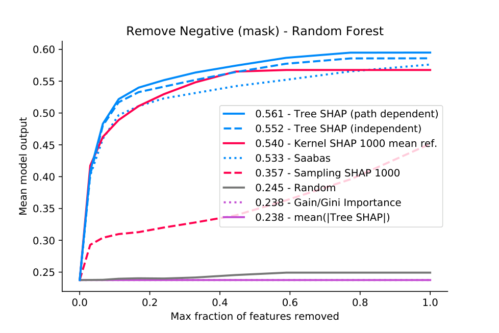

<!-- Start of picture text -->
Remove Negative (mask) - Random Forest 0.60 0.55 0.50  0.561 - Tree SHAP (path dependent)  0.552 - Tree SHAP (independent) 0.45  0.540 - Kernel SHAP 1000 mean ref.  0.533 - Saabas 0.40  0.357 - Sampling SHAP 1000  0.245 - Random  0.238 - Gain/Gini Importance 0.35  0.238 - mean(|Tree SHAP|) 0.30 0.25 0.0 0.2 0.4 0.6 0.8 1.0 Max fraction of features removed Mean model output <!-- End of picture text -->

Supplementary Figure 28: **Remove negative (mask) metric for a random forest trained on the chronic kidney disease dataset.** This is just like Supplementary Figure 19 except that we remove the most negative features instead of keeping them. Note that the Tree SHAP and Sampling SHAP algorithms correspond to TreeExplainer and IME [71], respectively. 

58

<!-- PDF page 59 -->

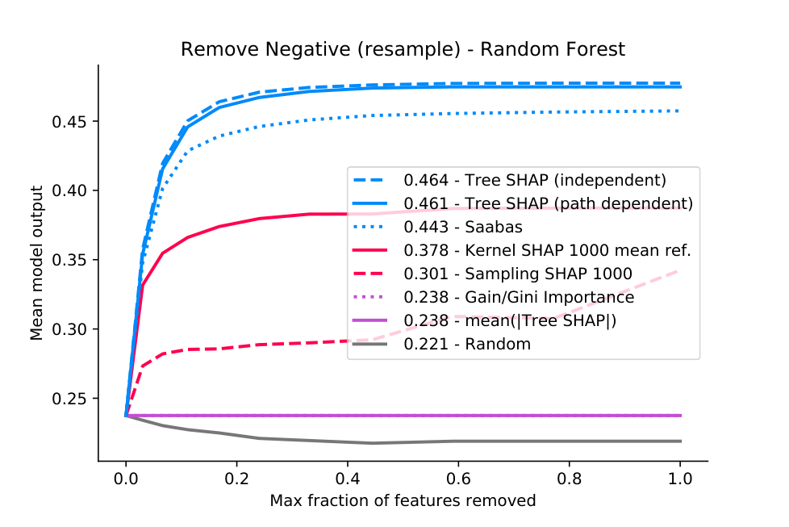

<!-- Start of picture text -->
Remove Negative (resample) - Random Forest 0.45  0.464 - Tree SHAP (independent) 0.40  0.461 - Tree SHAP (path dependent)  0.443 - Saabas  0.378 - Kernel SHAP 1000 mean ref. 0.35  0.301 - Sampling SHAP 1000  0.238 - Gain/Gini Importance  0.238 - mean(|Tree SHAP|) 0.30  0.221 - Random 0.25 0.0 0.2 0.4 0.6 0.8 1.0 Max fraction of features removed Mean model output <!-- End of picture text -->

Supplementary Figure 29: **Remove negative (resample) metric for a random forest trained on the chronic kidney disease dataset.** This is just like Supplementary Figure 20 except that we remove the most negative features instead of keeping them. Note that the Tree SHAP and Sampling SHAP algorithms correspond to TreeExplainer and IME [71], respectively. 

59

<!-- PDF page 60 -->

#### Remove Negative (impute) - Random Forest 

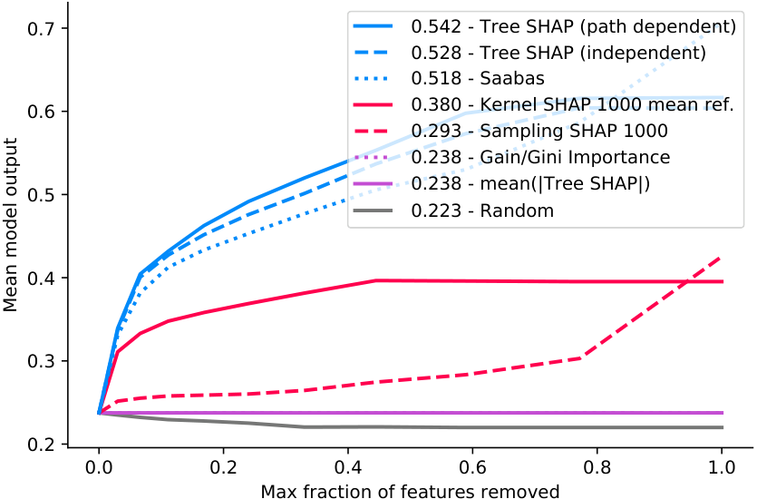

<!-- Start of picture text -->
0.7  0.542 - Tree SHAP (path dependent)  0.528 - Tree SHAP (independent)  0.518 - Saabas  0.380 - Kernel SHAP 1000 mean ref. 0.6  0.293 - Sampling SHAP 1000  0.238 - Gain/Gini Importance  0.238 - mean(|Tree SHAP|) 0.5  0.223 - Random 0.4 0.3 0.2 0.0 0.2 0.4 0.6 0.8 1.0 Max fraction of features removed Mean model output <!-- End of picture text -->

Supplementary Figure 30: **Remove negative (impute) metric for a random forest trained on the chronic kidney disease dataset.** This is just like Supplementary Figure 21 except that we remove the most negative features instead of keeping them. Note that the Tree SHAP and Sampling SHAP algorithms correspond to TreeExplainer and IME [71], respectively. 

60

<!-- PDF page 61 -->

<!-- Start of picture text -->
Remove Absolute (mask) - Random Forest 0.5 0.4 0.3  0.457 - Tree SHAP (independent) 0.2  0.412 - Tree SHAP (path dependent)  0.340 - mean(|Tree SHAP|)  0.318 - Gain/Gini Importance  0.287 - Kernel SHAP 1000 mean ref. 0.1  0.266 - Saabas  0.107 - Sampling SHAP 1000  0.080 - Random 0.0 0.0 0.2 0.4 0.6 0.8 1.0 Max fraction of features removed 1 - ROC AUC <!-- End of picture text -->

Supplementary Figure 31: **Remove absolute (mask) metric for a random forest trained on the chronic kidney disease dataset.** This is just like Supplementary Figure 22 except that we remove the most important features instead of keeping them. Note that the Tree SHAP and Sampling SHAP algorithms correspond to TreeExplainer and IME [71], respectively. 

61

<!-- PDF page 62 -->

#### Remove Absolute (resample) - Random Forest 

<!-- Start of picture text -->
 0.548 - Tree SHAP (independent) 0.7  0.540 - Tree SHAP (path dependent)  0.243 - mean(|Tree SHAP|) 0.6  0.229 - Saabas  0.216 - Gain/Gini Importance 0.5  0.169 - Kernel SHAP 1000 mean ref.  0.097 - Sampling SHAP 1000 0.4  0.079 - Random 0.3 0.2 0.1 0.0 0.0 0.2 0.4 0.6 0.8 1.0 Max fraction of features removed 1 - ROC AUC <!-- End of picture text -->

Supplementary Figure 32: **Remove absolute (resample) metric for a random forest trained on the chronic kidney disease dataset.** This is just like Supplementary Figure 23 except that we remove the most important features instead of keeping them. Note that the Tree SHAP and Sampling SHAP algorithms correspond to TreeExplainer and IME [71], respectively. 

62

<!-- PDF page 63 -->

#### Remove Absolute (impute) - Random Forest 

<!-- Start of picture text -->
0.5 0.4 0.3  0.457 - Tree SHAP (independent) 0.2  0.412 - Tree SHAP (path dependent)  0.340 - mean(|Tree SHAP|)  0.318 - Gain/Gini Importance  0.276 - Kernel SHAP 1000 mean ref. 0.1  0.266 - Saabas  0.110 - Sampling SHAP 1000  0.081 - Random 0.0 0.0 0.2 0.4 0.6 0.8 1.0 Max fraction of features removed 1 - ROC AUC <!-- End of picture text -->

Supplementary Figure 33: **Remove absolute (impute) metric for a random forest trained on the chronic kidney disease dataset.** This is just like Supplementary Figure 24 except that we remove the most important features instead of keeping them. Note that the Tree SHAP and Sampling SHAP algorithms correspond to TreeExplainer and IME [71], respectively. 

63

<!-- PDF page 64 -->

Supplementary Figure 34: **Consensus human intuition values for an AND function.** Human consensus values were measured by a user study over 33 participants for a simple AND-based function. The most popular allocation was chosen as the consensus (Methods 12). The labels denote the allocation given by people as “fever / cough / headache”. The title gives the input values for sample being explained as “fever value/cough value”, where ‘T’ is true and ‘F’ is false; note that headache is always set to true. 

Supplementary Figure 35: **Consensus human intuition values for an OR function.** Human consensus values were measured by a user study over 33 participants for a simple OR-based function. The most popular allocation was chosen as the consensus (Methods 12). The labels denote the allocation given by people as “fever / cough / headache”. The title gives the input values for sample being explained as “fever value/cough value”, where ‘T’ is true and ‘F’ is false; note that headache is always set to true. 

64

<!-- PDF page 65 -->

Supplementary Figure 36: **Consensus human intuition values for an eXclusive OR (XOR) function.** Human consensus values were measured by a user study over 33 participants for a simple XOR-based function. The most popular allocation was chosen as the consensus (Methods 12). The labels denote the allocation given by people as “fever / cough / headache”. The title gives the input values for sample being explained as “fever value/cough value”, where ‘T’ is true and ‘F’ is false; note that headache is always set to true. 

Supplementary Figure 37: **Consensus human intuition values for a SUM function.** Human consensus values were measured by a user study over 33 participants for a simple SUM function. The most popular allocation was chosen as the consensus (Methods 12). The labels denote the allocation given by people as “fever / cough / headache”. The title gives the input values for sample being explained as “fever value/cough value”, where ‘T’ is true and ‘F’ is false; note that headache is always set to true. 

65

<!-- PDF page 66 -->

<!-- Start of picture text -->
AND (true/true) - Decision Tree 8 6 4 2 0 2 Fever Cough Headache Features in the model Human Consensus 5.99 - Saabas 0.00 - Kernel SHAP 1000 mean ref. 9.00 - Gain/Gini Importance 0.00 - TreeExplainer (independent) 9.90 - mean(|TreeExplainer|) 0.00 - TreeExplainer 13.87 - Random 0.08 - IME 1000 Feature attribution value <!-- End of picture text -->

Supplementary Figure 38: **Comparison with human intuition for an AND function.** Human consensus values were measured by a user study for a simple AND-based function evaluated when all inputs were set to ‘true’ (Supplementary Figure 34). The results of different explanation methods were then compared to these consensus values to measure their consistency with human intuition (Methods 12). 

66

<!-- PDF page 67 -->

<!-- Start of picture text -->
OR (true/true) - Decision Tree 8 6 4 2 0 Fever Cough Headache Features in the model Feature attribution value <!-- End of picture text -->

<!-- Start of picture text -->
Human Consensus 5.99 - Saabas 0.00 - Kernel SHAP 1000 mean ref. 9.00 - Gain/Gini Importance 0.00 - TreeExplainer (independent) 9.88 - mean(|TreeExplainer|) 0.02 - TreeExplainer 10.78 - Random 0.29 - IME 1000 <!-- End of picture text -->

Supplementary Figure 39: **Comparison with human intuition for an OR function.** Human consensus values were measured by a user study for a simple OR-based function evaluated when all inputs were set to ‘true’ (Supplementary Figure 35). The results of different explanation methods were then compared to these consensus values to measure their consistency with human intuition (Methods 12). 

67

<!-- PDF page 68 -->

<!-- Start of picture text -->
XOR (true/true) - Decision Tree 8 6 4 2 0 2 4 Fever Cough Headache Features in the model Human Consensus 3.00 - Gain/Gini Importance 0.00 - Kernel SHAP 1000 mean ref. 3.94 - mean(|TreeExplainer|) 0.00 - TreeExplainer (independent) 8.56 - Random 0.02 - TreeExplainer 11.98 - Saabas 0.16 - IME 1000 Feature attribution value <!-- End of picture text -->

Supplementary Figure 40: **Comparison with human intuition for an eXclusive OR (XOR) function.** Human consensus values were measured by a user study for a simple XOR-based function evaluated when all inputs were set to ‘true’ (Supplementary Figure 36). The results of different explanation methods were then compared to these consensus values to measure their consistency with human intuition (Methods 12). 

68

<!-- PDF page 69 -->

## **References** 

- [1] Marco Ancona et al. “Towards better understanding of gradient-based attribution methods for Deep Neural Networks”. In: _6th International Conference on Learning Representations (ICLR 2018)_ . 2018. 

- [2] Lidia Auret and Chris Aldrich. “Empirical comparison of tree ensemble variable importance measures”. In: _Chemometrics and Intelligent Laboratory Systems_ 105.2 (2011), pp. 157–170. 

- [3] Sebastian Bach et al. “On pixel-wise explanations for non-linear classifier decisions by layer-wise relevance propagation”. In: _PloS one_ 10.7 (2015), e0130140. 

- [4] David Baehrens et al. “How to explain individual classification decisions”. In: _Journal of Machine Learning Research_ 11.Jun (2010), pp. 1803–1831. 

- [5] George L Bakris et al. “Effects of blood pressure level on progression of diabetic nephropathy: results from the RENAAL study”. In: _Archives of internal medicine_ 163.13 (2003), pp. 1555–1565. 

- [6] Benjamin Bowe et al. “Association between monocyte count and risk of incident CKD and progression to ESRD”. In: _Clinical Journal of the American Society of Nephrology_ 12.4 (2017), pp. 603–613. 

- [7] Leo Breiman. “Random forests”. In: _Machine learning_ 45.1 (2001), pp. 5–32. 

- [8] Leo Breiman et al. _Classification and regression trees_ . CRC press, 1984. 

- [9] S Chebrolu, A Abraham, and J Thomas. “Feature deduction and ensemble design of intrusion detection systems”. In: _Computers & security_ 24.4 (2005), pp. 295–307. 

- [10] Tianqi Chen and Carlos Guestrin. “XGBoost: A scalable tree boosting system”. In: _Proceedings of the 22Nd ACM SIGKDD International Conference on Knowledge Discovery and Data Mining_ . ACM. 2016, pp. 785–794. 

- [11] Alfred K Cheung et al. “Effects of intensive BP control in CKD”. In: _Journal of the American Society of Nephrology_ 28.9 (2017), pp. 2812–2823. 

- [12] François Chollet et al. _Keras_ . `https://github.com/fchollet/keras` . 2015. 

- [13] Chronic Kidney Disease Prognosis Consortium et al. “Association of estimated glomerular filtration rate and albuminuria with all-cause and cardiovascular mortality in general population cohorts: a collaborative meta-analysis”. In: _The Lancet_ 375.9731 (2010), pp. 2073–2081. 

- [14] Christine S Cox et al. “Plan and operation of the NHANES I Epidemiologic Followup Study, 1992”. In: (1997). 

- [15] Anupam Datta, Shayak Sen, and Yair Zick. “Algorithmic transparency via quantitative input influence: Theory and experiments with learning systems”. In: _Security and Privacy (SP), 2016 IEEE Symposium on_ . IEEE. 2016, pp. 598–617. 

- [16] Cameron Davidson-Pilon. _Lifelines_ . `https://github.com/camdavidsonpilon/lifelines` . 2016. 

- [17] Fangfang Fan et al. “White blood cell count predicts the odds of kidney function decline in a Chinese community-based population”. In: _BMC nephrology_ 18.1 (2017), p. 190. 

- [18] Jing Fang and Michael H Alderman. “Serum uric acid and cardiovascular mortality: the NHANES I epidemiologic follow-up study, 1971-1992”. In: _Jama_ 283.18 (2000), pp. 2404–2410. 

- [19] Jerome H Friedman. “Greedy function approximation: a gradient boosting machine”. In: _Annals of statistics_ (2001), pp. 1189–1232. 

- [20] Jerome Friedman, Trevor Hastie, and Robert Tibshirani. _The elements of statistical learning_ . Vol. 1. Springer series in statistics Springer, Berlin, 2001. 

- [21] Katsushige Fujimoto, Ivan Kojadinovic, and Jean-Luc Marichal. “Axiomatic characterizations of probabilistic and cardinal-probabilistic interaction indices”. In: _Games and Economic Behavior_ 55.1 (2006), pp. 72–99. 

- [22] Robin Genuer, Jean-Michel Poggi, and Christine Tuleau-Malot. “Variable selection using random forests”. In: _Pattern Recognition Letters_ 31.14 (2010), pp. 2225–2236. 

- [23] SPRINT Research Group. “A randomized trial of intensive versus standard blood-pressure control”. In: _New England Journal of Medicine_ 373.22 (2015), pp. 2103–2116. 

69

<!-- PDF page 70 -->

- [24] Patrick J Heagerty, Thomas Lumley, and Margaret S Pepe. “Time-dependent ROC curves for censored survival data and a diagnostic marker”. In: _Biometrics_ 56.2 (2000), pp. 337–344. 

- [25] Sara Hooker et al. “Evaluating feature importance estimates”. In: _arXiv preprint arXiv:1806.10758_ (2018). 

- [26] A Irrthum, L Wehenkel, P Geurts, et al. “Inferring regulatory networks from expression data using tree-based methods”. In: _PloS one_ 5.9 (2010), e12776. 

- [27] Hemant Ishwaran et al. “Variable importance in binary regression trees and forests”. In: _Electronic Journal of Statistics_ 1 (2007), pp. 519–537. 

- [28] Rui Jiang et al. “A random forest approach to the detection of epistatic interactions in case-control studies”. In: _BMC bioinformatics_ 10.1 (2009), S65. 

- [29] Kaggle. _The State of ML and Data Science 2017_ . 2017. url: `https://www.kaggle.com/surveys/2017` . [30] Jared L Katzman et al. “DeepSurv: personalized treatment recommender system using a Cox proportional hazards deep neural network”. In: _BMC medical research methodology_ 18.1 (2018), p. 24. 

- [31] Jalil Kazemitabar et al. “Variable Importance using Decision Trees”. In: _Advances in Neural Information Processing Systems_ . 2017, pp. 426–435. 

- [32] Guolin Ke et al. “Lightgbm: A highly efficient gradient boosting decision tree”. In: _Advances in Neural Information Processing Systems_ . 2017, pp. 3146–3154. 

- [33] _Kidney Disease Statistics for the United States_ . 2018. url: `https://www.niddk.nih.gov/healthinformation/health-statistics/kidney-disease` . 

- [34] Masaomi Kimura et al. “Comparison of lesion formation between contact force-guided and non-guided circumferential pulmonary vein isolation: a prospective, randomized study.” In: _Heart rhythm_ 11.6 (June 2014), pp. 984–91. issn: 1556-3871. doi: `10 . 1016 / j . hrthm . 2014 . 03 . 019` . url: `https : //linkinghub.elsevier.com/retrieve/pii/S1547527114003002%20http://www.ncbi.nlm.nih. gov/pubmed/24657428` . 

- [35] Pieter-Jan Kindermans et al. “Learning how to explain neural networks: PatternNet and PatternAttribution”. In: _arXiv preprint arXiv:1705.05598_ (2017). 

- [36] Karl-Heinz Kuck et al. “Cryoballoon or Radiofrequency Ablation for Paroxysmal Atrial Fibrillation”. In: _New England Journal of Medicine_ 374.23 (June 2016), pp. 2235–2245. issn: 0028-4793. doi: `10.1056/NEJMoa1602014` . url: `http://www.nejm.org/doi/10.1056/NEJMoa1602014` . 

- [37] James P Lash et al. “Chronic Renal Insufficiency Cohort (CRIC) Study: baseline characteristics and associations with kidney function”. In: _Clinical Journal of the American Society of Nephrology_ 4.8 (2009), pp. 1302–1311. 

- [38] Lenore J Launer et al. “Body mass index, weight change, and risk of mobility disability in middle-aged and older women: the epidemiologic follow-up study of NHANES I”. In: _Jama_ 271.14 (1994), pp. 1093– 1098. 

- [39] Stan Lipovetsky and Michael Conklin. “Analysis of regression in game theory approach”. In: _Applied Stochastic Models in Business and Industry_ 17.4 (2001), pp. 319–330. 

- [40] Gilles Louppe. “Understanding random forests: From theory to practice”. In: _arXiv preprint arXiv:1407.7502_ (2014). 

- [41] Scott M Lundberg and Su-In Lee. “A Unified Approach to Interpreting Model Predictions”. In: _Advances in Neural Information Processing Systems 30_ . 2017, pp. 4768–4777. url: `http://papers.nips.cc/ paper/7062-a-unified-approach-to-interpreting-model-predictions.pdf` . 

- [42] Scott M Lundberg et al. “Explainable machine learning predictions to help anesthesiologists prevent hypoxemia during surgery”. In: _Nature Biomedical Engineering_ 2 (2018), pp. 749–760. 

- [43] Kathryn L Lunetta et al. “Screening large-scale association study data: exploiting interactions using random forests”. In: _BMC genetics_ 5.1 (2004), p. 32. 

70

<!-- PDF page 71 -->

- [44] Eloi Marijon et al. “Real-time contact force sensing for pulmonary vein isolation in the setting of paroxysmal atrial fibrillation: procedural and 1-year results.” In: _Journal of cardiovascular electrophysiology_ 25.2 (Feb. 2014), pp. 130–7. issn: 1540-8167. doi: `10 . 1111 / jce . 12303` . url: `http : //doi.wiley.com/10.1111/jce.12303%20http://www.ncbi.nlm.nih.gov/pubmed/24433324` . 

- [45] Yasuko Matsui and Tomomi Matsui. “NP-completeness for calculating power indices of weighted majority games”. In: _Theoretical Computer Science_ 263.1-2 (2001), pp. 305–310. 

- [46] Kunihiro Matsushita et al. “Comparison of risk prediction using the CKD-EPI equation and the MDRD study equation for estimated glomerular filtration rate”. In: _Jama_ 307.18 (2012), pp. 1941–1951. 

- [47] Kunihiro Matsushita et al. “Estimated glomerular filtration rate and albuminuria for prediction of cardiovascular outcomes: a collaborative meta-analysis of individual participant data”. In: _The lancet Diabetes & endocrinology_ 3.7 (2015), pp. 514–525. 

- [48] Dariush Mozaffarian et al. “Heart disease and stroke statistics—2016 update: a report from the American Heart Association”. In: _Circulation_ (2015), CIR–0000000000000350. 

- [49] Paula F Orlandi et al. “Hematuria as a risk factor for progression of chronic kidney disease and death: findings from the Chronic Renal Insufficiency Cohort (CRIC) Study”. In: _BMC nephrology_ 19.1 (2018), p. 150. 

- [50] Feng Pan et al. “Feature selection for ranking using boosted trees”. In: _Proceedings of the 18th ACM conference on Information and knowledge management_ . ACM. 2009, pp. 2025–2028. 

- [51] Fabian Pedregosa et al. “Scikit-learn: Machine learning in Python”. In: _Journal of machine learning research_ 12.Oct (2011), pp. 2825–2830. 

- [52] H Mitchell Perry Jr et al. “Early predictors of 15-year end-stage renal disease in hypertensive patients”. In: _Hypertension_ 25.4 (1995), pp. 587–594. 

- [53] Gregory Plumb, Denali Molitor, and Ameet S Talwalkar. “Model Agnostic Supervised Local Explanations”. In: _Advances in Neural Information Processing Systems_ . 2018, pp. 2520–2529. 

- [54] Liudmila Prokhorenkova et al. “CatBoost: unbiased boosting with categorical features”. In: _Advances in Neural Information Processing Systems_ . 2018, pp. 6637–6647. 

- [55] Marco Tulio Ribeiro, Sameer Singh, and Carlos Guestrin. “Anchors: High-precision model-agnostic explanations”. In: _AAAI Conference on Artificial Intelligence_ . 2018. 

- [56] Marco Tulio Ribeiro, Sameer Singh, and Carlos Guestrin. “Why should i trust you?: Explaining the predictions of any classifier”. In: _Proceedings of the 22nd ACM SIGKDD_ . ACM. 2016, pp. 1135–1144. 

- [57] Stephanie M van Rooden et al. “The identification of Parkinson’s disease subtypes using cluster analysis: a systematic review”. In: _Movement disorders_ 25.8 (2010), pp. 969–978. 

- [58] Steven J Rosansky et al. “The association of blood pressure levels and change in renal function in hypertensive and nonhypertensive subjects”. In: _Archives of internal medicine_ 150.10 (1990), pp. 2073– 2076. 

- [59] Alvin E Roth. _The Shapley value: essays in honor of Lloyd S. Shapley_ . Cambridge University Press, 1988. 

- [60] A. Saabas. _treeinterpreter Python package_ . url: `https://github.com/andosa/treeinterpreter` . 

- [61] Marco Sandri and Paola Zuccolotto. “A bias correction algorithm for the Gini variable importance measure in classification trees”. In: _Journal of Computational and Graphical Statistics_ 17.3 (2008), pp. 611–628. 

- [62] Mark J Sarnak et al. “The effect of a lower target blood pressure on the progression of kidney disease: long-term follow-up of the modification of diet in renal disease study”. In: _Annals of internal medicine_ 142.5 (2005), pp. 342–351. 

- [63] Lloyd S Shapley. “A value for n-person games”. In: _Contributions to the Theory of Games_ 2.28 (1953), pp. 307–317. 

- [64] Edward H Shortliffe and Martin J Sepúlveda. “Clinical Decision Support in the Era of Artificial Intelligence”. In: _Jama_ 320.21 (2018), pp. 2199–2200. 

71

<!-- PDF page 72 -->

- [65] Avanti Shrikumar et al. “Not Just a Black Box: Learning Important Features Through Propagating Activation Differences”. In: _arXiv preprint arXiv:1605.01713_ (2016). 

- [66] Neil B Shulman et al. “Prognostic value of serum creatinine and effect of treatment of hypertension on renal function. Results from the hypertension detection and follow-up program. The Hypertension Detection and Follow-up Program Cooperative Group.” In: _Hypertension_ 13.5 Suppl (1989), p. I80. 

- [67] Therese Sørlie et al. “Repeated observation of breast tumor subtypes in independent gene expression data sets”. In: _Proceedings of the national academy of sciences_ 100.14 (2003), pp. 8418–8423. 

- [68] Jost Tobias Springenberg et al. “Striving for simplicity: The all convolutional net”. In: _arXiv preprint arXiv:1412.6806_ (2014). 

- [69] Carolin Strobl et al. “Bias in random forest variable importance measures: Illustrations, sources and a solution”. In: _BMC bioinformatics_ 8.1 (2007), p. 25. 

- [70] C Strobl et al. “Conditional variable importance for random forests”. In: _BMC bioinformatics_ 9.1 (2008), p. 307. 

- [71] Erik Štrumbelj and Igor Kononenko. “Explaining prediction models and individual predictions with feature contributions”. In: _Knowledge and information systems_ 41.3 (2014), pp. 647–665. 

- [72] Mukund Sundararajan, Ankur Taly, and Qiqi Yan. “Axiomatic attribution for deep networks”. In: _arXiv preprint arXiv:1703.01365_ (2017). 

- [73] Navdeep Tangri et al. “Multinational assessment of accuracy of equations for predicting risk of kidney failure: a meta-analysis”. In: _Jama_ 315.2 (2016), pp. 164–174. 

- [74] W Gordon Walker et al. “Renal function change in hypertensive members of the Multiple Risk Factor Intervention Trial: racial and treatment effects”. In: _JAMA_ 268.21 (1992), pp. 3085–3091. 

- [75] F Perry Wilson et al. “Urinary creatinine excretion, bioelectrical impedance analysis, and clinical outcomes in patients with CKD: the CRIC study”. In: _Clinical Journal of the American Society of Nephrology_ 9.12 (2014), pp. 2095–2103. 

- [76] H Peyton Young. “Monotonic solutions of cooperative games”. In: _International Journal of Game Theory_ 14.2 (1985), pp. 65–72. 

- [77] Matthew D Zeiler and Rob Fergus. “Visualizing and understanding convolutional networks”. In: _European conference on computer vision_ . Springer. 2014, pp. 818–833. 

- [78] Martin Zinkevich. _Rules of Machine Learning: Best Practices for ML Engineering_ . 2017. 

72
