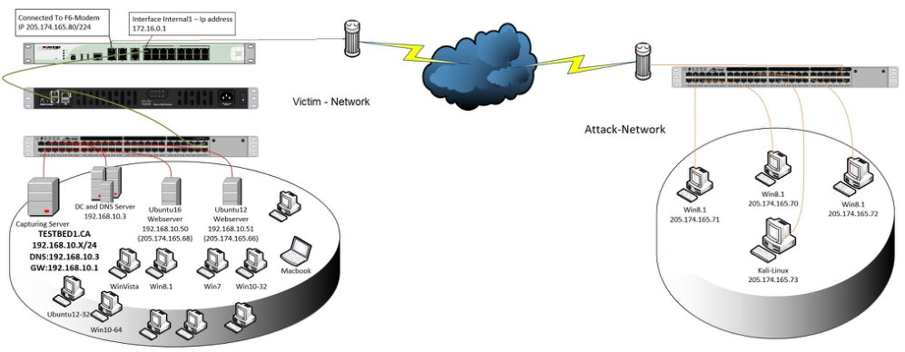
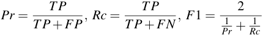

[Original PDF](toward-generating-intrusion-model.pdf)

<!-- Converted locally with PyMuPDF 2.0. The source language is preserved. Page comments refer to PDF pages. -->

<!-- PDF page 1 -->

# Toward Generating a New Intrusion Detection Dataset and Intrusion Traffic Characterization

Iman Sharafaldin, Arash Habibi Lashkari and Ali A. Ghorbani

_Canadian Institute for Cybersecurity (CIC), University of New Brunswick (UNB), Canada_

**Keywords:** Intrusion Detection, IDS Dataset, DoS, Web Attack, Infiltration, Brute Force.

## Abstract

With exponential growth in the size of computer networks and developed applications, the significant increasing of the potential damage that can be caused by launching attacks is becoming obvious. Meanwhile, Intrusion Detection Systems (IDSs) and Intrusion Prevention Systems (IPSs) are one of the most important defense tools against the sophisticated and ever-growing network attacks. Due to the lack of adequate dataset, anomaly-based approaches in intrusion detection systems are suffering from accurate deployment, analysis and evaluation. There exist a number of such datasets such as DARPA98, KDD99, ISC2012, and ADFA13 that have been used by the researchers to evaluate the performance of their proposed intrusion detection and intrusion prevention approaches. Based on our study over eleven available datasets since 1998, many such datasets are out of date and unreliable to use. Some of these datasets suffer from lack of traffic diversity and volumes, some of them do not cover the variety of attacks, while others anonymized packet information and payload which cannot reflect the current trends, or they lack feature set and metadata. This paper produces a reliable dataset that contains benign and seven common attack network flows, which meets real world criteria and is publicly avaliable. Consequently, the paper evaluates the performance of a comprehensive set of network traffic features and machine learning algorithms to indicate the best set of features for detecting the certain attack categories.

## 1 INTRODUCTION

Intrusion detection plays a vital role in the network defense process by aiming security administrators in forewarning them about malicious behaviors such as intrusions, attacks, and malware. Having IDS is a mandatory line of defense for protecting critical networks against these ever-increasing issues of intrusive activities. So, research on IDS domain has flourished over the years to propose the better IDS systems. However, many researchers struggle to find comprehensive and valid datasets to test and evaluate their proposed techniques (Koch et al., 2017) and having a suitable dataset is a significant challenge itself (Nehinbe, 2011).

On one hand, many such datasets cannot be shared due to the privacy issues. On the other hand, those that become available are heavily anonymized and do not reflect the current trends, even though, the lack of traffic variety and attack diversity is evident in most of them. Therefore, based on the lack of certain statistical characteristics and the unavailability of these

datasets a perfect dataset is yet to be realized (Nehinbe, 2011; Ali Shiravi and Ghorbani, 2012). It is also necessary to mention that due to malware evolution and the continuous changes in attack strategies, benchmark datasets need to be updated periodically (Nehinbe, 2011).

Since 1999, Scott _et al._ (Scott and Wilkins, 1999), Heideman and Papadopulus (Heidemann and Papdopoulos, 2009), Ghorbani _et al._ (Ghorbani Ali and Mahbod, 2010), Nehinbe (Nehinbe, 2011), Shiravi _et al._ (Ali Shiravi and Ghorbani, 2012), and Sharfaldin _et al._ (Gharib et al., 2016) tried to propose an evaluation framework for IDS datasets. According to the last research and proposed evaluation framework, eleven characteristics, namely Attack Diversity, Anonymity, Available Protocols, Complete Capture, Complete Interaction, Complete Network Configuration, Complete Traffic, Feature Set, Heterogeneity, Labelling, and Metadata are critical for a comprehensive and valid IDS dataset (Gharib et al., 2016). **Our Contributions:** Our contributions in this paper are twofold. Firstly, we generate a new IDS dataset namely CICIDS2017, which covers all the eleven

_The first two authors contributed equally to this work._

> Sharafaldin, I., Lashkari, A. and Ghorbani, A.
> Toward Generating a New Intrusion Detection Dataset and Intrusion Traffic Characterization.
> DOI: 10.5220/0006639801080116
> In Proceedings of the 4th International Conference on Information Systems Security and Privacy (ICISSP 2018), pages 108-116
> ISBN: 978-989-758-282-0
> Copyright © 2018 by SCITEPRESS – Science and Technology Publications, Lda. All rights reserved

<!-- PDF page 2 -->

necessary criteria with common updated attacks such as DoS, DDoS, Brute Force, XSS, SQL Injection, Infiltration, Port scan and Botnet. The dataset is completely labelled and more than 80 network traffic features extracted and calculated for all benign and intrusive flows by using CICFlowMeter software which is publicly available in Canadian Institute for Cybersecurity website (Habibi Lashkari et al., 2017). Secondly, the paper analyzes the generated dataset to select the best feature sets to detect different attacks and also we executed seven common machine learning algorithms to evaluate our dataset.

The rest of the paper is organized as follows. An overview of the current available datasets between 1998 and 2016 is presented in Section 2. Section 3 discusses the designed network topology and the attack scenarios. Section 4 presents the generated dataset with explanation of eleven characteristics. Finally, the feature selection and machine learning analysis is discussed in section 5.

## 2 AVAILABLE DATASETS

In this section, we analyze and evaluate the eleven publicly available IDS datasets since 1998 to demonstrate their shortages and issues that reflect the real need for a comprehensive and reliable dataset. **DARPA (Lincoln Laboratory 1998-99):** The dataset was constructed for network security analysis and exposed the issues associated with the artificial injection of attacks and benign traffic. This dataset includes e- mail, browsing, FTP, Telnet, IRC, and SNMP activities. It contains attacks such as DoS, Guess password, Buffer overflow, remote FTP, Syn flood, Nmap, and Rootkit. This dataset does not represent real-world network traffic, and contains irregularities such as the absence of false positives. Also, the dataset is outdated for the effective evaluation of IDSs on modern networks, both in terms of attack types and network infrastructure. Moreover, it lacks actual attack data records (McHugh, 2000) (Brown et al., 2009).

**KDD’99 (University of California, Irvine 1998-99):** This dataset is an updated version of the DARPA98, by processing the tcpdump portion. It contains different attacks such as Neptune-DoS, pod-DoS, SmurfDoS, and buffer-overflow (University of California, 2007). The benign and attack traffic are merged together in a simulated environment. This dataset has a large number of redundant records and is studded by data corruptions that led to skewed testing results (Tavallaee et al., 2009). NSL-KDD was created using KDD (Tavallaee et al., 2009) to address some of the KDD’s shortcomings (McHugh, 2000).

**DEFCON (The Shmoo Group, 2000-2002:** The DEFCON-8 dataset created in 2000 contains port scanning and buffer overflow attacks, whereas DEFCON-10 dataset, which was created in 2002, contains port scan and sweeps, bad packets, administrative privilege, and FTP by Telnet protocol attacks. In this dataset, the traffic produced during the “Capture the Flag (CTF)” competition is different from the real world network traffic since it mainly consists of intrusive traffic as opposed to normal background traffic. This dataset is used to evaluate alert correlation techniques (Nehinbe, 2010) (Group, 2000).

**CAIDA (Center of Applied Internet Data Analysis 2002-2016):** This organization has three different datasets, the CAIDA OC48, which includes different types of data observed on an OC48 link in San Jose, the CAIDA DDOS, which includes one-hour DDoS attack traffic split of 5-minute pcap files, and the CAIDA Internet traces 2016, which is passive traffic traces from CAIDA’s Equinix-Chicago monitor on the High-speed Internet backbone. Most of CAIDAs datasets are very specific to particular events or attacks and are anonymized with their payload, protocol information, and destination. These are not the effective benchmarking datasets due to a number of shortcomings, see (for Applied Internet Data Analysis (CAIDA), 2002) (for Applied Internet Data Analysis (CAIDA), 2007) (for Applied Internet Data Analysis (CAIDA), 2016) (Proebstel, 2008) (Ali Shiravi and Ghorbani, 2012) for details.

**LBNL (Lawrence Berkeley National Laboratory and ICSI 2004-2005):** The dataset is full header network traffic recorded at a medium-sized site. It does not have payload and suffers from a heavy anonymization to remove any information which could identify an individual IP (Nechaev et al., 2004). **CDX (United States Military Academy 2009):** This dataset represents the network warfare competitions, that can be utilized to generate modern day labelled dataset. It includes network traffic such as Web, email, DNS lookups, and other required services. The attackers used the attack tools such as Nikto, Nessus, and WebScarab to carry out reconnaissance and attacks automatically. This dataset can be used to test IDS alert rules, but it suffers from the lack of traffic diversity and volume (Sangster et al., 2009).

**Kyoto (Kyoto University 2009):** This dataset has been created through honypots, so there is no process for manual labelling and anonymization, but it has limited view of the network traffic because only attacks directed at the honeypots can be observed. It has ten extra features such as IDS Detection, Malware Detection, and Ashula Detection than previous available datasets which are useful in NIDS analy-

<!-- PDF page 3 -->

sis and evaluation. The normal traffic here has been simulated repeatedly during the attacks and producing only DNS and mail traffic data, which is not reflected in real world normal network traffic, so there are no false positives, which are important for minimizing the number of alerts (Song et al., 2011) (M. Sato, 2012) (R. Chitrakar, 2012).

**Twente (University of Twente 2009):** This dataset includes three services such as OpenSSH, Apache web server and Proftp using auth/ident on port 113 and captured data from a honeypot network by Netflow. There is some simultaneous network traffic such as auth/ident, ICMP, and IRC traffic, which are not completely benign or malicious. Moreover, this dataset contains some unknown and uncorrelated alerts traffic. It is labelled and is more realistic, but the lack of volume and diversity of attacks is obvious (Sperotto et al., 2009).

**UMASS (University of Massachusetts 2011):** The dataset includes trace files, which are network packets, and some traces on wireless applications (of Massachusetts Amherst, 2011) (Nehinbe, 2011). It has been generated using a single TCP-based download request attack scenario. The dataset is not useful for testing IDS and IPS techniques due to the lack of variety of traffic and attacks (Swagatika Prusty and Liberatore, 2011).

**ISCX2012 (University of New Brunswick 2012):** This dataset has two profiles, the Alpha-profile which carried out various multi-stage attack scenarios, and the Beta-profile, which is the benign traffic generator and generates realistic network traffic with background noise. It includes network traffic for HTTP, SMTP, SSH, IMAP, POP3, and FTP protocols with full packet payload. However, it does not represent new network protocols since nearly 70% of todays network traffics are HTTPS and there are no HTTPS traces in this dataset. Moreover, the distribution of the simulated attacks is not based on real world statistics (Ali Shiravi and Ghorbani, 2012).

**ADFA (University of New South Wales 2013):** This dataset includes normal training and validating data and 10 attacks per vector (Creech and Hu, 2013). It contains FTP and SSH password brute force, Java based Meterpreter, Add new Superuser, Linux Meterpreter payload and C100 Webshel attacks. In addition to the lack of attack diversity and variety of attacks, the behaviors of some attacks in this dataset are not well separated from the normal behavior (Xie and Hu, 2013) (Xie et al., 2014).

## 3 EXPERIMENTS

To create a comprehensive testbed, we designed and implemented two networks, namely Attack-Network and Victim-Network. The Victim-Network is a high secure infrastructure with Firewall, Router, switches and most of the common operating systems along with an agent that provide the benign behaviors on each PC. The Attack-Network is a completely separated infrastructure designed by a router and switch and a set of PCs with public IPs and different necessary operating systems for executing the attack scenarios. The following sections discuss the infrastructure, benign profile agent and attack scenarios.

### 3.1 Testbed Architecture

As Figure 1 shows, our testbed infrastructure has been divided into two completely separated networks, namely Victim-Network and Attack-Network. Unlike the previous datasets, in the Victim-Network, we covered all common and necessary equipments, including router, firewall, switch, along with the different versions of the common three operating systems namely Windows, Linux and Macintosh.

Table 1 shows the list of servers, workstations and firewall, with installed operating systems and related public and private IPs. The Attack-Network includes one router, one switch and four PCs, which have the Kali and Windows 8.1 operating systems. The Victim-Network consists three servers, one firewall, two switches and ten PCs interconnected by a domain controller (DC) and active directory. Also, one port in the main switch of the Victim-Network has been configured as the mirror port and completely captured all send and receive traffic to the network.

### 3.2 Benign Profile Agent

Generating the realistic background traffic is one of the highest priorities of this work. For this dataset, we used our proposed B-Profile system (Sharafaldin et al., 2017), which is responsible for profiling the abstract behavior of human interactions and generate a naturalistic benign background traffic. Our B- Profile for this dataset extracts the abstract behavior of 25 users based on the HTTP, HTTPS, FTP, SSH, and email protocols.

At First, it tries to encapsulate network events produced by users with machine learning and statistical analysis techniques. The encapsulated features are distributions of packet sizes of a protocol, the number of packets per flow, certain patterns in the payload, the size of the payload, and request time distribution

<!-- PDF page 4 -->

Table 1: Victim-Network Operating Systems and IPs.

| Network | Machine | OS | IPs |
|---|---|---|---|
| Victim-Network | Servers | Win Server 2016 (DC and DNS) | 192.168.10.3 |
| Victim-Network | Servers | Ubuntu 16 (Web Server) | 192.168.10.50- 205.174.165.68 |
| Victim-Network | Servers | Ubuntu 12 | 192.168.10.51- 205.174.165.66 |
| Victim-Network | PCs | Ubuntu 14.4 (32, 64) | 192.168.10.19- 192168.10.17 |
| Victim-Network | PCs | Ubuntu 16.4 (32-64) | 192.168.10.16- 192.168.10.12 |
| Victim-Network | PCs | Win 7Pro | 192.168.10.9 |
| Victim-Network | PCs | Win 8.1-64 | 192.168.10.5 |
| Victim-Network | PCs | Win Vista | 192.168.10.8 |
| Victim-Network | PCs | Win 10 (Pro 32-64) | 192.168.10.14- 192.168.10.15 |
| Victim-Network | PCs | Mac | 192.168.10.25 |
| Victim-Network | Firewall | Fortinet | |
| Attackers | PCs | Kali | 205.174.165.73 |
| Attackers | PCs | win 8.1 | 205.174.165.69 |
| Attackers | PCs | Win 8.1 | 205.174.165.70 |
| Attackers | PCs | Win 8.1 | 205.174.165.71 |

of protocols. Then, after deriving the B-Profiles from users, an agent which has been developed by Java is used to generating realistic benign events and simultaneously perform B-Profile on the Victim-Network for predefined five protocols.

access to the device and its connection. **DoS Attack:** The attacker seeks to make a machine or network resource unavailable temporarily. It typically accomplished by flooding the targeted machine or resource with superfluous requests in an attempt to overload systems and prevent some or all legitimate requests from being fulfilled.

**DDoS Attack:** It typically occurs when multiple systems, flood the bandwidth or resources of a victim. Such an attack is often the result of multiple compromised systems (for example, a botnet) flooding the targeted system with generating the huge network traffic.

**Web Attack:** This attack types are coming out every day, because individuals and organizations take security seriously now. We use the SQL Injection, which an attacker can create a string of SQL commands, and then use it to force the database to reply the information, Cross-Site Scripting (XSS) which is happening when developers dont test their code properly to find the possibility of script injection, and Brute Force over HTTP which can tries a list of passwords to find the administrator’s password.

**Infiltration Attack:** The infiltration of the network from inside is normally exploiting a vulnerable software such as Adobe Acrobat Reader. After successful exploitation, a backdoor will be executed on the victim’s computer and can conduct different attacks on the victim’s network such as IP sweep, full port scan and service enumerations using Nmap.

### 3.3 Attack Profiles and Scenarios

## 4 DATASET

Since CICIDS2017 is intended for network security and intrusion detection purposes, it should cover a diverse set of attack scenarios. In this dataset, we create six attack profiles based on the last updated list of common attack families and execute them by using related tools and codes.

**Brute Force Attack:** This is one of the most popular attacks that only cannot be used for password cracking, but also to discover hidden pages and content in a web application. It is basically a hit and try attack, then the victim succeeds.

**Heartbleed Attack:** It comes from a bug in the OpenSSL cryptography library, which is a widely used implementation of the Transport Layer Security (TLS) protocol. It is normally exploited by sending a malformed heartbeat request with a small payload and large length field to the vulnerable party (usually a server) in order to elicit the victim’s response. **Botnet:** A number of Internet-connected devices used by a botnet owner to perform various tasks. It can be used to steal data, send spam, and allow the attacker

The capturing period started at 09:00 on Monday, July 3rd and continuously ran for an exact duration of 5 days, ending at 17:00 on Friday July 7th. Attacks were subsequently executed during this period. As table 2 shows, Monday is the normal day and just includes the benign traffic. The implemented attacks include Brute Force FTP, Brute Force SSH, DoS, Heartbleed, Web Attack, Infiltration, Botnet and DDoS are executed in the morning and afternoon of Tuesday, Wednesday, Thursday and Friday respectively. Based on the explained attack scenarios on Section 3, to execute each attack we used one of the best and most publicly available tools or developed the code by Python. (Dataset is publicly available at http://www.unb.ca/cic/datasets/IDS2017.html) **Bruteforce attack (Tuesday morning-afternoon):** There are many tools for conducting brute force attacks on password cracking such as Hydra, Medusa, Ncrack, Metasploit modules and Nmap NSE scripts. Also, there are some tools such as hashcat and hash-

<!-- PDF page 5 -->

Figure 1: Testbed Architecture.

Table 2: Daily Label of Dataset.

| Days | Labels |
|---|---|
| Monday | Benign |
| Tuesday | BForce,SFTP and SSH |
| Wednes. | DoS and Hearbleed Attacks slowloris, Slowhttptest, Hulk and GoldenEye |
| Thurs. | Web and Infiltration Attacks Web BForce, XSS and Sql Inject. Infiltration Dropbox Download and Cool disk |
| Friday | DDoS LOIT, Botnet ARES, PortScans (sS,sT,sF,sX,sN,sP,sV,sU, sO,sA,sW,sR,sL and B) |

pump for password hash cracking. Meanwhile, Patator is one of the most comprehensive multi-threaded tools which is written in Python and seems to be more reliable and flexible because it can save every response in a separate log file for later review and supports more than 30 different methods such as FTP, SSH, Telnet, and SMTP. In this scenario the attacker is a Kali Linux and the victim is an Ubuntu 16.04 system as the web server and executes the FTP-Patator in the morning and the SSH-Patator in the afternoon. **DoS attack (Wednesday morning):** Among the available tools of DoS attack such as LOIC, HOIC, Hulk, GoldenEye, Slowloris, and Slowhttptest, we used the four last ones. Slowloris and Slowhttptest let a single machine keeping connections open with minimal bandwidth that consumes the web server resources and take it down very fast. In this scenario the attacker is a Kali Linux and the victim is an Ubuntu 16.04 system with Apache web server. **DoS attack (Wednesday Afternoon):** Heartleech is one of the most famous tools to exploit Heartbleed

which can scan a system to find the vulnerabilities. In this scenario we compiled and installed OpenSSL version 1.0.1f which is a vulnerable version of OpenSSL on Ubuntu 12.04 and then by using Heartleech we retrieved the memory dumps of web server’s process on the server.

**Web attack (Thursday morning):** In order to implement this attack scenario, we used Damn Vulnerable Web App (DVWA), which is a vulnerable PHP/MySQL web application. In order to automate the attacks in XSS and Brute-force section we developed an automated code with Selenium framework. The attacker is a Kali Linux and the victim is an Ubuntu 16.04 system as a web server.

**Infiltration attack (Thursday Afternoon):** To implement this attack scenario, we use the Metasploit as the most common security issues and vulnerability verifier. After victim download the infected file in first level, from Dropbox for windows machine or from infected USB falsh memory for macintosh machine, the attacker execute the Nmap and portscan for the second level on the entire Victim-Network. The attacker is a Kali Linux and the victims are Windows, Ubuntu and Macintosh systems in the Victim-Network.

**Botnet attack (Friday morning):** There are different tools for Botnet attack such as Grum, Windigo, Storm and Ares. In this dataset, we used Ares which is a Python based Botnet, that can provide remote shell, file upload/download, capturing screenshots and key logging. The attacker is a Kali Linux and the victims are five different Windows OS, namely Vista, 7, 8.1, 10 (32-bit) and 10 (64-bit).

**DDoS attack and PortScan (Friday Afternoon):** Among the available DDoS attack tools such as High Orbit Ion Canon (HOIC), Low Orbit Ion Canon (LOIC), DDoSIM, we use the LOIC which is sending the UDP, TCP, or HTTP requests to the victim

<!-- PDF page 6 -->

server. The attackers are a group of Windows 8.1 systems and the victim is an Ubuntu 16 system as a web server. Also, we execute the Portscan attack over the all Windows machines by the main NMap switches such as sS, sT, sF, sX, sN, sP, sV, sU, sO, sA, sW, sR, sL and B.

## 5 ANALYSIS

We evaluate the proposed dataset in a fourfold manner. We begin to extract the 80 traffic features from the dataset using CICFlowMeter (CICFlowMeter, 2017),(Habibi Lashkari et al., 2017). Afterwards, we test the 80 extracted features using RandomForestRegressor to select the best short feature set for each attack which can be best detection features set for each attack. Then, we examine the performance and accuracy of the selected features with seven common machine learning algorithms. Finally, we evaluate the quality of the generated dataset by searching for common mistakes and criticisms of other synthetically created datasets, based on the 11 criteria from the last proposed dataset evaluation framework by Canadian Institute for Cybersecurity (CIC)(Sharafaldin et al., 2017).

For extracting the network traffic features, we used the CICFlowMeter (CICFlowMeter, 2017), (Habibi Lashkari et al., 2017), which is a flow based feature extractor and can extract 80 features from a pcap file. The flow label in this application includes SourceIP, SourcePort, DestinationIP, DestinationPort and Protocol. Then we labelled the generated flows for each day based on the daily attack schedule that is explained in Section 4. All 80 extracted features have been defined and explained in the CICFlowMeter webpage (CICFlowMeter, 2017).

In the second step, to find the best feature set for detecting each attack from 80 extracted feature, we used RandomForestRegressor class of scikit-learn (Pedregosa et al., 2011). First we calculate importance of each feature in the whole dataset, then we achieve the final result by multiplying the average standardized mean value of each feature split on each class, with the corresponding feature importance’s value.

Table 3 shows the list of the best selected features and corresponding weight of each section. As Table 3 shows, the Flow Inter arrival time (IAT) related features such as Min, Mean, Max and also the Flow Duration are the best common features for DoS detection. For the Heartbleed attack, the Flow Duration, Subflow Forwarding (Fwd) and Backwarding (Bwd) bytes alongwith packet length features such

Table 3: Feature Selection.

| Label | Feature | Weight |
|---|---|---|
| Benign | B.Packet Len Min | 0.0479 |
| Benign | Subflow F.Bytes | 0.0007 |
| Benign | Total Len F.Packets | 0.0004 |
| Benign | F.Packet Len Mean | 0.0002 |
| DoS GoldenEye | B.Packet Len Std | 0.1585 |
| DoS GoldenEye | Flow IAT Min | 0.0317 |
| DoS GoldenEye | Fwd IAT Min | 0.0257 |
| DoS GoldenEye | Flow IAT Mean | 0.0214 |
| Heartbleed | B.Packet Len Std | 0.2028 |
| Heartbleed | Subflow F.Bytes | 0.1367 |
| Heartbleed | Flow Duration | 0.0991 |
| Heartbleed | Total Len F.Packets | 0.0903 |
| DoS Hulk | B.Packet Len Std | 0.2028 |
| DoS Hulk | B.Packet Len Std | 0.1277 |
| DoS Hulk | Flow Duration | 0.0437 |
| DoS Hulk | Flow IAT Std | 0.0227 |
| DoS Slowhttp | Flow Duration | 0.0443 |
| DoS Slowhttp | Active Min | 0.0228 |
| DoS Slowhttp | Active Mean | 0.0219 |
| DoS Slowhttp | Flow IAT Std | 0.0200 |
| DoS slowloris | Flow Duration | 0.0431 |
| DoS slowloris | F.IAT Min | 0.0378 |
| DoS slowloris | B.IAT Mean | 0.0300 |
| DoS slowloris | F.IAT Mean | 0.0265 |
| SSH-Patator | Init Win F.Bytes | 0.0079 |
| SSH-Patator | Subflow F.Bytes | 0.0052 |
| SSH-Patator | Total Len F.Packets | 0.0034 |
| SSH-Patator | ACK FlagCount | 0.0007 |
| FTP-Patator | Init Win F.Bytes | 0.0077 |
| FTP-Patator | F.PSH Flags | 0.0062 |
| FTP-Patator | SYN FlagCount | 0.0061 |
| FTP-Patator | F.Packets/s | 0.0014 |
| Web Attack | Init Win F.Bytes | 0.0200 |
| Web Attack | Subflow F.Bytes | 0.0145 |
| Web Attack | Init Win B.Bytes | 0.0129 |
| Web Attack | Total Len F.Packets | 0.0096 |
| Infiltration | Subflow F.Bytes | 4.3012 |
| Infiltration | Total Len F.Packets | 2.8427 |
| Infiltration | Flow Duration | 0.0657 |
| Infiltration | Active Mean | 0.0227 |
| Bot | Subflow F.Bytes | 0.0239 |
| Bot | Total Len F.Packets | 0.0158 |
| Bot | F.Packet Len Mean | 0.0025 |
| Bot | B.Packets/s | 0.0021 |
| PortScan | Init Win F.Bytes | 0.0083 |
| PortScan | B.Packets/s | 0.0032 |
| PortScan | PSH FlagCount | 0.0009 |
| DDoS | B.Packet Len Std | 0.1728 |
| DDoS | AvgPacket Size | 0.0162 |
| DDoS | Flow Duration | 0.0137 |
| DDoS | Flow IAT Std | 0.0086 |

<!-- PDF page 7 -->

Table 4: The Performance Examination Results.

|Algorithm|Pr|Rc|F1|Execution (Sec.)|
|---|---|---|---|---|
|KNN|0.96|0.96|0.96|1908.23|
|RF|0.98|0.97|0.97|74.39|
|ID3|0.98|0.98|0.98|235.02|
|Adaboost|0.77|0.84|0.77|1126.24|
|MLP|0.77|0.83|0.76|575.73|
|Naive-Bayes|0.88|0.04|0.04|14.77|
|QDA|0.97|0.88|0.92|18.79|

as Standard Deviation (Std) of the backward packets and length of forward packets are most influential features. SSH-Patator and FTP-Patator as representations of the brute force attack, shown that Initial window bytes along with some flags such as Acknowledge (ACK), Push (Psh) and Synchronization (SYN) are the most useful features for tracing this attack. Besides, the analysis shows that for detecting the Web attacks, Initial Window Bytes (Forwarding and Backwarding), forwarding subflow bytes and forwarding packet’s length are the best features. While for discovering the infiltration attack, forwarding subflow bytes and forwarding packets’ length along with the duration of the flow and Mean of active time is important. Again forwarding subflow bytes and forwarding packet’s length and mean with backward packets are the best features for Bot detection also. Initial forwarding window bytes, backward packets and push flags are the best presented feature set. Finally, for DDoS attack, backward packet length, average packet size and some inter arrival time related features have been selected.

For the next step of our analysis, we have use three following common information retrieval evaluation metrics:

**Precision (Pr)** or **Positive Predictive value:** It is the ratio of correctly classified attacks flows (TP), in front of all the classified flows (TP+FP).

**Recall (Rc)** or **Sensitivity:** It is the ratio of correctly classified attack flows (TP), in front of all generated flows (TP+FN).

**F-Measure (F1):** It is a harmonic combination of the precision and recall into a single measure.

Table 4 shows the performance examination results in terms of the weighted average of our evaluation metrics for the seven selected common machine learning algorithms, namely K-Nearest Neighbors (KNN), Random Forest (RF), ID3, Adaboost, Multilayer perceptron (MLP), Naive-Bayes (NB), Quadratic Discriminant Analysis (QDA) derived from the gener-

ated dataset. Also the execution time for training and testing process have been calculated and shown in this table. We can observe that based on the execution, the KNN requires 1908.23 _Seconds_ and is the slowest one, but on contrary RF is the fastest one by 74.39 _Seconds_ execution. In addition, according to the weighted average of the three evaluation metrics (Pr, Rc, F1), the highest accuracy belongs to KNN, RF and ID3 algorithms. Considering the execution time and the evaluation metrics RF is the best algorithm with the shortest execution time and highest accuracy.

On the last part of our dataset test evaluation, we compare the generated dataset with the public available datasets that reviewed in the Section 2. Regarding to the last dataset evaluation framework published on 2016 (Gharib et al., 2016), covering eleven criteria is necessary for each dataset. None of the previous IDS available datasets could cover all of the criteria. Now we are going to discuss about how we covered each evaluation criteria in the generated dataset:

**Complete Network configuration:** By having a complete network topology includes Modem, Firewall, Switches, Routers, and presence of variaty of operating systems such as Windows, Ubuntu and Macintosh.

**Complete Traffic:** By having a user profiling agent and 12 different machines in Victim-Network and real attacks from the Attack-Network.

**Labelled Dataset:** Section 4 and Table 2 show the benign and attack labels for each day. Also, the details of the attack timing will be published on the dataset document.

**Complete Interaction:** As Figure 1 shows, we covered both within and between internal LAN by having two different networks and Internet communication as well.

**Complete Capture:** Because used the mirror port, such as tapping system, all traffics have been captured and recorded on the storage server.

**Available Protocols:** By providing the presence of all common available protocols, such as HTTP, HTTPS, FTP, SSH and email protocols.

**Attack Diversity:** By including the most common attacks based on the 2016 McAfee report, such as Web based, Brute force, DoS, DDoS, Infiltration, Heartbleed, Bot and Scan already covered in this dataset. **Heterogeneity:** By capturing the network traffic form the main Switch and memory dump and system calls from all victim machines during the attacks execution. **Feature Set:** By extracting more than 80 network flow features from the generated network traffic and delivering the network flow dataset as a CSV file. **MetaData:** By completely explaining about the

<!-- PDF page 8 -->

Table 5: Comparison between generated dataset and public datasets based on last IDS dataset evaluation framework.

|  | Network | Traffic | Label. | Interact. | Captu. | Protocols / http | Protocols / https | Protocols / SSH | Protocols / FTP | Protocols / Email | Protocols / Browser | Attack Diversity / Bforce | Attack Diversity / DoS | Attack Diversity / Scan | Attack Diversity / Bdoor | Attack Diversity / DNS | Attack Diversity / Other | Ano. | Heter. | Features | Meta. |
|---|---|---|---|---|---|---|---|---|---|---|---|---|---|---|---|---|---|---|---|---|---|
|DARPA|YES|NO|YES|YES|YES|YES|NO|YES|YES|YES|NO|YES|YES|YES|NO|NO|YES|NO|NO|NO|YES|
|KDD’99|YES|NO|YES|YES|YES|YES|NO|YES|YES|YES|NO|YES|YES|YES|NO|NO|YES|NO|NO|YES|YES|
|DEFCON|NO|NO|NO|YES|YES|YES|NO|YES|NO|NO|NO|NO|NO|YES|YES|NO|YES|-|NO|NO|NO|
|CAIDAs|YES|YES|NO|NO|NO|-|-|-|-|-|NO|NO|YES|YES|NO|YES|YES|YES|NO|NO|YES|
|LBNL|YES|YES|NO|NO|NO|YES|NO|YES|NO|NO|-|-|-|YES|-|-|-|YES|NO|NO|NO|
|CDX|NO|NO|NO|YES|YES|YES|NO|YES|YES|YES|NO|NO|YES|YES|NO|YES|-|-|NO|NO|NO|
|KYOTO|YES|NO|YES|YES|YES|YES|YES|YES|YES|YES|YES|YES|YES|YES|YES|YES|YES|NO|NO|YES|YES|
|TWENTE|YES|YES|YES|YES|YES|YES|NO|YES|YES|NO|NO|YES|NO|YES|NO|NO|YES|-|-|NO|YES|
|UMASS|YES|NO|YES|NO|YES|YES|NO|NO|NO|NO|NO|NO|NO|NO|NO|NO|YES|-|-|NO|NO|
|ISCX2012|YES|NO|YES|YES|YES|YES|NO|YES|YES|YES|YES|YES|YES|YES|YES|NO|YES|NO|YES|NO|YES|
|ADFA2013|YES|YES|YES|YES|YES|YES|NO|YES|YES|YES|YES|YES|NO|NO|YES|NO|YES|NO|-|NO|YES|
|CICIDS2017|YES|YES|YES|YES|YES|YES|YES|YES|YES|YES|YES|YES|YES|YES|YES|YES|YES|YES|YES|YES|YES|

dataset in Section 4 and present the detail of the dataset on the Tables 1 and 2 alongwith Figure 1. Also more detail includes the attack time schedules, list of logs and memory dump process will explain on the final documents which is going to be attached to the dataset.

Finally, Table 5 shows the comparison between eleven available datasets and the our generated one.

## 6 CONCLUSIONS

Having a reliable, publicly available IDS evaluation datasets is one of the fundamental concerns of researchers and producers in this domain. In this paper, we have monitored the state-of-the-art in the IDS dataset generation and evaluation by analyzing the eleven publicly available datasets since 1998 which are limited because of the lack of the traffic diversity and volumes, anonymized packet information and payload, constraints on the variety of attacks, and lack of the feature set and metadata. Then we generate a new IDS dataset includes seven common updated family of attacks that met real worlds criteria and is publicly available (http://www.unb.ca/cic/datasets/IDS2017.html). On the evaluate section, we fist extract the 80 traffic features from the dataset and clarify the best short feature set to detect each attack family using RandomForestRegressor algorithm. Afterwards, we examine the performance and accuracy of the selected features with seven common machine learning algorithms. Finally, we compare the quality of the generated dataset by searching for common mistakes and criticisms of other synthetically created datasets, based on the 11 criteria of the last proposed dataset evaluation framework with other publicly available datastes since 1998 till 2016. In the future, we sould like to increase number of PCs as well as conducting more up to date attacks.

## ACKNOWLEDGEMENTS

The authors generously acknowledge the funding from the Atlantic Canada Opportunity Agency (ACOA) through the Atlantic Innovation Fund (AIF) and through grant from the National Science and Engineering Research Council of Canada (NSERC) to Dr. Ghorbani.

## REFERENCES

Ali Shiravi, Hadi Shiravi, M. T. and Ghorbani, A. A. (2012). Toward developing a systematic approach to generate benchmark datasets for intrusion detection. _Computers and Security_ , 31(3):357 – 374.

Brown, C., Cowperthwaite, A., Hijazi, A., and Somayaji, A. (2009). Analysis of the 1999 darpa/lincoln laboratory ids evaluation data with netadhict. In _2009 IEEE SCISDA_ , pages 1–7.

CICFlowMeter (2017). Canadian institute for cybersecurity (cic).

Creech, G. and Hu, J. (2013). Generation of a new ids test dataset: Time to retire the kdd collection. In _2013 IEEE Wireless Communications and Networking Conference (WCNC)_ , pages 4487–4492.

for Applied Internet Data Analysis (CAIDA), T. C. (2002). Caida data set oc48 link a (san jose, ca).

for Applied Internet Data Analysis (CAIDA), T. C. (2007). Caida ddos attack dataset.

for Applied Internet Data Analysis (CAIDA), T. C. (2016). Caida anonymized internet traces 2016 dataset.

- Gharib, A., Sharafaldin, I., Habibi Lashkari, A., , and Ghorbani, A. A. (2016). An evaluation framework for intrusion detection dataset. In _2016 International Conference on Information Science and Security (ICISS)_ , pages 1–6.

Ghorbani Ali, L. W. and Mahbod, T. (2010). Network intrusion detection and prevention: Concepts and techniques.

Group, T. S. (2000). Defcon 8, 10 and 11.

Habibi Lashkari, A., Draper Gil, G., Mamun, M. S. I., and Ghorbani, A. A. (2017). Characterization of tor traffic using time based features. In _In Proceedings of the 3rd International Conference on Information Systems Security and Privacy (ICISSP)_ , pages 253–262.

<!-- PDF page 9 -->

- Heidemann, J. and Papdopoulos, C. (2009). Uses and challenges for network datasets. In _Cybersecurity Applications Technology Conference For Homeland Security,CATCH’09_ , pages 73–82.

- Koch, R., Golling, M. G., and Rodosek, G. D. (2017). Towards comparability of intrusion detection systems: New data sets. In _Proceedings of the TERENA Networking Conference_ , page 7.

- M. Sato, H. Yamaki, H. T. (2012). Unknown attacks detection using feature extraction from anomaly-based ids alerts. In _Applications and the Internet (SAINT), 2012 IEEE/IPSJ 12th International Symposium on_ , pages 273–277.

- McHugh, J. (2000). Testing intrusion detection systems: A critique of the 1998 and 1999 darpa intrusion detection system evaluations as performed by lincoln laboratory. _ACM Trans. Inf. Syst. Secur._ , 3(4):262–294.

- Nechaev, B., Allman, M., Paxson, V., and Gurtov, A. (2004). Lawrence berkeley national laboratory (lbnl)/icsi enterprise tracing project.

- Nehinbe, J. O. (2010). _A Simple Method for Improving Intrusion Detections in Corporate Networks_ , pages 111–122. Springer Berlin Heidelberg.

_ing Analysis Datasets and Gathering Experience Returns for Security_ , pages 29–36. ACM.

      - Sperotto, A., Sadre, R., Vliet, F., and Pras, A. (2009). A labeled data set for flow-based intrusion detection. In _Proceedings of the 9th IEEE International Workshop on IP Operations and Management IPOM09_ , pages 39–50.

      - Swagatika Prusty, B. N. L. and Liberatore, M. (2011). Forensic Investigation of the OneSwarm Anonymous Filesharing System. In _ACM Conference on CCS_ .

      - Tavallaee, M., Bagheri, E., Lu, W., and Ghorbani, A. A. (2009). A detailed analysis of the kdd cup 99 data set. In _2009 IEEE SCISDA_ , pages 1–6.

      - University of California, I. U. (2007). Kdd cup 1999.

      - Xie, M. and Hu, J. (2013). Evaluating host-based anomaly detection systems: A preliminary analysis of adfa-ld. In _2013 6th International Congress on Image and Signal Processing (CISP)_ , volume 03, pages 1711–1716.

      - Xie, M., Hu, J., and Slay, J. (2014). Evaluating host-based anomaly detection systems: Application of the oneclass svm algorithm to adfa-ld. In _2014 11th FSKD_ , pages 978–982.

- Nehinbe, J. O. (2011). A critical evaluation of datasets for investigating idss and ipss researches. In _IEEE 10th International Conference on CIS_ , pages 92–97.

- of Massachusetts Amherst, U. (2011). Optimistic tcp acking.

- Pedregosa, F., Varoquaux, G., Gramfort, A., Michel, V., Thirion, B., Grisel, O., Blondel, M., Prettenhofer, P., Weiss, R., Dubourg, V., Vanderplas, J., Passos, A., Cournapeau, D., Brucher, M., Perrot, M., and Duchesnay, E. (2011). Scikit-learn: Machine learning in Python.

- Proebstel, E. P. (2008). Characterizing and improving distributed network-based intrusion detection systems(nids):timestamp synchronization and sampled

   - traffic. Master’s thesis, University of California DAVIS, CA, USA.

- R. Chitrakar, C. H. (2012). Anomaly based intrusion detection using hybrid learning approach of combining k- medoids clustering and naive bayes classification. In _8th WiCOM_ , pages 1–5.

- Sangster, B., OConnor, T. J., Cook, T., Fanelli, R., Dean, E., Adams, W. J., Morrell, C., and Conti, G. (2009). Toward instrumenting network warfare competitions to generate labeled datasets. In _2009 Usenix_ . Usenix: The Advanced Computing System Association.

- Scott, P. and Wilkins, E. (1999). Evaluating data mining procedures: techniques for generating artificial data sets. _Information and Software Technology_ , 41(9):579 – 587.

- Sharafaldin, I., Gharib, A., Habibi Lashkari, A., , and Ghorbani, A. A. (2017). Towards a reliable intrusion detection benchmark dataset. _Software Networking_ , 2017:177–200.

- Song, J., Takakura, H., Okabe, Y., Eto, M., Inoue, D., and Nakao, K. (2011). Statistical analysis of honeypot data and building of kyoto 2006+ dataset for nids evaluation. In _Proceedings of the First Workshop on Build-_
