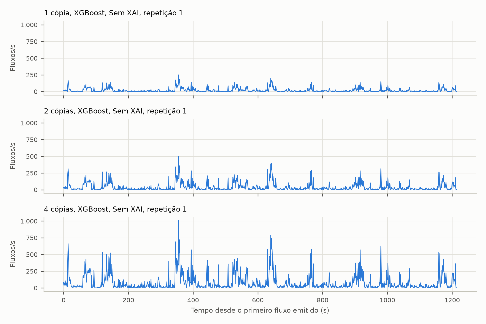
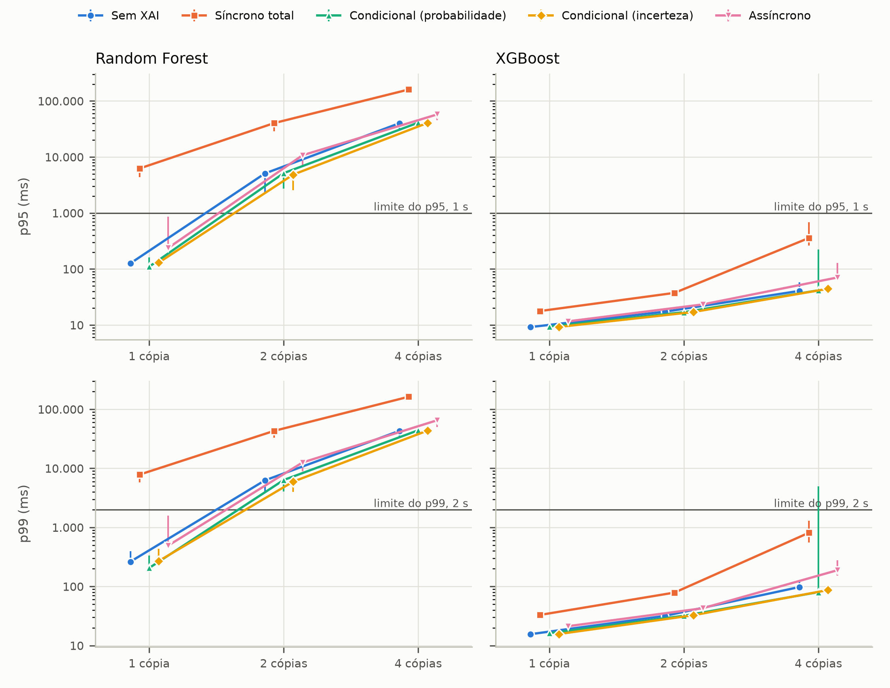
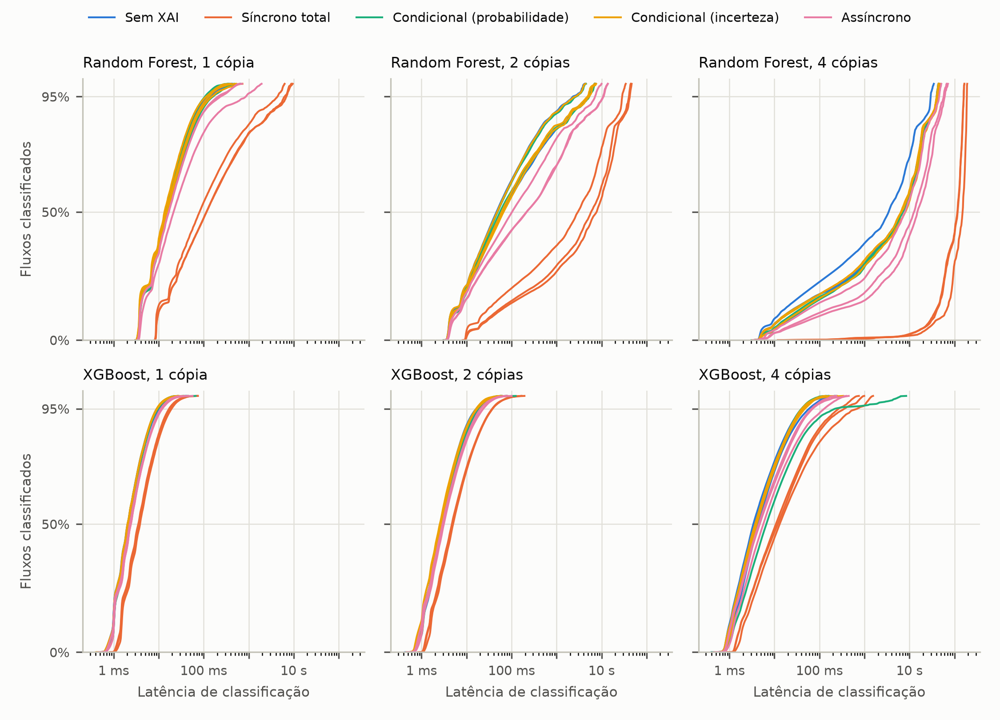
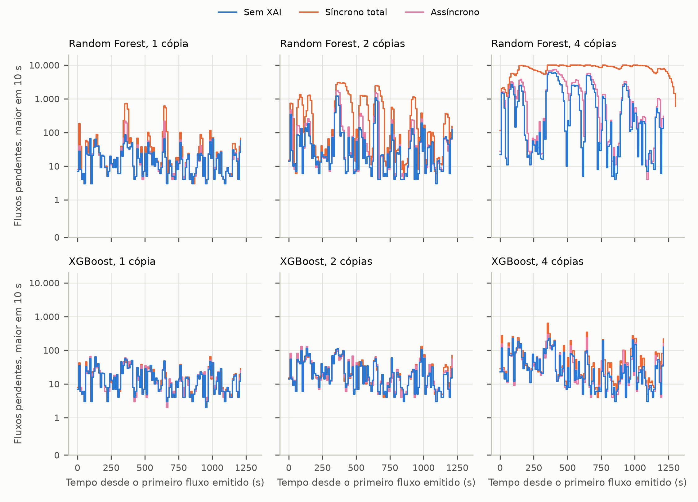
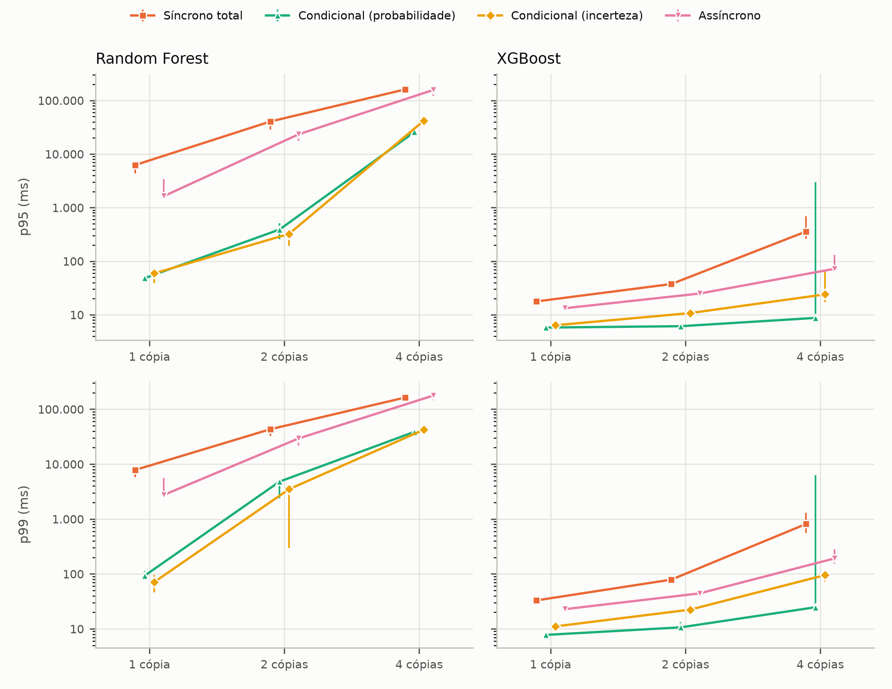
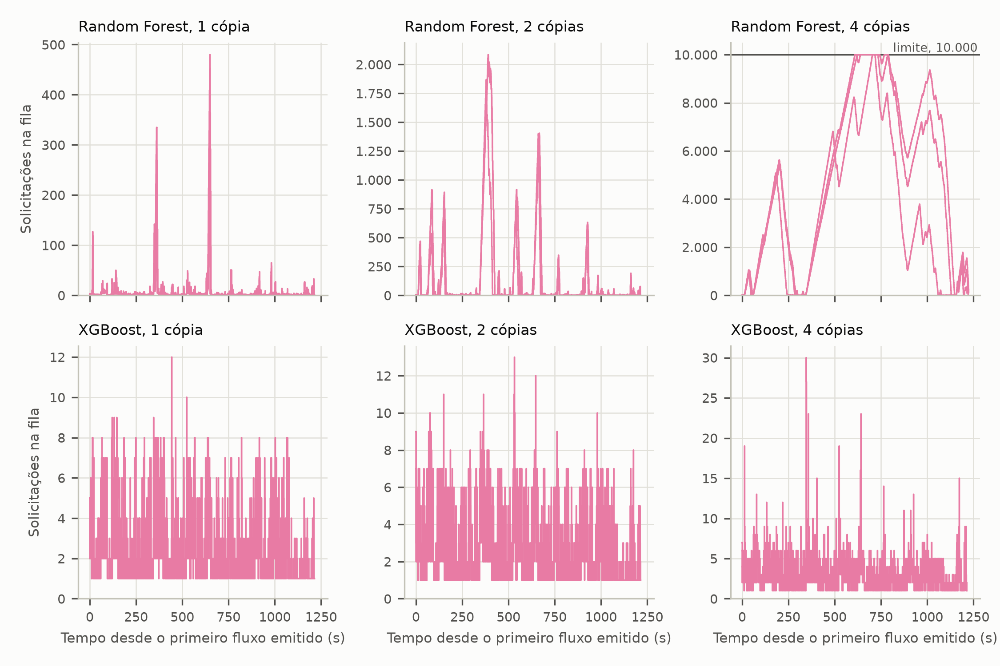
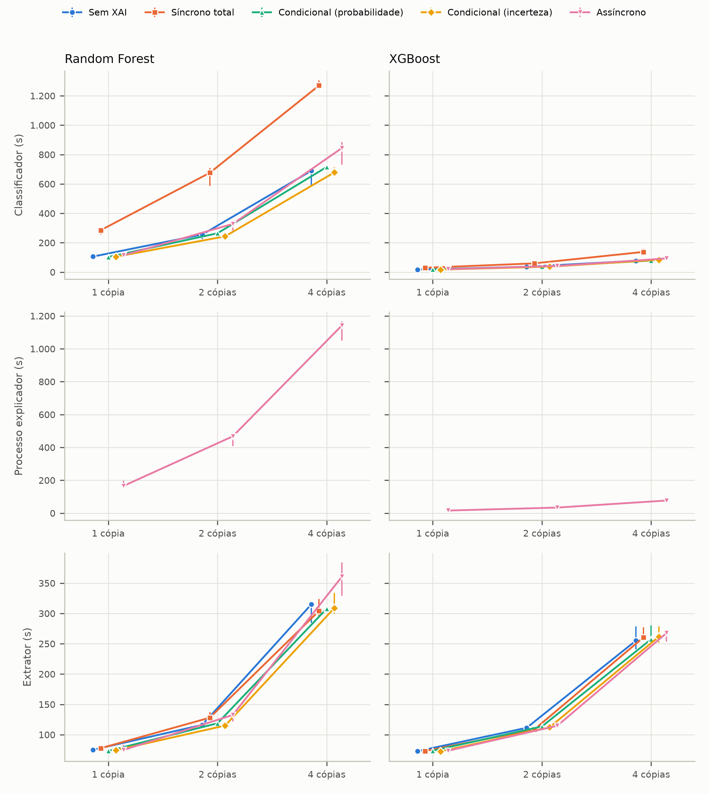

# Resultados da matriz `campanha`

Este relatório reúne as medidas das 90 execuções válidas da matriz `campanha`, no trecho `campanha`. Cada combinação de classificador, configuração de explicação e nível de carga tem 3 execuções. Cada célula das tabelas traz a mediana das execuções da combinação e, entre parênteses, o mínimo e o máximo. O nível de carga é o número de cópias do trecho reproduzidas ao mesmo tempo ([decisão 15](../docs/decisoes.md#15-carga-por-sobreposição-de-cópias)). Os termos seguem o [glossário](../docs/glossario.md).

A [auditoria](campanha-auditoria-20261120T125714303006Z.md) aprovou a matriz. Em cada execução, o hash da tabela por fluxo e o da tabela de explicações coincidem com os registrados, e as latências, a cobertura explicativa, os descartes e a fila de explicações pendentes recalculados dessas tabelas coincidem com o registro do NIDS.

## Viabilidade

Uma execução é viável quando a latência de classificação não passa de 1 s no p95 nem de 2 s no p99, nenhum fluxo é descartado na fila de saída do extrator e, no Assíncrono, a fila de explicações pendentes não cresce até o fim ([protocolo](../docs/protocolo-experimental.md), seção 8). A fila cresce até o fim quando atinge o maior tamanho pela primeira vez no último décimo da execução, ou quando está no limite no último décimo ([decisão 23](../docs/decisoes.md#23-critério-da-fila-de-explicações-pendentes)). Cada coluna de critério conta as execuções que o atendem. A combinação é viável quando todas as execuções são ([decisão 24](../docs/decisoes.md#24-viabilidade-de-uma-combinação)). A coluna dos explicados traz a proporção dos fluxos classificados com a explicação concluída.

| Combinação | Latência | Sem fluxo descartado | Fila | Execuções viáveis | Viável | Explicados |
|---|---:|---:|---:|---:|---|---:|
| RF, Sem XAI, 1× | 3 de 3 | 3 de 3 | — | 3 de 3 | sim | 0,0% |
| RF, Sem XAI, 2× | 0 de 3 | 3 de 3 | — | 0 de 3 | não | 0,0% |
| RF, Sem XAI, 4× | 0 de 3 | 3 de 3 | — | 0 de 3 | não | 0,0% |
| RF, Síncrono total, 1× | 0 de 3 | 3 de 3 | — | 0 de 3 | não | 100,0% |
| RF, Síncrono total, 2× | 0 de 3 | 3 de 3 | — | 0 de 3 | não | 100,0% |
| RF, Síncrono total, 4× | 0 de 3 | 0 de 3 | — | 0 de 3 | não | 100,0% |
| RF, Condicional (probabilidade), 1× | 3 de 3 | 3 de 3 | — | 3 de 3 | sim | 2,8% |
| RF, Condicional (probabilidade), 2× | 0 de 3 | 3 de 3 | — | 0 de 3 | não | 2,8% |
| RF, Condicional (probabilidade), 4× | 0 de 3 | 3 de 3 | — | 0 de 3 | não | 2,8% |
| RF, Condicional (incerteza), 1× | 3 de 3 | 3 de 3 | — | 3 de 3 | sim | 0,1% |
| RF, Condicional (incerteza), 2× | 0 de 3 | 3 de 3 | — | 0 de 3 | não | 0,1% |
| RF, Condicional (incerteza), 4× | 0 de 3 | 3 de 3 | — | 0 de 3 | não | 0,1% |
| RF, Assíncrono, 1× | 3 de 3 | 3 de 3 | 3 de 3 | 3 de 3 | sim | 100,0% |
| RF, Assíncrono, 2× | 0 de 3 | 3 de 3 | 3 de 3 | 0 de 3 | não | 100,0% |
| RF, Assíncrono, 4× | 0 de 3 | 3 de 3 | 3 de 3 | 0 de 3 | não | 95,9% (94,8%–99,4%) |
| XGB, Sem XAI, 1× | 3 de 3 | 3 de 3 | — | 3 de 3 | sim | 0,0% |
| XGB, Sem XAI, 2× | 3 de 3 | 3 de 3 | — | 3 de 3 | sim | 0,0% |
| XGB, Sem XAI, 4× | 3 de 3 | 3 de 3 | — | 3 de 3 | sim | 0,0% |
| XGB, Síncrono total, 1× | 3 de 3 | 3 de 3 | — | 3 de 3 | sim | 100,0% |
| XGB, Síncrono total, 2× | 3 de 3 | 3 de 3 | — | 3 de 3 | sim | 100,0% |
| XGB, Síncrono total, 4× | 3 de 3 | 3 de 3 | — | 3 de 3 | sim | 100,0% |
| XGB, Condicional (probabilidade), 1× | 3 de 3 | 3 de 3 | — | 3 de 3 | sim | 2,8% |
| XGB, Condicional (probabilidade), 2× | 3 de 3 | 3 de 3 | — | 3 de 3 | sim | 2,8% |
| XGB, Condicional (probabilidade), 4× | 2 de 3 | 3 de 3 | — | 2 de 3 | não | 2,8% |
| XGB, Condicional (incerteza), 1× | 3 de 3 | 3 de 3 | — | 3 de 3 | sim | 0,1% |
| XGB, Condicional (incerteza), 2× | 3 de 3 | 3 de 3 | — | 3 de 3 | sim | 0,1% |
| XGB, Condicional (incerteza), 4× | 3 de 3 | 3 de 3 | — | 3 de 3 | sim | 0,1% |
| XGB, Assíncrono, 1× | 3 de 3 | 3 de 3 | 3 de 3 | 3 de 3 | sim | 100,0% |
| XGB, Assíncrono, 2× | 3 de 3 | 3 de 3 | 3 de 3 | 3 de 3 | sim | 100,0% |
| XGB, Assíncrono, 4× | 3 de 3 | 3 de 3 | 3 de 3 | 3 de 3 | sim | 100,0% |

## Sobrecarga de latência

A sobrecarga de latência é a diferença entre a mediana das execuções da estratégia e a do Sem XAI, com o mesmo classificador e a mesma carga, em milissegundos ([decisão 25](../docs/decisoes.md#25-sobrecarga-de-latência)). A estratégia difere do Sem XAI quando os intervalos do mínimo ao máximo das execuções não se sobrepõem ([decisão 26](../docs/decisoes.md#26-diferença-entre-combinações)). Quando se sobrepõem, a tabela marca que a estratégia não se distingue do Sem XAI.

| Combinação | Média | p95 | p99 |
|---|---:|---:|---:|
| RF, Síncrono total, 1× | 926 | 6.139 | 7.595 |
| RF, Síncrono total, 2× | 10.088 | 35.327 | 36.913 |
| RF, Síncrono total, 4× | 92.141 | 120.507 | 120.020 |
| RF, Condicional (probabilidade), 1× | −4,17 (não se distingue) | −16,1 (não se distingue) | −57,0 (não se distingue) |
| RF, Condicional (probabilidade), 2× | 1,04 (não se distingue) | 68,5 (não se distingue) | 92,3 (não se distingue) |
| RF, Condicional (probabilidade), 4× | 297 (não se distingue) | 1.002 (não se distingue) | 944 (não se distingue) |
| RF, Condicional (incerteza), 1× | 0,158 (não se distingue) | 3,67 (não se distingue) | 6,30 (não se distingue) |
| RF, Condicional (incerteza), 2× | −54,9 (não se distingue) | −238 (não se distingue) | −304 (não se distingue) |
| RF, Condicional (incerteza), 4× | −1,51 (não se distingue) | 582 (não se distingue) | 497 (não se distingue) |
| RF, Assíncrono, 1× | 15,8 | 110 | 228 |
| RF, Assíncrono, 2× | 997 | 5.665 | 6.316 |
| RF, Assíncrono, 4× | 6.666 | 17.438 | 21.976 |
| XGB, Síncrono total, 1× | 2,68 | 8,57 | 17,4 |
| XGB, Síncrono total, 2× | 5,29 | 20,2 | 47,0 |
| XGB, Síncrono total, 4× | 53,8 | 318 | 715 |
| XGB, Condicional (probabilidade), 1× | 0,132 (não se distingue) | 0,218 (não se distingue) | 0,621 (não se distingue) |
| XGB, Condicional (probabilidade), 2× | −0,039 (não se distingue) | −0,356 (não se distingue) | 0,090 (não se distingue) |
| XGB, Condicional (probabilidade), 4× | −0,059 (não se distingue) | 0,862 (não se distingue) | −17,7 (não se distingue) |
| XGB, Condicional (incerteza), 1× | 0,027 (não se distingue) | 0,041 (não se distingue) | 0,083 (não se distingue) |
| XGB, Condicional (incerteza), 2× | −0,177 (não se distingue) | −0,216 (não se distingue) | 0,791 (não se distingue) |
| XGB, Condicional (incerteza), 4× | 0,789 (não se distingue) | 3,55 (não se distingue) | −11,0 (não se distingue) |
| XGB, Assíncrono, 1× | 0,660 | 2,43 | 5,71 |
| XGB, Assíncrono, 2× | 1,16 | 6,03 | 11,0 |
| XGB, Assíncrono, 4× | 7,06 | 29,8 | 90,1 |

## Carga efetiva

A carga efetiva é o número de fluxos emitidos pelo extrator por segundo de reprodução, com os pacotes por segundo enviados pelas cópias.

| Nível de carga | Execuções | Fluxos emitidos | Fluxos/s | Pacotes/s |
|---:|---:|---:|---:|---:|
| 1× | 30 | 24.413 | 20,3 | 3.088 |
| 2× | 30 | 48.816 | 40,7 | 6.177 |
| 4× | 30 | 97.622 (97.622–97.889) | 81,3 (81,3–81,6) | 12.354 |



## Latência de classificação

A latência de classificação vai do fim da extração dos atributos do fluxo (`t0`) ao momento em que a classificação fica disponível (`t3`). Os valores estão em milissegundos.





| Combinação | Média | p95 | p99 | Vazão (fluxos/s) | Fluxos descartados | Pacotes perdidos na captura |
|---|---:|---:|---:|---:|---:|---:|
| RF, Sem XAI, 1× | 33,1 (31,3–36,5) | 126 (118–142) | 263 (228–394) | 20,1 | 0,0% | 0 |
| RF, Sem XAI, 2× | 724 (365–738) | 5.086 (2.304–5.104) | 6.256 (3.857–6.563) | 40,2 | 0,0% | 0 |
| RF, Sem XAI, 4× | 11.196 (7.625–11.639) | 40.103 (29.557–41.065) | 43.092 (32.996–43.760) | 80,3 | 0,0% | 0 |
| RF, Síncrono total, 1× | 959 (627–1.010) | 6.265 (4.363–6.876) | 7.857 (5.808–8.459) | 20,1 | 0,0% | 0 |
| RF, Síncrono total, 2× | 10.813 (7.248–12.168) | 40.413 (28.672–42.294) | 43.168 (32.846–45.735) | 40,2 | 0,0% | 0 |
| RF, Síncrono total, 4× | 103.337 (101.888–132.627) | 160.610 (159.775–188.212) | 163.112 (162.280–189.580) | 67,3 (58,8–67,7) | 12,2% (11,7%–21,2%) | 0 |
| RF, Condicional (probabilidade), 1× | 28,9 (28,7–38,8) | 110 (107–161) | 206 (190–335) | 20,1 | 0,0% | 0 |
| RF, Condicional (probabilidade), 2× | 726 (403–756) | 5.155 (2.711–5.324) | 6.348 (4.068–6.797) | 40,2 | 0,0% | 0 |
| RF, Condicional (probabilidade), 4× | 11.493 (11.469–11.644) | 41.105 (40.278–41.892) | 44.036 (42.837–45.059) | 80,3 | 0,0% | 0 |
| RF, Condicional (incerteza), 1× | 33,3 (28,9–39,3) | 130 (113–152) | 269 (222–433) | 20,1 | 0,0% | 0 |
| RF, Condicional (incerteza), 2× | 670 (379–750) | 4.849 (2.578–5.230) | 5.951 (3.965–6.439) | 40,2 | 0,0% | 0 |
| RF, Condicional (incerteza), 4× | 11.195 (11.002–12.476) | 40.685 (40.185–42.935) | 43.589 (43.244–45.110) | 80,3 | 0,0% | 0 |
| RF, Assíncrono, 1× | 49,0 (47,3–124) | 237 (207–861) | 491 (485–1.595) | 20,1 | 0,0% | 0 |
| RF, Assíncrono, 2× | 1.721 (1.081–1.741) | 10.751 (7.148–11.067) | 12.572 (8.847–12.800) | 40,2 | 0,0% | 0 |
| RF, Assíncrono, 4× | 17.863 (12.846–20.774) | 57.541 (45.591–60.610) | 65.067 (49.670–69.670) | 80,3 | 0,0% | 0 |
| XGB, Sem XAI, 1× | 3,15 (3,14–3,43) | 9,21 (9,05–10,2) | 15,6 (15,3–18,1) | 20,1 | 0,0% | 0 |
| XGB, Sem XAI, 2× | 5,04 (4,83–5,33) | 17,3 (16,3–17,9) | 31,8 (31,7–32,3) | 40,2 | 0,0% | 0 |
| XGB, Sem XAI, 4× | 10,2 (9,88–13,0) | 40,8 (40,2–58,4) | 98,0 (84,7–122) | 80,3 | 0,0% | 0 |
| XGB, Síncrono total, 1× | 5,84 (5,64–6,15) | 17,8 (17,0–19,4) | 33,0 (30,6–34,1) | 20,1 | 0,0% | 0 |
| XGB, Síncrono total, 2× | 10,3 (10,2–10,4) | 37,5 (37,1–38,0) | 78,8 (74,8–79,7) | 40,2 | 0,0% | 0 |
| XGB, Síncrono total, 4× | 64,0 (50,3–104) | 359 (264–691) | 813 (555–1.307) | 80,3 | 0,0% | 0 |
| XGB, Condicional (probabilidade), 1× | 3,28 (3,17–3,36) | 9,43 (9,14–9,67) | 16,2 (15,3–17,1) | 20,1 | 0,0% | 0 |
| XGB, Condicional (probabilidade), 2× | 5,00 (4,89–5,52) | 16,9 (16,6–19,4) | 31,9 (30,9–36,4) | 40,2 | 0,0% | 0 |
| XGB, Condicional (probabilidade), 4× | 10,1 (9,98–160) | 41,6 (40,0–221) | 80,2 (76,6–4.985) | 80,3 (80,3–80,5) | 0,0% | 0 (0–10.231) |
| XGB, Condicional (incerteza), 1× | 3,18 (3,13–3,19) | 9,25 (9,04–9,25) | 15,7 (15,3–16,3) | 20,1 | 0,0% | 0 |
| XGB, Condicional (incerteza), 2× | 4,86 (4,83–5,05) | 17,1 (16,3–17,2) | 32,6 (28,3–33,2) | 40,2 | 0,0% | 0 |
| XGB, Condicional (incerteza), 4× | 11,0 (10,1–11,1) | 44,3 (40,6–47,4) | 87,0 (82,6–92,8) | 80,3 | 0,0% | 0 |
| XGB, Assíncrono, 1× | 3,81 (3,65–3,89) | 11,6 (11,2–12,1) | 21,3 (19,0–21,7) | 20,1 | 0,0% | 0 |
| XGB, Assíncrono, 2× | 6,20 (5,78–6,35) | 23,3 (20,4–23,5) | 42,8 (39,3–43,8) | 40,2 | 0,0% | 0 |
| XGB, Assíncrono, 4× | 17,3 (15,0–24,3) | 70,5 (66,7–127) | 188 (151–276) | 80,3 | 0,0% | 0 |

A vazão é o número de fluxos classificados dividido pelo tempo entre o primeiro `t0` e o último `t3` da execução. Os fluxos descartados são os que a fila de saída do extrator recusou, em proporção dos emitidos.

## Fluxos pendentes de classificação

Um fluxo fica pendente de classificação de `t0` até `t3`. O número de fluxos pendentes soma os que esperam na fila de saída do extrator e o que está no classificador. Um intervalo com fluxo pendente começa quando um fluxo é emitido sem nenhum outro pendente e termina quando nenhum fica pendente. O NIDS satura numa execução quando um único intervalo com fluxo pendente cobre mais da metade do tempo entre o primeiro fluxo emitido e a última classificação ([decisão 27](../docs/decisoes.md#27-saturação)).

A figura mostra a repetição 1 do Sem XAI, do Síncrono total e do Assíncrono, com o maior número de fluxos pendentes a cada 10 s. Os dois condicionais estão só na tabela.



| Combinação | Maior número de fluxos pendentes | Intervalo mais longo com fluxo pendente (s) | Intervalo mais longo, em fração do tempo | Fração do tempo com fluxo pendente | Execuções saturadas |
|---|---:|---:|---:|---:|---:|
| RF, Sem XAI, 1× | 85 (82–120) | 1,7 (1,7–2,8) | 0,1% (0,1%–0,2%) | 8,8% (8,7%–8,8%) | 0 de 3 |
| RF, Sem XAI, 2× | 1.199 (790–1.209) | 29,9 (22,6–30,4) | 2,5% (1,9%–2,5%) | 21,2% (18,5%–21,5%) | 0 de 3 |
| RF, Sem XAI, 4× | 6.111 (5.580–6.186) | 136,1 (96,7–136,4) | 11,2% (8,0%–11,2%) | 57,0% (48,8%–57,6%) | 0 de 3 |
| RF, Síncrono total, 1× | 676 (534–727) | 33,3 (28,5–34,2) | 2,7% (2,3%–2,8%) | 23,5% (21,1%–23,6%) | 0 de 3 |
| RF, Síncrono total, 2× | 3.086 (2.762–3.116) | 131,9 (95,7–140,6) | 10,9% (7,9%–11,6%) | 55,7% (48,4%–58,4%) | 0 de 3 |
| RF, Síncrono total, 4× | 10.097 (10.093–10.100) | 1.260,4 (1.260,3–1.303,5) | 99,0% (99,0%–99,7%) | 99,8% (99,8%–99,9%) | 3 de 3 |
| RF, Condicional (probabilidade), 1× | 75 (72–87) | 1,4 (1,2–4,4) | 0,1% (0,1%–0,4%) | 8,5% (8,4%–9,3%) | 0 de 3 |
| RF, Condicional (probabilidade), 2× | 1.212 (871–1.219) | 29,8 (23,9–29,9) | 2,5% (2,0%–2,5%) | 21,9% (19,6%–22,2%) | 0 de 3 |
| RF, Condicional (probabilidade), 4× | 6.158 (6.158–6.195) | 137,3 (132,6–139,4) | 11,3% (10,9%–11,5%) | 59,0% (58,2%–59,8%) | 0 de 3 |
| RF, Condicional (incerteza), 1× | 74 (68–108) | 1,6 (1,1–3,7) | 0,1% (0,1%–0,3%) | 8,7% (8,1%–8,9%) | 0 de 3 |
| RF, Condicional (incerteza), 2× | 1.169 (834–1.221) | 29,5 (22,8–30,3) | 2,4% (1,9%–2,5%) | 20,1% (18,7%–21,2%) | 0 de 3 |
| RF, Condicional (incerteza), 4× | 6.139 (6.123–6.205) | 136,3 (133,0–138,0) | 11,2% (11,0%–11,4%) | 56,2% (55,9%–59,0%) | 0 de 3 |
| RF, Assíncrono, 1× | 102 (102–218) | 5,5 (5,1–9,6) | 0,4% (0,4%–0,8%) | 9,5% (9,4%–11,4%) | 0 de 3 |
| RF, Assíncrono, 2× | 1.746 (1.487–1.798) | 45,5 (35,0–45,6) | 3,7% (2,9%–3,8%) | 27,1% (23,3%–27,3%) | 0 de 3 |
| RF, Assíncrono, 4× | 7.494 (6.491–7.683) | 175,4 (145,9–399,2) | 14,4% (12,0%–32,9%) | 69,7% (60,1%–73,0%) | 0 de 3 |
| XGB, Sem XAI, 1× | 66 (63–72) | 0,059 (0,059–0,096) | 0,0% | 1,5% (1,5%–1,6%) | 0 de 3 |
| XGB, Sem XAI, 2× | 130 (115–143) | 0,156 (0,123–0,203) | 0,0% | 3,1% (2,7%–3,2%) | 0 de 3 |
| XGB, Sem XAI, 4× | 207 (203–225) | 0,597 (0,578–0,901) | 0,0% (0,0%–0,1%) | 6,6% (6,4%–8,0%) | 0 de 3 |
| XGB, Síncrono total, 1× | 66 (66–72) | 0,155 (0,151–0,155) | 0,0% | 2,5% (2,4%–2,6%) | 0 de 3 |
| XGB, Síncrono total, 2× | 131 (126–131) | 0,275 (0,266–0,446) | 0,0% | 5,0% (5,0%–5,3%) | 0 de 3 |
| XGB, Síncrono total, 4× | 635 (488–865) | 6,0 (5,1–8,2) | 0,5% (0,4%–0,7%) | 11,5% (11,4%–13,5%) | 0 de 3 |
| XGB, Condicional (probabilidade), 1× | 66 (66–72) | 0,045 (0,035–0,088) | 0,0% | 1,6% (1,5%–1,6%) | 0 de 3 |
| XGB, Condicional (probabilidade), 2× | 130 (119–130) | 0,164 (0,156–0,170) | 0,0% | 3,2% | 0 de 3 |
| XGB, Condicional (probabilidade), 4× | 251 (225–1.241) | 0,525 (0,312–9,5) | 0,0% (0,0%–0,8%) | 6,7% (6,6%–12,8%) | 0 de 3 |
| XGB, Condicional (incerteza), 1× | 66 (63–72) | 0,045 (0,040–0,047) | 0,0% | 1,5% | 0 de 3 |
| XGB, Condicional (incerteza), 2× | 126 (112–130) | 0,133 (0,122–0,164) | 0,0% | 3,2% (2,9%–3,2%) | 0 de 3 |
| XGB, Condicional (incerteza), 4× | 229 (221–251) | 0,480 (0,343–1,0) | 0,0% (0,0%–0,1%) | 7,2% (6,5%–7,4%) | 0 de 3 |
| XGB, Assíncrono, 1× | 65 (63–66) | 0,084 (0,051–0,160) | 0,0% | 1,7% (1,6%–1,7%) | 0 de 3 |
| XGB, Assíncrono, 2× | 131 | 0,193 (0,183–0,197) | 0,0% | 3,5% (3,3%–3,7%) | 0 de 3 |
| XGB, Assíncrono, 4× | 298 (224–352) | 1,6 (0,983–2,0) | 0,1% (0,1%–0,2%) | 7,9% (7,7%–9,1%) | 0 de 3 |

## Explicações

A latência de explicação vai de `t0` ao momento em que a explicação fica disponível (`t4`). Os selecionados e os explicados estão em proporção dos fluxos classificados, e as latências, em milissegundos.



| Combinação | Selecionados | Explicados | Latência de explicação, média | p95 | p99 |
|---|---:|---:|---:|---:|---:|
| RF, Síncrono total, 1× | 100,0% | 100,0% | 959 (627–1.010) | 6.265 (4.363–6.876) | 7.857 (5.808–8.459) |
| RF, Síncrono total, 2× | 100,0% | 100,0% | 10.813 (7.248–12.168) | 40.413 (28.672–42.294) | 43.168 (32.846–45.735) |
| RF, Síncrono total, 4× | 100,0% | 100,0% | 103.337 (101.888–132.627) | 160.610 (159.775–188.212) | 163.112 (162.280–189.580) |
| RF, Condicional (probabilidade), 1× | 2,8% | 2,8% | 19,4 (19,2–21,4) | 48,5 (48,0–51,0) | 93,4 (82,2–113) |
| RF, Condicional (probabilidade), 2× | 2,8% | 2,8% | 172 (107–186) | 391 (259–510) | 4.818 (2.403–5.277) |
| RF, Condicional (probabilidade), 4× | 2,8% | 2,8% | 4.856 (4.770–5.128) | 25.812 (25.693–26.597) | 38.726 (37.986–38.795) |
| RF, Condicional (incerteza), 1× | 0,1% | 0,1% | 28,0 (20,3–29,2) | 59,4 (39,0–63,8) | 71,2 (46,5–96,2) |
| RF, Condicional (incerteza), 2× | 0,1% | 0,1% | 168 (53,2–184) | 324 (192–354) | 3.500 (298–4.092) |
| RF, Condicional (incerteza), 4× | 0,1% | 0,1% | 7.263 (6.886–7.830) | 42.049 (41.526–43.175) | 42.420 (42.004–43.424) |
| RF, Assíncrono, 1× | 100,0% | 100,0% | 214 (208–468) | 1.636 (1.524–3.412) | 2.745 (2.680–5.560) |
| RF, Assíncrono, 2× | 100,0% | 100,0% | 5.661 (3.806–5.691) | 23.318 (17.627–23.391) | 29.365 (22.044–29.409) |
| RF, Assíncrono, 4× | 100,0% | 95,9% (94,8%–99,4%) | 80.165 (54.654–88.611) | 157.421 (121.371–172.262) | 177.454 (144.060–193.969) |
| XGB, Síncrono total, 1× | 100,0% | 100,0% | 5,84 (5,64–6,15) | 17,8 (17,0–19,4) | 33,0 (30,6–34,1) |
| XGB, Síncrono total, 2× | 100,0% | 100,0% | 10,3 (10,2–10,4) | 37,5 (37,1–38,0) | 78,8 (74,8–79,7) |
| XGB, Síncrono total, 4× | 100,0% | 100,0% | 64,0 (50,3–104) | 359 (264–691) | 813 (555–1.307) |
| XGB, Condicional (probabilidade), 1× | 2,8% | 2,8% | 2,58 (2,54–2,59) | 5,79 (5,73–5,86) | 7,76 (7,53–8,08) |
| XGB, Condicional (probabilidade), 2× | 2,8% | 2,8% | 2,77 (2,76–3,03) | 6,13 (6,00–6,24) | 10,7 (9,80–13,4) |
| XGB, Condicional (probabilidade), 4× | 2,8% | 2,8% | 3,61 (3,36–341) | 8,76 (8,03–2.995) | 24,8 (22,4–6.295) |
| XGB, Condicional (incerteza), 1× | 0,1% | 0,1% | 3,49 (3,48–3,57) | 6,38 (5,68–7,18) | 11,1 (10,8–11,1) |
| XGB, Condicional (incerteza), 2× | 0,1% | 0,1% | 4,50 (4,50–4,65) | 10,8 (10,3–11,0) | 22,4 (18,7–27,6) |
| XGB, Condicional (incerteza), 4× | 0,1% | 0,1% | 9,26 (6,70–9,40) | 24,1 (17,1–69,9) | 95,3 (72,1–114) |
| XGB, Assíncrono, 1× | 100,0% | 100,0% | 5,14 (4,87–5,23) | 13,3 (12,4–13,8) | 22,8 (20,3–23,5) |
| XGB, Assíncrono, 2× | 100,0% | 100,0% | 7,61 (7,02–7,85) | 24,9 (21,6–25,6) | 44,3 (40,3–45,4) |
| XGB, Assíncrono, 4× | 100,0% | 100,0% | 18,8 (16,5–26,4) | 72,1 (68,5–131) | 192 (153–282) |

No Assíncrono, a espera na fila vai da solicitação de explicação à retirada pelo processo explicador, em milissegundos. O tempo de esvaziamento vai da última solicitação aceita à última explicação disponível. A posição do maior tamanho é o instante em que a fila o atinge, em fração da execução.



| Combinação | Solicitações descartadas | Pendentes no fim | Espera na fila, média | Espera na fila, p95 | Maior tamanho | Posição do maior tamanho | Maior tamanho no último décimo | Esvaziamento (s) |
|---|---:|---:|---:|---:|---:|---:|---:|---:|
| RF, Assíncrono, 1× | 0 | 0 | 160 (153–336) | 1.320 (1.301–2.561) | 308 (305–480) | 53,2% (29,7%–53,5%) | 31 (27–33) | 0,014 (0,013–0,015) |
| RF, Assíncrono, 2× | 0 | 0 | 3.911 (2.716–3.961) | 17.664 (12.408–17.696) | 2.059 (1.869–2.085) | 32,1% (31,3%–32,1%) | 176 (174–192) | 0,012 (0,012–0,019) |
| RF, Assíncrono, 4× | 3.968 (539–5.051) | 0 | 62.687 (41.791–68.232) | 133.046 (99.019–139.549) | 10.001 | 52,4% (50,1%–58,1%) | 3.553 (1.219–5.412) | 6,3 (0,753–10,0) |
| XGB, Assíncrono, 1× | 0 | 0 | 0,722 (0,647–0,723) | 2,46 (2,10–2,46) | 10 (8–12) | 36,5% (9,8%–43,1%) | 5 (4–5) | 0,003 (0,002–0,003) |
| XGB, Assíncrono, 2× | 0 | 0 | 0,762 (0,649–0,816) | 2,51 (2,08–2,64) | 11 (9–13) | 30,1% (0,0%–43,8%) | 6 (4–8) | 0,003 |
| XGB, Assíncrono, 4× | 0 | 0 | 0,835 (0,792–1,17) | 2,53 (2,45–3,37) | 23 (15–30) | 33,3% (28,5%–52,9%) | 9 (6–15) | 0,003 (0,002–0,003) |

O tamanho da fila é reconstruído dos instantes de solicitação e de retirada ([decisão 13](../docs/decisoes.md#13-limites-das-filas-e-política-de-descarte)). O classificador lê o instante da solicitação antes de pôr a solicitação na fila, e o processo explicador lê o instante da retirada depois de tirá-la (`src/domains/nids/service.py` e `src/core/explanation_worker.py`). Por isso, com a fila cheia, o tamanho reconstruído pode passar do limite de 10.000 solicitações, que a fila do NIDS não ultrapassa.

## Recursos

Tempo de CPU em segundos e pico de memória residente em MiB. O classificador é medido do início ao fim da captura, o processo explicador, do fim da carga do modelo ao fim do atendimento das solicitações, e o extrator, do início ao fim do processo ([decisão 14](../docs/decisoes.md#14-orçamento-de-cpu-e-de-memória)). O tempo de CPU por fluxo divide o tempo de CPU do processo pelo número de fluxos classificados, em milissegundos.



| Combinação | CPU do classificador | CPU do processo explicador | CPU do extrator | CPU do classificador por fluxo | CPU do processo explicador por fluxo | Memória do classificador | Memória do processo explicador | Memória do extrator |
|---|---:|---:|---:|---:|---:|---:|---:|---:|
| RF, Sem XAI, 1× | 106 (104–107) | — | 75 (74–75) | 4,34 (4,27–4,37) | — | 222 (221–222) | — | 1.832 (1.769–1.843) |
| RF, Sem XAI, 2× | 256 (224–260) | — | 116 (112–120) | 5,24 (4,58–5,32) | — | 244 (244–245) | — | 2.988 (2.880–3.078) |
| RF, Sem XAI, 4× | 690 (591–697) | — | 315 (284–320) | 7,07 (6,05–7,15) | — | 290 (253–291) | — | 4.917 (4.913–4.975) |
| RF, Síncrono total, 1× | 285 (256–286) | — | 78 (73–78) | 11,7 (10,5–11,7) | — | 246 (245–246) | — | 1.891 (1.751–1.901) |
| RF, Síncrono total, 2× | 676 (587–709) | — | 128 (123–137) | 13,9 (12,0–14,5) | — | 290 (289–290) | — | 3.211 (2.951–3.584) |
| RF, Síncrono total, 4× | 1.270 (1.270–1.305) | — | 304 (295–324) | 14,8 (14,7–17,0) | — | 357 (340–357) | — | 4.978 (4.941–4.981) |
| RF, Condicional (probabilidade), 1× | 103 (102–112) | — | 73 (72–76) | 4,22 (4,16–4,60) | — | 225 (225–226) | — | 1.836 (1.820–1.867) |
| RF, Condicional (probabilidade), 2× | 264 (237–269) | — | 119 (112–119) | 5,42 (4,86–5,51) | — | 249 | — | 3.347 (3.087–3.402) |
| RF, Condicional (probabilidade), 4× | 715 (706–724) | — | 308 (302–311) | 7,33 (7,23–7,42) | — | 297 (296–297) | — | 4.981 (4.923–4.990) |
| RF, Condicional (incerteza), 1× | 105 (98–107) | — | 74 (72–77) | 4,30 (4,00–4,40) | — | 225 (224–225) | — | 1.872 (1.766–1.877) |
| RF, Condicional (incerteza), 2× | 243 (226–257) | — | 115 (113–121) | 4,99 (4,64–5,27) | — | 248 (247–248) | — | 3.220 (3.160–3.442) |
| RF, Condicional (incerteza), 4× | 678 (677–714) | — | 309 (299–334) | 6,95 (6,94–7,32) | — | 295 (270–295) | — | 4.921 (4.919–4.983) |
| RF, Assíncrono, 1× | 115 (114–137) | 166 (165–196) | 75 (74–83) | 4,70 (4,68–5,62) | 6,80 (6,76–8,05) | 240 | 201 (201–202) | 1.788 (1.780–1.896) |
| RF, Assíncrono, 2× | 328 (282–330) | 468 (409–469) | 133 (122–133) | 6,72 (5,79–6,77) | 9,58 (8,38–9,61) | 284 (283–284) | 201 | 3.364 (3.337–3.564) |
| RF, Assíncrono, 4× | 845 (730–885) | 1.142 (1.049–1.167) | 361 (329–384) | 8,66 (7,48–9,07) | 11,7 (10,8–12,0) | 371 (371–372) | 201 (201–202) | 4.927 (4.920–4.981) |
| XGB, Sem XAI, 1× | 17 (17–18) | — | 73 (72–76) | 0,702 (0,694–0,751) | — | 224 (223–225) | — | 1.829 (1.776–1.860) |
| XGB, Sem XAI, 2× | 36 (32–37) | — | 111 (107–114) | 0,741 (0,655–0,755) | — | 247 (246–247) | — | 3.203 (3.085–3.645) |
| XGB, Sem XAI, 4× | 77 (75–93) | — | 255 (241–279) | 0,792 (0,769–0,957) | — | 293 | — | 4.913 (4.852–5.036) |
| XGB, Síncrono total, 1× | 29 (28–31) | — | 73 (72–77) | 1,20 (1,16–1,26) | — | 248 (246–249) | — | 1.799 (1.774–1.855) |
| XGB, Síncrono total, 2× | 59 (59–63) | — | 109 (108–113) | 1,22 (1,21–1,29) | — | 294 (293–294) | — | 3.125 (2.978–3.136) |
| XGB, Síncrono total, 4× | 137 (136–160) | — | 261 (258–277) | 1,41 (1,40–1,64) | — | 386 (383–386) | — | 4.923 (4.909–4.942) |
| XGB, Condicional (probabilidade), 1× | 18 (17–18) | — | 74 (72–75) | 0,741 (0,714–0,742) | — | 227 | — | 1.866 (1.861–1.874) |
| XGB, Condicional (probabilidade), 2× | 37 | — | 114 (111–115) | 0,766 (0,765–0,768) | — | 250 (249–251) | — | 3.437 (2.956–3.627) |
| XGB, Condicional (probabilidade), 4× | 79 (77–88) | — | 257 (253–280) | 0,806 (0,791–0,900) | — | 297 (269–297) | — | 4.917 (4.886–4.983) |
| XGB, Condicional (incerteza), 1× | 17 | — | 72 (72–73) | 0,704 (0,698–0,705) | — | 226 (226–227) | — | 1.861 (1.856–1.883) |
| XGB, Condicional (incerteza), 2× | 37 (34–37) | — | 112 (110–114) | 0,761 (0,699–0,761) | — | 249 (248–250) | — | 3.366 (2.988–3.656) |
| XGB, Condicional (incerteza), 4× | 84 (76–86) | — | 262 (251–279) | 0,859 (0,780–0,877) | — | 295 | — | 4.912 (4.889–5.027) |
| XGB, Assíncrono, 1× | 20 (19–20) | 16 (15–16) | 74 (73–75) | 0,821 (0,794–0,833) | 0,655 (0,622–0,666) | 247 | 204 | 1.841 (1.810–1.854) |
| XGB, Assíncrono, 2× | 42 (40–44) | 34 (32–35) | 115 (112–117) | 0,861 (0,813–0,894) | 0,697 (0,648–0,728) | 293 (293–294) | 204 (203–204) | 3.439 (3.184–3.569) |
| XGB, Assíncrono, 4× | 93 (91–108) | 77 (74–88) | 268 (254–273) | 0,958 (0,935–1,10) | 0,787 (0,761–0,904) | 386 | 204 | 4.922 (4.913–4.925) |

## Tempo de inferência e estado da máquina

O tempo de inferência e o tempo de explicação são as médias da duração de cada chamada, em milissegundos. A frequência é a mediana das leituras de cada segundo, em MHz. O classificador roda na CPU 2 e o processo explicador, na CPU 0. As CPUs 1 e 3 dividem os núcleos físicos dessas duas CPUs e não recebem processos do experimento. A memória disponível é a menor leitura da execução, em MiB.

| Combinação | Inferência | Explicação | Frequência da CPU 2 | Frequência da CPU 0 | Maior ocupação das CPUs 1 e 3 | Memória disponível |
|---|---:|---:|---:|---:|---:|---:|
| RF, Sem XAI, 1× | 3,87 (3,82–3,90) | — | 400 (400–523) | 3.806 (3.325–4.149) | 70,0% (63,6%–72,7%) | 8.517 (7.838–9.308) |
| RF, Sem XAI, 2× | 4,71 (4,12–4,78) | — | 477 (400–712) | 2.700 (2.607–2.855) | 75,0% (61,0%–76,2%) | 8.234 (7.241–8.356) |
| RF, Sem XAI, 4× | 6,36 (5,46–6,43) | — | 1.900 (1.851–2.000) | 2.000 (1.987–2.266) | 86,1% (82,0%–91,0%) | 6.001 (5.890–6.478) |
| RF, Síncrono total, 1× | 4,29 (3,80–4,35) | 6,80 (6,20–6,83) | 400 (400–552) | 3.200 (3.161–3.247) | 67,7% (63,6%–71,6%) | 9.426 (8.245–9.525) |
| RF, Síncrono total, 2× | 5,09 (4,33–5,27) | 8,11 (7,17–8,56) | 2.363 (2.300–2.500) | 2.575 (2.250–2.800) | 71,7% (56,4%–79,8%) | 7.972 (6.714–8.221) |
| RF, Síncrono total, 4× | 5,34 (5,28–6,20) | 8,82 (8,79–9,98) | 2.400 (2.100–2.400) | 2.232 (2.058–2.251) | 77,6% (76,8%–80,8%) | 6.338 (5.965–6.433) |
| RF, Condicional (probabilidade), 1× | 3,60 (3,55–3,93) | 6,66 (6,63–7,03) | 400 | 4.014 (3.743–4.273) | 70,0% (60,6%–74,0%) | 9.313 (7.873–9.796) |
| RF, Condicional (probabilidade), 2× | 4,66 (4,18–4,74) | 8,02 (7,32–8,13) | 471 (400–806) | 2.800 (2.688–2.868) | 73,0% (51,0%–92,1%) | 7.278 (6.903–8.075) |
| RF, Condicional (probabilidade), 4× | 6,36 (6,27–6,43) | 9,99 (9,86–10,8) | 1.900 (1.900–2.000) | 2.000 | 88,0% (85,0%–100,0%) | 5.929 (5.594–6.293) |
| RF, Condicional (incerteza), 1× | 3,83 (3,56–3,91) | 8,81 (8,18–9,10) | 400 | 3.274 (3.120–3.344) | 77,5% (70,0%–81,0%) | 9.382 (8.870–9.719) |
| RF, Condicional (incerteza), 2× | 4,48 (4,16–4,71) | 8,28 (7,67–8,57) | 401 (400–657) | 2.789 (2.764–2.876) | 75,0% (65,3%–78,2%) | 7.767 (7.189–7.994) |
| RF, Condicional (incerteza), 4× | 6,25 (6,25–6,59) | 10,2 (10,2–10,5) | 1.900 (1.789–1.900) | 2.000 (1.974–2.000) | 84,0% (82,8%–85,7%) | 5.884 (4.552–5.969) |
| RF, Assíncrono, 1× | 4,19 (4,16–4,99) | 6,70 (6,66–7,91) | 400 (400–576) | 3.000 (2.944–3.000) | 71,3% (64,0%–72,4%) | 9.206 (8.173–9.253) |
| RF, Assíncrono, 2× | 6,01 (5,20–6,06) | 9,42 (8,26–9,46) | 927 (570–1.115) | 2.490 (2.414–2.588) | 65,7% (62,4%–69,7%) | 7.203 (6.987–7.800) |
| RF, Assíncrono, 4× | 7,81 (6,75–8,17) | 12,0 (10,7–12,4) | 1.700 (1.700–1.844) | 1.800 (1.700–1.994) | 88,1% (83,8%–90,0%) | 6.120 (4.902–6.344) |
| XGB, Sem XAI, 1× | 0,268 (0,266–0,289) | — | 400 | 3.390 (2.804–4.112) | 77,0% (66,3%–78,8%) | 8.856 (8.512–9.497) |
| XGB, Sem XAI, 2× | 0,278 (0,239–0,284) | — | 400 (400–435) | 2.938 (2.904–2.952) | 72,3% (71,0%–100,0%) | 7.538 (7.337–8.142) |
| XGB, Sem XAI, 4× | 0,286 (0,278–0,355) | — | 478 (453–628) | 2.800 (2.511–2.806) | 68,4% (63,6%–77,8%) | 5.813 (5.075–6.533) |
| XGB, Síncrono total, 1× | 0,284 (0,273–0,298) | 0,431 (0,416–0,455) | 400 | 3.262 (3.162–3.303) | 70,3% (60,6%–100,0%) | 9.322 (7.921–9.779) |
| XGB, Síncrono total, 2× | 0,273 (0,269–0,294) | 0,451 (0,448–0,476) | 400 (400–479) | 2.973 (2.954–3.419) | 65,0% (61,6%–78,8%) | 7.917 (7.642–8.377) |
| XGB, Síncrono total, 4× | 0,303 (0,300–0,359) | 0,531 (0,530–0,616) | 471 (468–626) | 2.715 (2.603–2.755) | 75,0% (74,3%–77,6%) | 5.744 (5.604–6.194) |
| XGB, Condicional (probabilidade), 1× | 0,281 (0,267–0,282) | 0,617 (0,605–0,636) | 400 | 3.510 (3.347–4.128) | 74,0% (68,3%–74,0%) | 8.637 (7.864–9.423) |
| XGB, Condicional (probabilidade), 2× | 0,283 (0,282–0,284) | 0,656 (0,639–0,659) | 400 | 2.945 (2.900–2.971) | 72,4% (72,0%–75,8%) | 7.357 (7.261–8.474) |
| XGB, Condicional (probabilidade), 4× | 0,286 (0,279–0,317) | 0,679 (0,655–1,79) | 555 (445–569) | 2.754 (2.502–2.910) | 70,7% (65,3%–99,0%) | 6.061 (5.615–6.415) |
| XGB, Condicional (incerteza), 1× | 0,270 (0,269–0,271) | 0,786 (0,761–0,796) | 400 | 3.413 (3.338–3.735) | 67,0% (65,0%–76,0%) | 9.292 (8.870–9.329) |
| XGB, Condicional (incerteza), 2× | 0,288 (0,258–0,290) | 0,820 (0,808–0,848) | 400 | 2.877 (2.822–2.937) | 74,0% (72,0%–88,0%) | 7.474 (6.299–7.769) |
| XGB, Condicional (incerteza), 4× | 0,318 (0,282–0,324) | 1,57 (0,829–1,97) | 573 (525–576) | 2.715 (2.700–3.055) | 73,5% (64,0%–84,2%) | 6.010 (5.834–6.399) |
| XGB, Assíncrono, 1× | 0,331 (0,318–0,335) | 0,534 (0,506–0,544) | 400 | 3.602 (3.305–3.901) | 66,0% (63,0%–75,7%) | 9.144 (8.322–9.233) |
| XGB, Assíncrono, 2× | 0,342 (0,319–0,358) | 0,572 (0,529–0,597) | 400 (400–447) | 2.838 (2.827–2.994) | 67,3% (66,7%–68,7%) | 7.112 (6.871–7.146) |
| XGB, Assíncrono, 4× | 0,375 (0,364–0,441) | 0,653 (0,629–0,751) | 481 (446–547) | 2.697 (2.600–2.725) | 75,8% (74,0%–93,0%) | 5.768 (5.705–6.101) |

## Reprodução

```bash
cd src && python main.py campanha-resultados --matriz ../configs/campanha.json
```

O registro dos ensaios está em `training-runs/matrizes/campanha/registro.jsonl`, e o dos resultados, com as medidas de cada execução, em `training-runs/nids/resultados-campanha/20261120T173808263579Z/report.json`.
