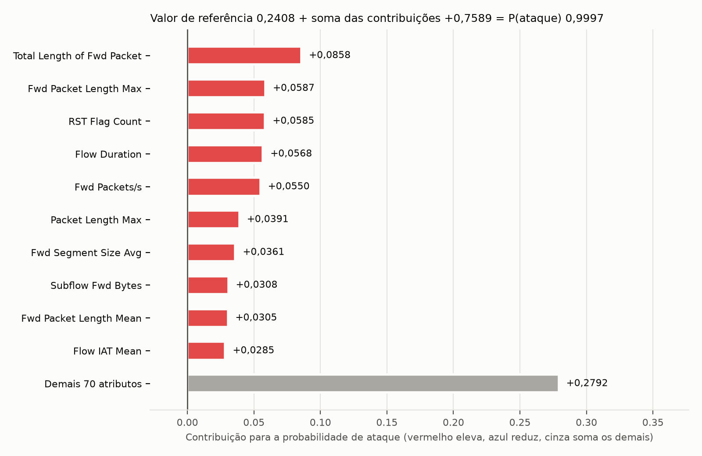

# Exemplo de explicação TreeSHAP no Random Forest piloto

Este documento é um exercício de aprendizado e de integração inicial do TreeSHAP. Ele explica uma previsão do Random Forest piloto, que não é um dos modelos congelados, para um registro do conjunto de validação. A configuração do explicador segue a [decisão 7](../docs/decisoes.md), e os termos seguem o [glossário](../docs/glossario.md).

## Registro explicado

O registro é o de índice 296.923 da validação, com origem no arquivo `friday.csv`, `id` 424.308 e rótulo original Portscan. Entre os 22.648 registros Portscan da validação que o piloto classifica como ataque, ele tem a probabilidade de ataque mediana. Como o número de registros é par, vale o menor dos dois registros centrais na ordem de probabilidade e de índice.

O piloto atribui a esse registro probabilidade de ataque 0,999698 e o classifica como ataque, porque a classe é ataque quando a probabilidade é maior que 0,5.

## Valor de referência e contribuições

A saída explicada é a probabilidade de ataque. O valor de referência é 0,240825. Ele é a média das saídas das folhas de cada árvore, ponderada pela cobertura do nó. No piloto, a cobertura do nó conta os sorteios da amostra bootstrap de cada árvore. Essas amostras são retiradas de uma amostra de treino com 100.000 registros, dos quais 24.077 (24,08%) são ataques.

As 80 contribuições somam 0,758873. O valor de referência mais essa soma reproduz a probabilidade de ataque com resíduo de 0, abaixo da tolerância de 1,0 × 10⁻⁹. Uma contribuição positiva eleva a saída em relação ao valor de referência, e uma negativa a reduz. Cada contribuição é o valor de Shapley do atributo para este registro. Ela descreve o comportamento do modelo, e não uma relação causal no tráfego.



| Atributo | Valor no registro | Contribuição |
|---|---:|---:|
| Total Length of Fwd Packet | 0,0000 | +0,0858 |
| Fwd Packet Length Max | 0,0000 | +0,0587 |
| RST Flag Count | 1,0000 | +0,0585 |
| Flow Duration | 41,0000 | +0,0568 |
| Fwd Packets/s | 24.390,2439 | +0,0550 |
| Packet Length Max | 0,0000 | +0,0391 |
| Fwd Segment Size Avg | 0,0000 | +0,0361 |
| Subflow Fwd Bytes | 0,0000 | +0,0308 |
| Fwd Packet Length Mean | 0,0000 | +0,0305 |
| Flow IAT Mean | 41,0000 | +0,0285 |
| Demais 70 atributos | | +0,2792 |

Os 10 atributos da tabela concentram 60,8% da soma dos valores absolutos das contribuições. A maior contribuição positiva é a de Total Length of Fwd Packet (+0,0858), e a maior contribuição negativa é a de Bwd Packet Length Std (−0,0080). 2 atributos têm contribuição zero.

## Reprodução

A partir de `src/`, com o ambiente descrito no [README](../src/README.md):

```bash
python main.py explicar-exemplo
```

A configuração está em [configs/tree-shap.json](../configs/tree-shap.json). O registro da execução está em [training-runs/tree-shap/exemplo/20261112T110545765014Z/report.json](../training-runs/tree-shap/exemplo/20261112T110545765014Z/report.json), com as 80 contribuições.
